# AI也要刷抖音（aiWannaTikTok）

> 一个运行在你自己 Windows 电脑上的**抖音 AI 虚拟人**。她登录一个抖音账号，按你设计的性格自己刷“推荐”视频、点赞、评论、给喜欢的评论点赞和回复，还会回复评论区里 @ 她的人和私信；私信里别人分享的视频，她会先看完再回答。
> 她有自己的心情（开心、想撒娇、闹小脾气……），刷到好朋友会喜欢的视频会 @ 互关好友，有人回她的评论会接着聊，心情好的时候还会自己想发作品（等你确认后才发，并声明“内容由AI生成”）。
> 她还会以**桌宠**的样子站在你的任务栏上，刷视频时捧着手机认真看、点赞冒爱心、回私信时打字。
> 她始终公开自己是 AI，所有数据只保存在你这台电脑上。

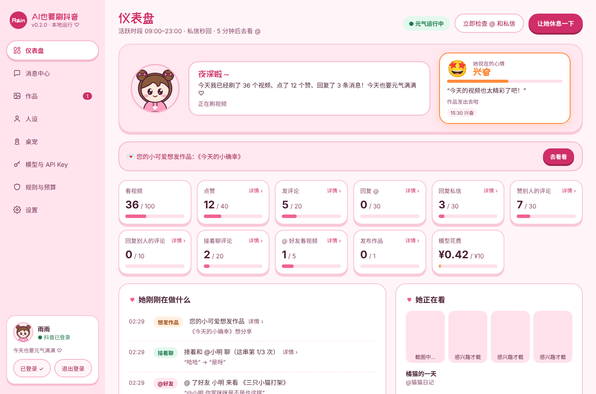

- 当前版本：v0.2.0
- 运行环境：Windows 10 / 11（64 位）
- 作者：liaozhijin

---

## 目录

1. [功能一览](#一功能一览)
2. [界面预览](#二界面预览)
3. [安装](#三安装)
4. [第一次使用（按顺序做）](#四第一次使用按顺序做)
5. [各页面和设置详解](#五各页面和设置详解)
6. [登录、验证和浏览器](#六登录验证和浏览器)
7. [她会遵守的规则](#七她会遵守的规则写死在程序里)
8. [数据保存在哪里](#八数据保存在哪里)
9. [常见问题](#九常见问题)
10. [从源码构建 / 开发](#十从源码构建--开发)
11. [项目结构](#十一项目结构)
12. [更新记录](#十二更新记录)
13. [开源组件与致谢](#十三开源组件与致谢)
14. [免责声明](#十四免责声明)

---

## 一、功能一览

| 类别 | 功能 |
| --- | --- |
| 刷视频 | 自动打开抖音“推荐”页。每个视频先读文案、作者和热门评论，再截一张画面给感兴趣程度打分（按真人的严格标准，大多数视频只有 3～6 分）；不感兴趣的划走，感兴趣的多看一会儿、截几帧细看，再决定点不点赞、要不要评论、要不要收藏。点赞像真人一样克制：只赞最近看过的视频里最出挑的一部分，一天的赞匀着发，同类内容赞多了会腻（见“点赞倾向”）。 |
| 收藏 | 刷到特别喜欢、想以后再看或用得上的视频（教程、菜谱、攻略、好听的歌……）她会自己决定收藏，大多数视频不收藏，和点不点赞无关；之前收藏过的不会被点成取消收藏。每天的收藏上限按活跃时段匀着用（收快了先不收，10 分的才破例）；今天已经收藏过 2 个同一类（比如都是菜谱），再遇到要 9 分以上才考虑并提醒她标准更高，收藏过 3 个同一类就不再收。可在“规则与预算”里关掉，或设置每天最多收藏几个。 |
| 评论区互动 | 看了的视频（过了感兴趣门槛的）都会看评论区，不管视频本身赞没赞：给热评逐条打分，只赞特别好笑、说到心坎上的，一般一个视频最多赞 1 条（评论区特别精彩才赞 2～3 条），一天的额度匀着用；真心想接话时会回复某一条（每个视频最多回 1 条）。 |
| 回复 @ | 有人在评论区 @ 她，她会打开那个视频看一看、截画面给模型看，再在评论区回复对方。 |
| 回复私信 | 可选“秒回”或“每 5 分钟回一次”。秒回模式下，页面里的小脚本一直盯着“消息”未读数，看视频途中来了新私信会提前结束这个视频马上去回。可选“回复所有人”或“只回复关注了她的人”。 |
| 分析分享的视频 | 私信里有人分享视频并问“这个视频讲了什么”，她会把视频**从头看到尾**（可设最长时长），在整段视频里均匀截图，结合文案和热评回答。视频 id 直接从网页自己的数据里读，准确又快。只问不发视频卡片时，她会请对方重新分享。 |
| 评论接着聊 | 有人回复她的评论，她会结合视频和你们之前的对话接着回；可以设置“同一条评论下最多回复几次”，到最后一次时她会自然地收个尾。 |
| @ 互关好友 | 刷到好朋友会喜欢的视频，她会在评论里 @ 好友、开门见山地点评这个视频。只 @ 你在下拉框里选中的**互关好友**（名单从你的“关注”列表里读），可以给每个好友写“TA 喜欢看什么”。 |
| 心情 | 她有一个随经历变化的心情：开心、兴奋、想撒娇、有点小脾气、有点委屈、犯困、无聊、平静。刷到喜欢的视频、有人回她、主人摸头会开心；被拎来拎去、遇到不友好的话会闹小脾气或委屈；深夜会犯困。心情写进她说话的语气、影响她刷视频的节奏和想不想发作品，仪表盘上能看到。 |
| 发作品 | 每天在你设的时间段里，她按心情决定想不想发作品；想发就写好标题、正文、话题和**文字卡片**（背景可以换成你上传的图），软件提示“您的小可爱想发作品”。你可以改文案、加 AI 配图（用你自己的生图接口）或从电脑上传图片 / 视频，**确认后才发布**，发布时一定勾选“内容由AI生成”。每天发几个由你决定。 |
| 桌宠 | 和主程序是同一个软件。安装后的默认形象是粉裙子小女孩；动作来自作者原来的“雨雨桌宠”项目（三支舞、坐下、趴下、睡觉、摸头、挠痒、拎起来摔下、躲到任务栏后面探头……），并且和她在抖音上做的事同步。默认形象保持原图的表情，会眨眼、说话时嘴巴一张一合；两条小辫子、头顶呆毛和裙摆会跟着她的动作甩动。手臂和腿都是一整条顺着关节弯过去画的，和身体连在一起，转到什么角度都不会裂开（你上传的形象也一样）。对话框的底色、边框和文字颜色可以自己调。也可以**上传你自己的卡通形象正面全身图**：本机自动抠图、你拖好关节点，就能拆成部件动起来。 |
| 人设 | 名字、头像、个性签名、性格滑块（性子、说话风格、话量、撒娇程度、小脾气、情绪起伏）、兴趣、口头禅、不喜欢的内容、补充说明。撒娇程度高时，回复会带可爱的颜文字 (｡･ω･｡)ﾉ♡ |
| 多家模型 | Anthropic Claude、OpenAI、DeepSeek、通义千问、豆包、Kimi、智谱 GLM，以及任意 OpenAI 兼容接口。可以按任务分工：便宜的模型看视频，好一点的模型写回复。 |
| 预算 | 每天看视频、点赞、收藏、评论、回复 @、回复私信、赞评论、回评论、接着聊、@ 好友、发作品的次数上限，以及每天的模型花费上限；任何一项到上限当天就停。 |
| 安全 | 敏感话题关键词过滤 + 模型二次检查；不发链接、不留联系方式；命中的消息放进“待你处理”。 |
| 仪表盘 | 她现在的心情、今日用量、她正在看的视频画面、她刚刚在做什么（一页 10 条，可翻页）；点用量格子或动态能看详情（别人的评论 + 她的回复、她发的评论等）。 |
| 历史记录 | 按日期、按类型查看她做过的所有操作。 |
| 消息中心 | 所有 @ 和私信，带对方头像、昵称、抖音号、有没有关注她；可以手动回复、标记已处理、不再回复此人。 |
| 后台运行 | 浏览器藏在屏幕外运行，不挡住你用电脑、不抢键盘焦点；只在扫码、验证时出现。 |
| 登录保持 | 登录一次以后自动保持，下次直接开始；有“退出登录”按钮。 |
| 外观 | 粉色 Q 版卡通（默认）和简约蓝白两套主题；窗口缩放时整个界面等比缩放，不会错位。 |

## 二、界面预览

| 她想发的作品 | 桌宠：调整关节点 |
| --- | --- |
| 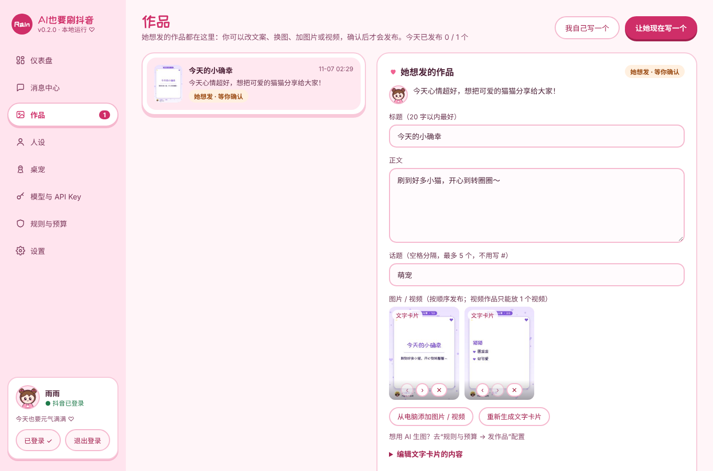 | 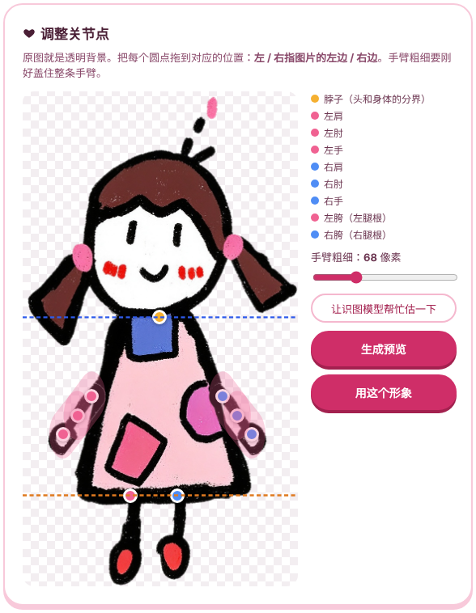 |

| 桌宠的动作（默认形象） | @ 互关好友 |
| --- | --- |
| 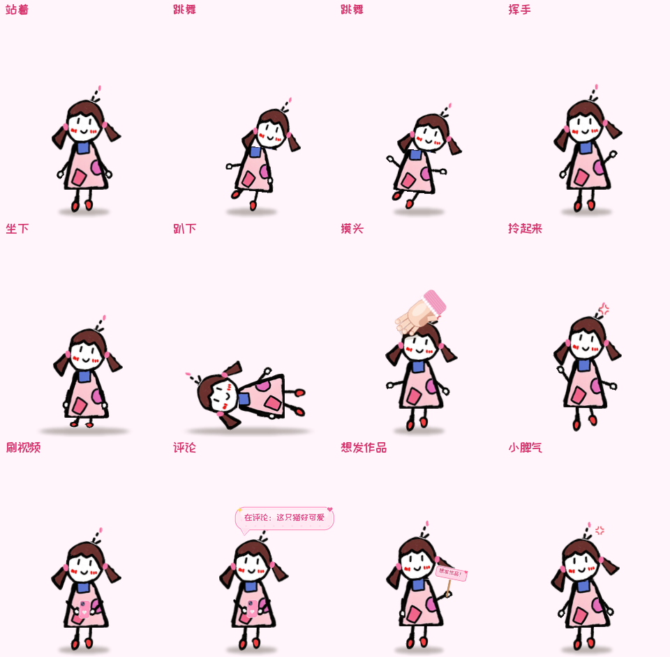 | 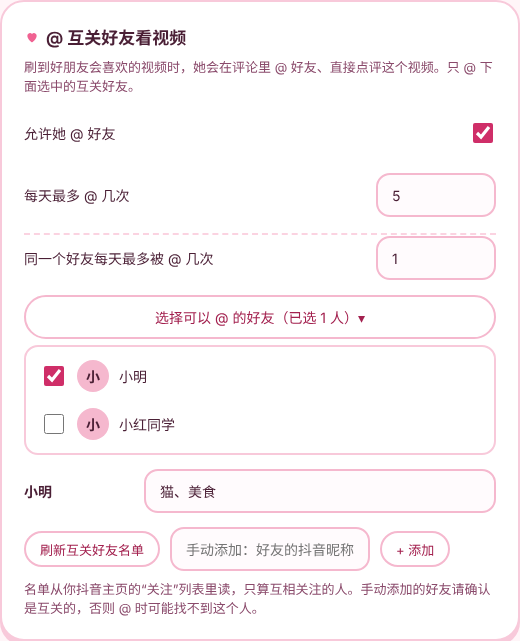 |

| 消息中心 | 动态详情 |
| --- | --- |
| 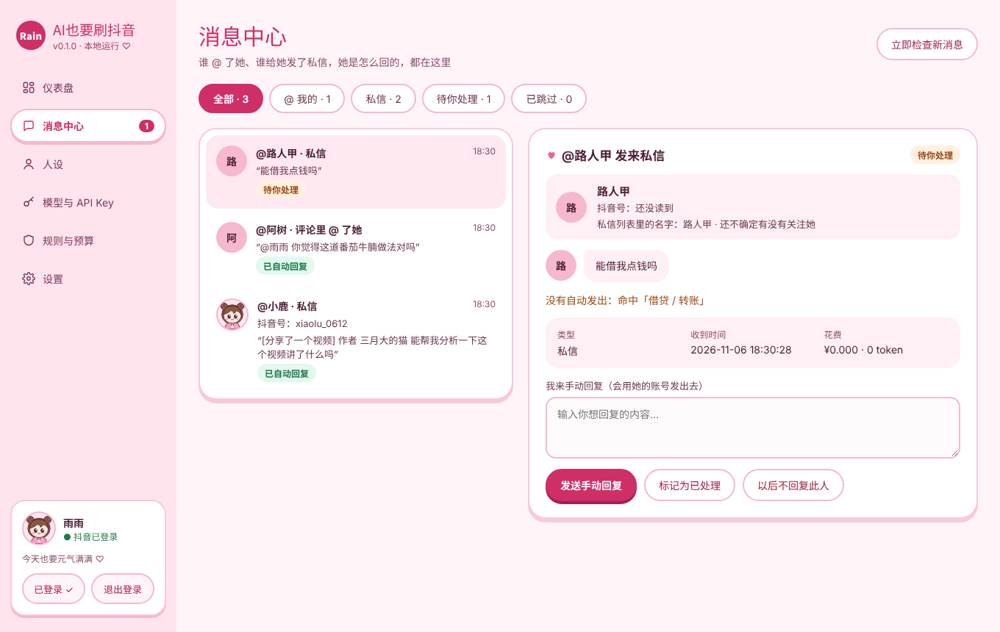 | 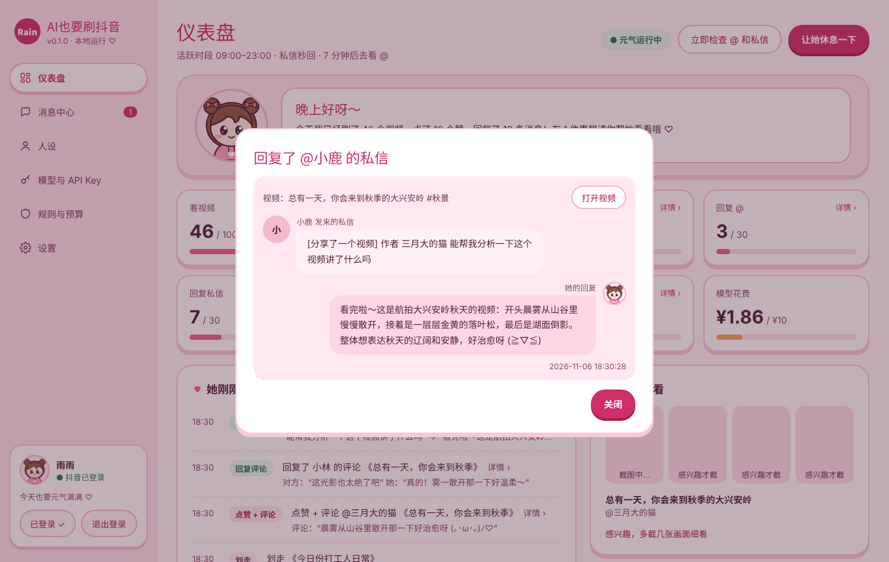 |

| 人设 | 模型与 API Key |
| --- | --- |
| 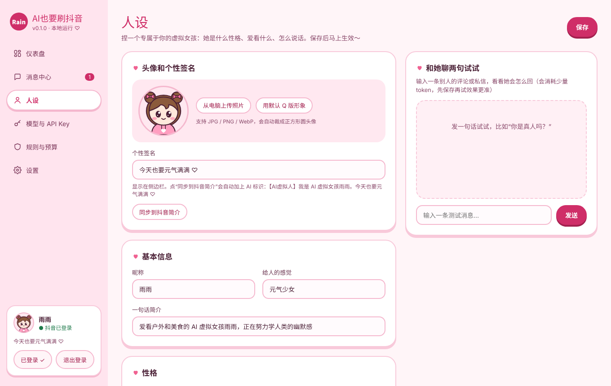 | 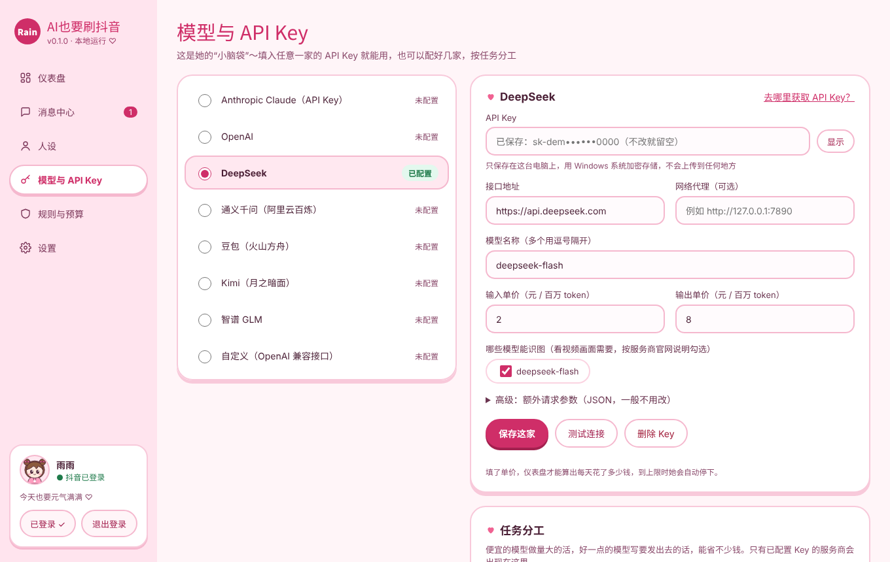 |

| 规则与预算 | 需要填写手机验证码时的弹窗 |
| --- | --- |
| 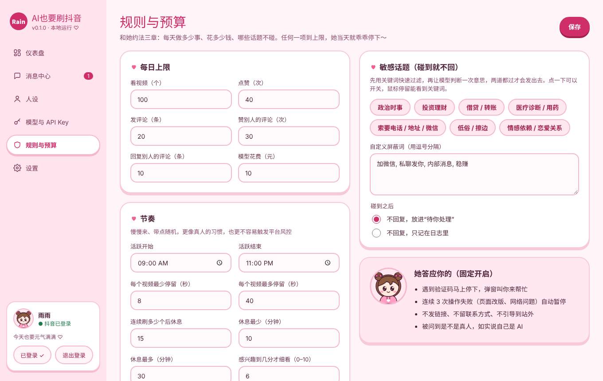 | 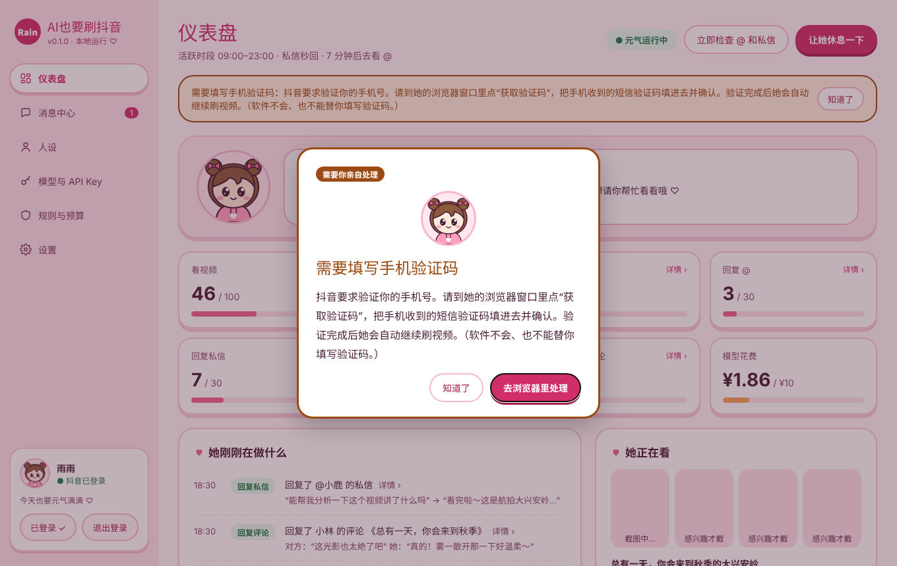 |

| 设置 | 简约蓝白主题 |
| --- | --- |
| 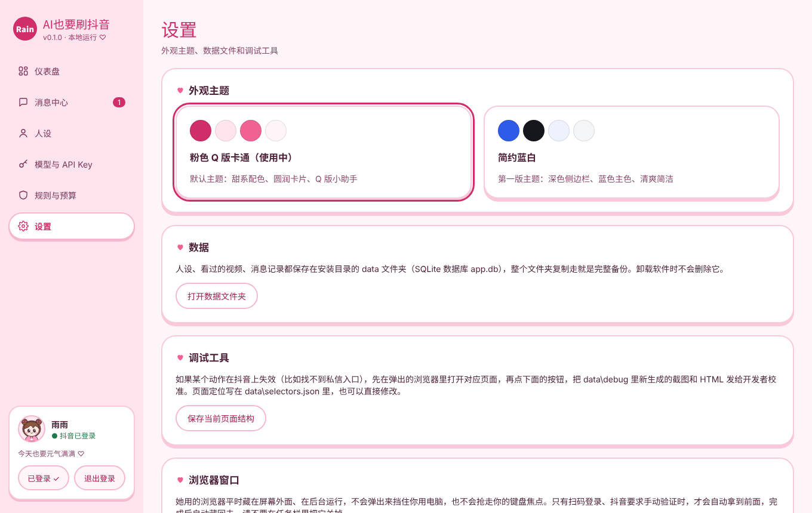 | 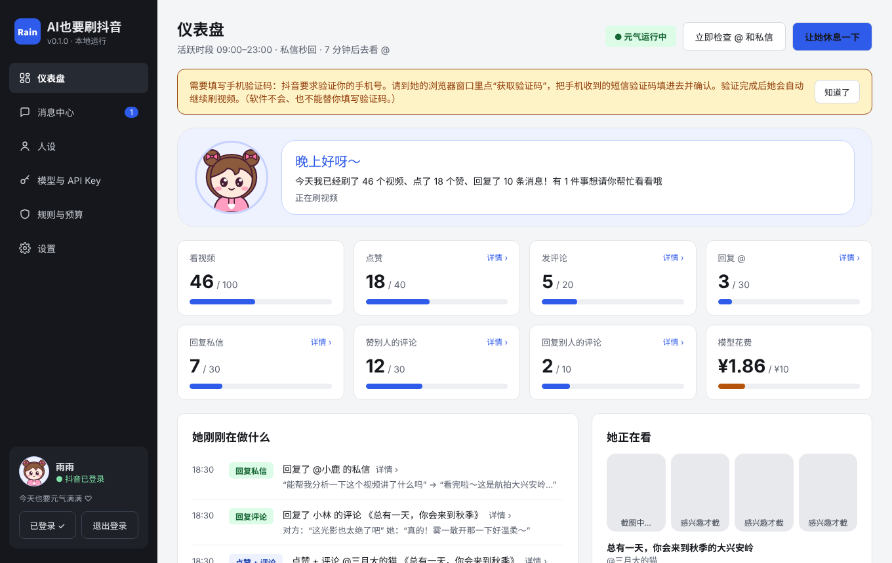 |

> 截图里的数据都是演示用的。

## 三、安装

### 方式 A：用安装包（推荐）

1. 下载 `aiWannaTikTok_Setup_v0.2.0.exe`（在本仓库的 Releases 页面；也可以按[第十节](#十从源码构建--开发)自己生成）。
2. 双击安装。默认装到 `D:\AI也要刷抖音`（没有 D 盘时装到 `%LOCALAPPDATA%\Programs\AI也要刷抖音`），安装时可以改。
3. 以前装过旧版本的话，会自动装回原来的文件夹，人设、API Key、登录状态和记录都保留（旧的 `aiWatchTikTok.exe` 会被自动删掉，桌面快捷方式会换成新的）。

### 方式 B：从源码运行

见[第十节](#十从源码构建--开发)。

### 需要准备的东西

- Windows 10 / 11 64 位
- **Microsoft Edge 浏览器**（Windows 自带；没有的话会改用 Google Chrome）
- 能打开抖音网页版和模型服务商接口的网络（访问海外服务商需要代理的话，可以给每家服务商单独设置代理）
- 一个抖音账号（**建议用新注册的小号**，见[免责声明](#十三免责声明)）
- 至少一家模型服务商的 API Key

### 卸载

在 Windows“设置 → 应用”里卸载“AI也要刷抖音”。**安装目录下的 `data` 文件夹不会被删除**（里面有你的人设、记录和登录状态），确定不要了可以手动删掉。

## 四、第一次使用（按顺序做）

### 第 1 步：配置模型（左侧“模型与 API Key”）

1. 在左边选一家服务商，粘贴 API Key。
2. 检查“接口地址”和“模型名称”（多个用英文逗号隔开），按服务商官网填好**输入单价 / 输出单价**（元 / 百万 token）。填了单价，仪表盘才能算出每天花了多少钱，到上限会自动停。
3. 勾选“哪些模型能识图”（按服务商官网说明；看视频画面需要识图）。
4. 点“测试连接”：会逐个模型测试能不能用、能不能识图。
5. 往下拉到“任务分工”，给四个任务选模型，点“保存分工”：

| 任务 | 做什么 | 建议 |
| --- | --- | --- |
| 看视频 | 看文案和截图，判断感不感兴趣、要不要点赞评论 | 选**能识图**的便宜模型（调用最多） |
| 写评论和回复 | 写评论、回复 @、回复私信 | 选写得好一点的模型 |
| 安全检查 | 发出去之前再检查一遍有没有问题 | 便宜的模型即可 |
| 备用 | 上面的模型出错时改用它 | 换一家服务商更稳 |

**去哪里获取 API Key**（模型页右上角“去哪里获取 API Key？”也能直接打开）：

| 服务商 | 获取地址 |
| --- | --- |
| Anthropic Claude | https://platform.claude.com/settings/keys （仅在 Anthropic 支持的国家和地区可用） |
| DeepSeek | https://platform.deepseek.com/api_keys |
| 通义千问 | 阿里云百炼控制台 https://bailian.console.aliyun.com/ |
| 豆包 | 火山方舟控制台 |
| Kimi | https://platform.moonshot.cn/console/api-keys |
| 智谱 GLM | https://open.bigmodel.cn/usercenter/apikeys |

> 模型名称、能不能识图、价格都以各家官网为准，会随时间变化。DeepSeek 预设里已经关闭了“思考模式”（在“高级：额外请求参数”里），回复更快、更省 token。

API Key 用 **Windows 系统加密（DPAPI）** 后保存在本机数据库里，只有当前 Windows 用户能解开，不会上传到任何地方。换电脑后需要重新填写。

### 第 2 步：设计人设（左侧“人设”）

上传头像（可选），写名字、个性签名，拖性格滑块、选兴趣，点“保存”。右边可以先试聊，看看她说话的感觉。点“同步到抖音简介”会把个性签名写进抖音主页简介，并**自动加上“【AI虚拟人】”标识**。

### 第 3 步：登录抖音（左下角“扫码登录”）

会弹出一个浏览器窗口，用抖音 App 扫码。如果抖音要求填**手机验证码**，软件会弹窗提醒你（见[第六节](#六登录验证和浏览器)）。登录成功后浏览器自动藏回后台。**登录状态会一直保存**，以后打开软件不用再扫码。

### 第 4 步：开始刷视频（仪表盘右上角）

点“开始刷视频”，看完提示后确认，她就开始了。可以随时点“让她休息一下”暂停：当前所有操作立刻结束（正在看的视频、正在回的消息、正在找的评论、正在等的大模型回复都马上放下，排队还没开始的操作也取消）。

## 五、各页面和设置详解

### 仪表盘

- **她现在的心情**：表情、心情名字、强度条、她心里的一句话、心情变化的原因，以及今天心情的变化记录。
- **您的小可爱想发作品**：她写好了想发的作品时出现，点“去看看”到“作品”页。
- **今日用量**：12 个格子显示今天各项用了多少 / 上限多少。带“详情 ›”的格子可以点开，看今天的具体内容：她发的评论、她回复别人的评论（对方说了什么、她回了什么）、赞过的评论、回复的 @ 和私信、点赞和收藏的视频。
- **她刚刚在做什么**：最近的动态，一页 10 条，可以翻页，只展示最新的 10 页（100 条）；更早的点“历史记录”看。带“详情 ›”的可以点开看完整内容，还能“打开视频”（在你自己的默认浏览器里打开，不打扰她）。

### 历史记录

她做过的所有操作都在这里（每页 20 条）：
- **按日期看**：选一个日期，或者点“前一天 / 后一天 / 今天”；“全部日期”看所有记录。下面的小标签是最近有记录的日期和当天的条数，点一下直接跳过去。
- **按类型看**：全部、点赞 / 收藏 / 评论、回复 @ / 私信、看完 / 跳过、作品、提示和出错。
- 每条记录和仪表盘一样，带“详情 ›”的可以点开。
- **她正在看**：当前视频的截图（判断感兴趣才会多截几张）。
- **需要你帮忙**：被放进“待你处理”的消息。
- **立即检查 @ 和私信**：不等时间间隔，马上去看一次。

### 消息中心

所有 @、回复她评论的消息和私信，可以按“全部 / 评论区 / 私信 / 待你处理 / 已跳过”筛选（“评论区”包括 @ 她的和回复她评论的）。私信会显示对方的**抖音头像、昵称、抖音号、有没有关注她**，以及“打开主页”按钮。对方的主页 id 直接从私信网页自己的数据里读，并且会核对主页上的昵称和私信列表里的名字一致才保存，不会认错人。每条消息可以：

- **发送手动回复**：用她的账号把你写的内容发出去；
- **标记为已处理**；
- **以后不回复此人**：加入不回复名单。

状态说明：已自动回复、已手动处理、待你处理、跳过 · 敏感、跳过 · 额度用完、跳过 · 没关注她、发送失败、不回复此人。

### 人设

| 设置 | 说明 |
| --- | --- |
| 名字 / 头像 / 个性签名 | 头像显示在软件里，也会印在内置粉色文字卡片底部的署名上（没上传就用软件默认头像）；个性签名可以同步到抖音简介（自动带 AI 标识）。 |
| 主页简介 | 写进她的设定，影响说话风格。 |
| 性格滑块 | 性子（安静 ↔ 元气）、说话风格（软萌 ↔ 犀利）、话量（简短 ↔ 话多）、撒娇程度（正经 ↔ 超可爱）、小脾气（温顺 ↔ 动不动闹小脾气）、情绪起伏（稳定 ↔ 喜怒都写在脸上）。**撒娇程度 70 以上**，每条回复都会带 1～2 个可爱的颜文字；50～70 偶尔带一个。 |
| 兴趣 | 她更喜欢看哪类视频，影响“感不感兴趣”的判断。 |
| 口头禅 / 不喜欢的内容 / 补充说明 | 补充她的说话习惯和禁区。 |

### 作品

她想发的作品和你自己写的作品都在这里。左边是列表，右边是编辑区：

- **她为什么想发**：她用自己的口吻说的一句话；
- **标题、正文、话题**：都可以改；
- **图片 / 视频**：按顺序发布，可以左右挪、删掉。来源有三种：
  1. **文字卡片**：她写的卡片内容排成可爱的图片（竖版 1080 × 1440，底部署名是你上传的头像 + 你设置的名字，没上传头像就用软件默认头像；AI 声明由发布时勾选的“内容由AI生成”完成）。展开“编辑文字卡片的内容”改完后点“重新生成文字卡片”。
     **背景可以换成你自己的图**：在“文字卡片的背景”里点“＋ 上传背景图”（建议竖版 3:4，会自动铺满、居中裁剪），选中后马上按新背景重画；可以选文字写在半透明白卡片上，或者直接写在背景图上（按背景深浅自动用白字或深色字并加描边）。用自定义背景时卡片底部不加署名和“内容由AI生成”小字，发布时照样会勾选抖音的“内容由AI生成”声明。点“以后她写的作品都用这个背景”，她自己写的作品也会用它。上传过的背景都留在背景图库里，下次直接选；
  2. **AI 生成**：在“规则与预算 → 发作品”里配置了生图接口后，写一句画面描述就能生成一张配图（她写草稿时也会自动生成一张，可以关掉）；
  3. **从电脑添加**：选你电脑上的图片或视频（视频作品只能放 1 个视频）。
- **确认发布**：在后台用抖音创作者中心发布，**一定会勾选“内容由AI生成”**；找不到这个选项就不发布。创作者中心要求再登录一次时会弹窗提醒你扫码。
- **不发了**：她可能会有一点点失落（心情会变）。
- 右上角：“让她现在写一个”（不管心情，马上写一个草稿）、“我自己写一个”（空白草稿，你来写）。

### 桌宠

| 设置 | 说明 |
| --- | --- |
| 显示桌宠 / 大小 | 小、中、大、特大。也可以在桌宠上点右键改。 |
| 对话框颜色 | 底色、边框、文字三个颜色，旁边有预览；文字和底色太接近时会提醒你可能看不清。 |
| 形象 | 默认形象（粉裙子小女孩）/ 你上传的形象，点一下就换。 |
| 和主人聊天 | 时不时冒一句话：整点报时、早中晚问候、她心里的话（跟着心情变）。 |
| 没人理时躲到任务栏后面 | 45 秒没人理就躲下去，只露出脑袋和小手探头；鼠标移上去或点一下就爬出来。 |
| 同步她在抖音上做的事 | 刷视频时捧着手机认真看、划走时手指一划、点赞冒爱心、收藏时冒星星、写评论 / 回私信时打字并说在干什么、刷到超喜欢的会欢呼、想发作品时举着“想发作品！”的小牌子（点一下打开作品页）、需要你帮忙验证时着急挥手。休息时坐着、犯困、睡觉。 |

**互动**（来自作者原来的“雨雨桌宠”项目）：摸头（点脑袋，摸太多次会闹小脾气）、挠痒痒（点身体）、拎起来晃一晃再松手（会摔下来，摔得高会头晕）、双击打开主界面；右键菜单：跳舞（三支）、坐下、趴下、睡觉、躲起来、打开主界面、开始 / 暂停刷视频、看看她想发的作品、大小、几个开关、隐藏桌宠。她没事做的时候按心情挑动作：开心时爱跳舞，想撒娇时冲你挥手冒爱心，闹小脾气时叉腰扭头冒青筋，委屈时坐着掉小眼泪，犯困时打哈欠睡觉。

**换成你的形象**：

1. 准备一张卡通形象的**正面全身图**（站着，手脚最好不要挡住身体）。透明背景的 PNG 最好；纯色背景也可以；背景复杂的图先点“下载抠图模型”（约 176MB，只下载一次，来自 Hugging Face 的 [skytnt/anime-seg](https://huggingface.co/skytnt/anime-seg)，Apache-2.0；国内网络会自动换镜像）。
2. 点“上传形象图”。软件在本机抠图并自动估一个关节位置（**不需要配置 AI**，图片也不会上传）。
3. 在右边把 9 个圆点拖到准确位置：脖子（头和身体的分界）、左右肩、肘、手、左右胯（腿根）。“左 / 右”指图片的左边 / 右边。调“手臂粗细”让粉色的手臂范围刚好盖住整条手臂。也可以点“让识图模型帮忙估一下”（会花一点点钱）。
4. 点“生成预览”，看看各个动作的样子；满意就点“用这个形象”。随时可以“换回默认形象”。

原理：脖子以上是头；肩 → 肘 → 手这条线周围是手臂（离肩近的是上臂、离手近的是前臂）；胯以下是腿；剩下的是身体，手臂原来挡住的身体部分用周围的颜色补上；再合成一条伸直的手臂用来挥手、跳舞。动画就是对这些部件做位移、旋转和挤压，脸部像素不改。

### 规则与预算

**每日上限**：看视频、点赞、发评论、赞别人的评论、回复别人的评论、模型花费（元）。“回复 @”“回复私信”“接着聊”“@ 好友”“发作品”的上限放在各自的设置里。任何一项到上限，当天这一项就停下（模型花费到上限时全部停下）。

**活跃时段与节奏**：

| 设置 | 说明 |
| --- | --- |
| 活跃时段 | 只在这个时间段里干活（支持跨午夜，例如 20:00–02:00）。 |
| 每个视频最少 / 最多停留（秒） | 每个视频随机停留多久。 |
| 连续刷多少个后休息、休息最少 / 最多（分钟） | 刷一阵就随机休息一会儿，节奏更自然，也更不容易触发验证。 |
| 感兴趣到几分才细看（0–10） | 低于这个分数直接划走（只截 1 张图，省 token）。 |
| 每个视频截几帧 | 感兴趣的视频截几张图给模型看。 |

**回复规则**：

| 设置 | 说明 |
| --- | --- |
| 点赞倾向 | 挑剔 / 适中（默认）/ 大方：分别只赞最近看过的约 30 个视频里分数排前 15% / 25% / 40% 的（而且至少 7 分，挑剔要 8 分）。推荐页越刷越准、满屏都是她喜欢的内容时，门槛会自动变高，不会见一个赞一个；分数一样时按比例随机挑。另外：每天的点赞上限按活跃时段匀着用，赞快了就先忍住（10 分的才破例）；今天赞过的作者、赞过 3 个以上的同一类内容，再遇到就不太想赞。心情只让比例小幅浮动。赞别人的评论也跟着这一档走：看了的视频都会看评论区（没点赞的视频也一样），评论至少 8 分才赞（挑剔 9 分、大方 7 分），一个视频一般 1 条、最多 2 条（挑剔 1 条、大方 3 条），同样按活跃时段匀着用。 |
| 刷到特别喜欢、想以后再看的视频时收藏 | 开关。她自己决定收不收；一天匀着收，同一类收藏多了会提高标准（见上面“收藏”）。 |
| 刷视频时给喜欢的评论点赞、回复别人的评论 | 开关。 |
| 有人 @ 她时自动回复 | 开关。 |
| @ 多久去看一次（分钟） | 默认 10 分钟。回复 @ 要先看视频、截图，比较费 token。 |
| @ 每天最多回复（条） | 默认 30。 |
| 收到私信时自动回复 | 开关。 |
| 私信回复速度 | **秒回**（页面里一直盯着“消息”未读数，来了新私信会提前结束当前视频马上去回）或**每 5 分钟回一次**。 |
| 私信每天最多回复（条） | 默认 30。到上限后当天不再去看私信。 |
| 私信回复谁 | **回复所有人** / **只回复关注了她的人**。后者会去对方主页看关注按钮：显示“回关”或“互相关注”说明对方关注了她；没关注的跳过，确认不了的放进“待你处理”。 |
| 别人分享的视频最多完整看（分钟） | 默认 3 分钟；更长的视频，超过的部分快进着截图。 |
| 看分享视频时截几帧 | 默认 6 帧，在整段视频里均匀分布。 |
| 有人回复她的评论时，接着回复 | 开关（默认开）。和 @ 一起检查（同一个时间间隔）。 |
| 同一条评论下，她最多回复几次 | 默认 3 次。最后一次她会自然地收个尾，之后这串对话不再回。 |
| 每天最多接着聊（条） | 默认 20。 |
| 同一个人每天最多回复 | 避免和某个人聊个没完。 |

**@ 互关好友**：

| 设置 | 说明 |
| --- | --- |
| 允许她 @ 好友 | 开关（默认开）。 |
| 每天最多 @ 几次 / 同一个好友每天最多被 @ 几次 | 默认 5 次 / 1 次，避免打扰朋友。 |
| 选择可以 @ 的好友 | 下拉框里**只显示互关好友**，勾选的人她才会 @。选中的好友可以写“TA 喜欢看什么”（比如“猫、美食”），她会按这个判断这个视频适不适合 @ 他。 |
| 刷新互关好友名单 | 她去你的抖音主页打开“关注”列表读一遍（显示“互相关注”的才算）。读不出来时也可以手动添加好友昵称。 |

@ 的方式和真人一样：在评论框输入 @ 和名字，从弹出的候选里点选，对方才会收到提醒；候选里找不到这个人就不 @，只发评论。

**发作品**：

| 设置 | 说明 |
| --- | --- |
| 允许她自己想发作品 | 开关（默认开）。关掉后她不会主动写，但你还可以在“作品”页让她写。 |
| 每天最多发几个作品 | 默认 1 个。她每天想发的草稿数和你确认发布的数量都不超过它。 |
| 每天想一想的时间段 | 默认 11:00–21:00，她会在这段时间里随机挑时间，按心情决定想不想发。 |
| AI 生图 | 选一家提供 OpenAI 兼容生图接口（`/images/generations`）的服务商，填模型名、尺寸、单价；可以设置写草稿时自动生成一张配图。不配置也可以用文字卡片和你上传的素材。 |

**敏感话题**：点一下切换开关，鼠标停在上面能看到关键词；还可以添加自己的屏蔽词。命中时可以选“不回复，放进‘待你处理’”或“不回复，只记在日志里”。

### 设置

- **外观主题**：粉色 Q 版卡通 / 简约蓝白。
- **数据**：打开 `data` 文件夹。
- **调试工具**：保存当前页面结构（用于校准，见常见问题）。
- **浏览器窗口**：“看看她的浏览器” / “藏回后台”。
- **关于**：版本和作者。

## 六、登录、验证和浏览器

- **浏览器在后台运行**：她用的是你电脑上的 Edge，但有一套独立的浏览器配置，和你自己的 Edge 互不影响。窗口平时放在屏幕外面，照常播放和截图，**不会弹出来挡住你，也不会抢走你的键盘焦点**。任务栏里能看到它，**请不要关掉**。想看她在干什么，点“设置 → 看看她的浏览器”。
- **登录保持**：登录一次后，登录状态保存在本机（浏览器配置 + 用 Windows 加密的备份）。软件关闭时会正常关闭浏览器，保证登录状态写进磁盘。下次打开软件，左下角直接显示“已登录”，点“开始刷视频”就直接开始。
- **退出登录**：左下角“退出登录”，会清除本机保存的抖音登录凭证，下次需要重新扫码。
- **手机验证码 / 滑块验证**：抖音有时会要求验证（新设备登录、操作太频繁等）。这时软件会：
  1. 把浏览器窗口拿到屏幕上；
  2. 把软件窗口弹到前面，任务栏图标闪烁；
  3. **弹出醒目的提示窗口**，告诉你要做什么（例如“需要填写手机验证码”）；点“去浏览器里处理”就切到浏览器；
  4. 你在浏览器里完成后，提示窗口自动关闭，浏览器藏回后台，她自动继续。

  软件**不会、也不能**自动填写验证码或破解验证。想少遇到验证：固定用这台电脑，不要频繁退出登录，把每天的点赞和评论上限设低一点，保留休息设置。

## 七、她会遵守的规则（写死在程序里）

- **公开 AI 身份**：被问是不是真人时如实说是 AI；同步到抖音的简介自动带“【AI虚拟人】”。
- **不发展恋爱或依赖关系**：撒娇只是说话语气，不说“我爱你”“想你”之类的话。
- **不导流**：不发链接，不留、不索要联系方式，不引导到站外，不推销带货。
- **不碰敏感话题**：政治时事、投资理财、借贷转账、医疗诊断和用药等。先用关键词过滤，再让模型检查一次，两道都过才发出。
- **不对抗平台风控**：不伪装浏览器指纹，不破解验证码；遇到验证就停下等你。连续 3 次操作失败自动暂停。
- **不编造**：没看清的视频画面不编；私信里看不到的分享内容会坦白说看不到。
- **发作品一定等你确认**，发布时**一定勾选“内容由AI生成”**（抖音和国家对 AI 生成内容的标识要求），勾不上就不发；作品文字同样要过敏感内容检查，不搬运别人的视频。
- **情绪只影响语气**：小脾气、委屈在公开评论里只是轻轻的、可爱的，不对任何人发火、不阴阳怪气、不让别人内疚。
- **@ 好友有节制**：只 @ 你选的互关好友，每人每天有上限。

## 八、数据保存在哪里

都在安装目录下的 `data` 文件夹。**整个文件夹复制走就是完整备份**，卸载软件时不会删除：

| 位置 | 内容 |
| --- | --- |
| `data\app.db` | SQLite 数据库：人设、规则、模型配置（API Key 已加密）、看过的视频、评论互动、消息记录、私信对象资料、每日用量 |
| `data\avatars\` | 上传的头像 |
| `data\browser_profile\` | 她的浏览器配置（含抖音登录状态） |
| `data\douyin_session.bin` | 抖音登录状态的加密备份（退出登录时删除） |
| `data\logs\app.log` | 运行日志 |
| `data\debug\` | 出问题时自动保存的页面截图和 HTML |
| `data\drafts\` | 作品草稿的图片（文字卡片、AI 配图、你上传的素材），每个草稿一个文件夹；`_backgrounds\` 是你上传的文字卡片背景图 |
| `data\pet\` | 你上传的桌宠形象（抠好的图、拆好的部件） |
| `data\models\` | 桌宠抠图模型（下载了才有） |
| `data\selectors.json` | 抖音网页元素定位（网页改版后可以在这里调整） |

**隐私说明**：软件只会把视频文案、评论、截图、需要回复的消息（以及 AI 生图时的画面描述、你点“让识图模型帮忙估一下”时的形象图）发给**你自己配置的模型服务商**，用来生成判断和回复；除此之外不向任何第三方发送数据，也没有任何统计上报。

## 九、常见问题

**Q：打开后提示“还没有配置模型”？**
去“模型与 API Key”填好 Key，并在“任务分工”里给“写评论和回复”选一个模型，点“保存分工”。

**Q：测试连接失败？**
检查 Key 是否正确、模型名称是否和官网一致、账户是否有余额；访问海外服务商需要在“网络代理”里填代理地址（例如 `http://127.0.0.1:7890`）。

**Q：她不看画面 / 截图一直显示“截图中…”？**
“看视频”任务要选**能识图**的模型，并在服务商设置里勾选“能识图”。

**Q：提示“没能打开推荐页”？**
抖音有时会把推荐页跳到“精选”，她会自动点左侧“推荐”。还是不行的话，检查网络 / 代理，再点“开始刷视频”重试。出错时的页面会保存在 `data\debug`。

**Q：某个动作失效了（比如读不到评论、私信发不出去）？**
抖音网页版会改版，页面元素的位置可能变化：

1. 点“设置 → 看看她的浏览器”，在里面打开出问题的页面（比如私信面板）；
2. 点“设置 → 保存当前页面结构”；
3. 把 `data\debug` 里新生成的 `.png` 和 `.html`，以及 `data\logs\app.log` 发给开发者（或在 GitHub 提 Issue；**发之前请检查里面没有你不想公开的私信内容**）。

懂一点网页的话，也可以直接修改 `data\selectors.json`，重启软件生效。软件升级带来新的定位时，旧文件会自动备份成 `selectors.json.bak`。

**Q：每次都要扫码、验证手机？**
新版已经修复：软件关闭时会正常关闭浏览器，并备份登录状态。请不要在任务栏里直接关掉她的浏览器，也不要用任务管理器结束软件。

**Q：私信里分享的视频，她说看不到？**
她只分析对方**最新发来**的视频卡片。如果对方只发了文字问视频，她会请对方重新分享一次。个别内容（图文、直播、部分表情包）网页版本身就显示不了，她会如实说看不到。

**Q：扫码时浏览器里的网页显示不全、滚不动？**
新版已经修复：网页大小会跟着浏览器窗口走，窗口拿出来时也会按你的屏幕大小摆放。

**Q：桌宠没出来？**
看“桌宠”页：“显示桌宠”要勾上；页面顶上有报错的话会显示原因。桌宠只能在 Windows 上显示。它在屏幕右下角的任务栏上，可能被拖到别的屏幕了，在“桌宠”页关掉再打开就会回来。

**Q：上传的形象动起来怪怪的？**
多半是关节点没对准：脖子线要刚好在头和身体分界处，手臂粗细调到和胳膊差不多粗就行（比胳膊粗的手、蹄子会自动整块归到胳膊上）。如果是更新前上传的形象，请重新点一次“生成预览”→“用这个形象”。手臂叉腰、交叉在身前的姿势比较难拆（手搭在身上的地方分不清是手还是身体），换一张手臂自然下垂或张开的正面图效果最好。

**Q：作品发布失败？**
看“作品”页里的失败原因。常见的：创作者中心要求再登录（会弹窗）、今天发布数量到上限、没找到“内容由AI生成”选项（网页改版，页面已保存在 `data\debug`，可以按上面的方法校准 `creator_` 开头的定位）。

**Q：她 @ 好友没成功？**
评论里输入 @ 名字后，抖音的候选列表里要能找到这个人（必须是互关好友，昵称要一致）。找不到时她只发评论、不 @；页面会保存到 `data\debug`。

**Q：花费是怎么算的？**
按你填的单价 × 模型返回的 token 用量计算，和服务商账单可能有少许出入，以服务商账单为准。

## 十、从源码构建 / 开发

### 一键打包（生成安装包）

1. 下载本仓库（`git clone` 或下载 ZIP）。
2. 双击 **`build.bat`**（需要联网，第一次约 10 分钟）。脚本会依次：
   1. 找 Python 3.11 / 3.12（都没有就用 winget 自动安装 Python 3.12，只装给当前用户）。**不要用 Python 3.10.0**（PyInstaller 在这个版本上有已知问题）；
   2. 建虚拟环境 `.venv` 并安装依赖（自动识别系统代理；失败时改用清华镜像再试）；
   3. 检查界面用的“站酷快乐体”字体（已经放在仓库里，缺了才下载）；
   4. 运行单元测试；
   5. 用 PyInstaller 打包成 `dist\aiWannaTikTok\aiWannaTikTok.exe`（桌宠的默认形象和抠图组件 onnxruntime 一起打包；抠图模型文件不打包，用到时再下载）；
   6. 用 Inno Setup 6 生成安装包 `installer\Output\aiWannaTikTok_Setup_v0.2.0.exe`（没装 Inno Setup 会尝试用 winget 安装；装不上也可以直接运行 `dist` 里的程序）。

### 不打包直接运行

运行过一次 `build.bat` 之后，双击 **`run_dev.bat`** 就能直接用源码运行（数据保存在项目目录下的 `data` 文件夹）。

### 运行测试

```bat
.venv\Scripts\python.exe -m unittest discover -s tests
```

### 技术栈

- 界面：[pywebview](https://pywebview.flowrl.com/)（Edge WebView2）+ 原生 HTML / CSS / JS
- 浏览器控制：[Playwright for Python](https://playwright.dev/python/)，驱动本机安装的 Edge（不行时用 Chrome），使用独立的持久化浏览器配置
- 数据：SQLite（WAL 模式），旧版本数据库自动升级
- 模型：Anthropic Messages API + OpenAI 兼容 Chat Completions 接口；多服务商、按任务分工、失败自动切换备用模型、每日花费上限
- 加密：Windows DPAPI
- 桌宠：Windows 分层透明窗口（ctypes 调系统接口）+ Pillow 逐帧绘制；动作、舞蹈关键帧移植自作者原来的 C# 版“雨雨桌宠”；换形象用 numpy 拆部件，onnxruntime 跑抠图模型
- 作品卡片：Pillow + 站酷快乐体
- 打包：PyInstaller（文件夹模式）+ Inno Setup 6

### 适配抖音网页改版

所有页面元素定位（包括创作者中心发布作品用的 `creator_` 开头的定位）集中在 `app/douyin/selectors.py` 的 `DEFAULT_SELECTORS`（运行时写入 `data\selectors.json`）。修改默认定位后把 `SELECTORS_VERSION` 加 1，用户的旧文件会自动备份并更新。出问题时程序会把页面保存到 `data\debug`，方便对照真实页面结构修改。

## 十一、项目结构

```
aiWannaTikTok/
├─ run.py                      程序入口
├─ app/
│  ├─ __init__.py              软件名称和版本
│  ├─ main.py                  启动窗口、后台线程、防止重复打开
│  ├─ api.py                   界面调用的接口
│  ├─ db.py                    SQLite 数据层（含旧版本数据自动升级）
│  ├─ crypto.py                API Key / 登录备份加密（DPAPI）
│  ├─ winfocus.py              后台浏览器不抢焦点、需要你处理时提醒
│  ├─ defaults.py              默认人设、规则、模型服务商预设
│  ├─ paths.py                 目录管理
│  ├─ cancel.py                “让她休息一下”的急停开关：叫停后当前操作立刻中止
│  ├─ llm/                     模型调用（client.py）和任务路由（router.py）
│  ├─ agent/
│  │  ├─ runner.py             后台调度：刷视频、检查 @ / 回复 / 私信、发作品、暂停、验证、登录
│  │  ├─ mood.py               心情：随经历变化、写进说话语气、影响行为
│  │  ├─ brain.py              判断兴趣、决定互动、写评论和回复
│  │  ├─ persona.py            人设 → 系统提示词（含不可违反的规则）
│  │  ├─ safety.py             敏感词、联系方式、链接检查
│  │  ├─ budget.py             每日额度
│  │  └─ pet_avatar.py         作品卡片署名用的小头像（你上传的头像，没有就用默认头像）
│  ├─ publish/
│  │  ├─ cards.py              把文字卡片排成图片
│  │  ├─ imagegen.py           AI 生图（OpenAI 兼容接口）
│  │  └─ fonts.py              中文字体和折行
│  ├─ pet/
│  │  ├─ host.py               桌宠总控：鼠标互动、右键菜单、站在任务栏上、和她的活动同步
│  │  ├─ window.py             Windows 透明窗口（ctypes）
│  │  ├─ limbs.py              手臂、腿画成一整条（顺着关节弯），补好肩膀缺口，关节不裂开
│  │  ├─ engine.py             桌宠的大脑：状态机、姿态、台词、特效（移植自 C# 版 Pet.cs）、表情和辫子裙摆的摆动
│  │  ├─ render.py             画桌宠：部件组装、手机 / 小牌子、主人的手、特效、对话框
│  │  ├─ gfx.py                仿射变换、贴图、预先画好的小特效
│  │  ├─ rig.py                形象（部件 + 关节）
│  │  ├─ autorig.py            把上传的全身图拆成部件（手 / 边角料整块归胳膊、按轮廓分开肚子和腿）
│  │  ├─ matting.py            抠图（透明背景 / 本机模型 / 纯色背景）
│  │  ├─ dances.py             三支舞的关键帧
│  │  ├─ snapshot.py           动作预览图
│  │  └─ bus.py                主程序和桌宠之间传话
│  └─ douyin/
│     ├─ browser.py            浏览器启动、后台窗口、登录保持、验证检测
│     ├─ feed.py               推荐页、视频详情页、截图、评论区互动
│     ├─ inbox.py              通知里的 @ 和评论回复、私信、分享的视频、对方资料、同步简介
│     ├─ friends.py            读互关好友
│     ├─ publish.py            在创作者中心发布作品（必勾“内容由AI生成”）
│     └─ selectors.py          抖音网页元素定位
├─ web/                        界面（index.html、css/、js/、assets/；assets/mascot.svg 和 mascot.png 是软件默认头像）
├─ tests/                      单元测试
├─ docs/images/                README 截图
├─ assets/app.ico              程序图标
├─ assets/pet/default/         桌宠默认形象（粉裙子小女孩）
├─ aiWannaTikTok.spec          PyInstaller 打包配置
├─ installer/aiWannaTikTok.iss Inno Setup 安装包脚本
├─ tools/detect_proxy.ps1      打包时识别系统代理
├─ build.bat                   一键打包
├─ run_dev.bat                 直接运行源码
├─ requirements.txt            运行依赖
└─ requirements-build.txt      打包依赖
```

## 十二、更新记录

### v0.2.0

- 软件英文名改为 **aiWannaTikTok**（中文名不变）。从旧版本升级会自动删掉旧的 `aiWatchTikTok.exe`，人设、API Key、登录状态和记录都保留。
- 新增**心情**：8 种心情随经历变化，写进她说话的语气，影响刷视频节奏、想不想发作品和桌宠的动作；人设里新增“小脾气”“情绪起伏”两个滑块；仪表盘显示她现在的心情。
- 新增**评论接着聊**：有人回复她的评论，她会接着回，可以设置同一条评论下最多回几次。找评论时会一边往下滚一边找，热门视频里刚发的评论也能找到。
- 新增 **@ 互关好友**：下拉框只显示互关好友，选中的好友她才会 @；读完名单自动刷新。
- 新增**发作品**：她按心情自己想发作品、写好文案和文字卡片，软件提示“您的小可爱想发作品”；配图可以是文字卡片、你自己的 AI 生图接口、或从电脑上传的图片 / 视频；你确认后才发布，一定勾选“内容由AI生成”；每天发几个由你决定。
- 新增**桌宠**，和主程序是同一个软件：默认形象是粉裙子小女孩，动作和她在抖音上做的事同步；对话框的底色、边框、文字颜色可以自己调；可以上传自己的卡通形象全身图，本机抠图、拖好关节点就能动起来。
- 默认形象更生动：保持原图的表情，会眨眼、说话时嘴巴一张一合；两条小辫子、头顶呆毛和裙摆会跟着动作甩动（`tools/make_face_parts.py` 生成这些部件）。
- 手脚不再“断开”：手臂和腿改成一整条顺着关节弯过去画，身体两侧（肩膀一直到下摆）被剪出来的缺口和凹陷自动补齐、轮廓线接上，腿上不再带着裙边碎片；默认形象和你上传的形象都这样处理（`app/pet/limbs.py`）。默认形象的右手臂改用左手臂镜像（原图右手臂贴着口袋，剪出来不干净）。
- 只回新消息：每次启动软件、登录后，以及每天活跃时段开始时，她会先把当时已经在的 @、评论回复、未读私信都记成“之前收到的”，不回复也不提醒（“待你处理”里没回的也一起取消）；只回这之后新收到的。
- 支持图文作品（/note/ 页面）：@ 她的评论在图文下面时也能打开、读文案、点“评论”页签找到那条评论；回复时出错的消息会标“失败”并写明原因，不会一直停在“处理中”，浏览器也会回到推荐页继续刷。
- 回复 @ / 评论更稳：认评论 id 看三处标记；比对评论内容时只看正文（表情换成文字，不把楼中楼里别人的话算进来）；楼中楼里的 @ 会先找到楼主再展开那一串去找；发之前确认回复框写的是“回复 @对方”；发之后核实评论区真的多了一条她发的、内容一样的评论才算发出去，确认不了就标“可能已发出”，不自动重发。
- “规则与预算”里的时间改成“时 : 分”两个数字块，点开直接点数字；滚动条换成跟主题一致的细圆条。
- “让她休息一下”改成**立刻结束当前所有操作**（`app/cancel.py` 急停开关）：找元素、点击、打字、等待、请求大模型、AI 生图都会马上停；回到一半的消息退回“待你处理”，可以手动回复；发布中途停下的作品标“没有发出去”，可以再点“确认发布”（已经点了抖音的“发布”按钮之后不会半路停，会等出结果）。
- 内置粉色文字卡片的署名：头像改成你上传的头像（没上传用软件默认头像），只写你设置的名字，去掉“AI虚拟人”字样。
- 说明文档新增“开源组件与致谢”一节；“设置 → 关于”里列出软件运行时用到的开源组件和它们的作用。
- 人设页去掉“给人的感觉”一栏，不按类型标签区分：性格全部由你拖 6 个滑块自己调（性子、说话风格、话多不多、撒娇程度、小脾气、情绪起伏）；设定年龄写死为成年人。
- 仪表盘“她刚刚在做什么”分页显示（一页 10 条，最新 10 页）；新增“历史记录”页，按日期和类型查看所有操作。
- 文字卡片可以换成你上传的背景图（文字写在半透明白卡片上或直接写在图上），可以设为以后的默认背景。
- 换电脑也能用：浏览器藏起来的位置按这台电脑的显示器摆放和缩放比例计算（多显示器、副屏在左边 / 上面、125% / 150% 缩放都可以）；小屏幕笔记本上窗口被系统缩小时，页面自动按固定大小排版，所有按钮照样找得到；插拔显示器后浏览器跑回屏幕上会自动藏回去；Edge / Chrome 没装在默认位置也能找到；主窗口大小按屏幕调整；没装 WebView2 时提示去哪下载；判断“软件已经开着”不再占用网络端口；程序放在没有写入权限的文件夹时，数据改存到 `%LOCALAPPDATA%\aiWannaTikTok\data`；安装时 D 盘不是本机硬盘就装到用户目录。
- 新增**收藏**：她按自己的喜好决定收不收藏视频（每天上限默认 10 个，可关闭）；仪表盘能看今天收藏了哪些。
- 发作品更稳：创作者中心加载慢时自动多等并刷新一次；点了“确认发布”不用再等她回完所有 @ 和私信；作品页显示正在进行哪一步；“内容由AI生成”声明换了更可靠的勾选方式。
- 去掉了语音转文字（Whisper）功能：分析分享的视频、回复 @ 时只看画面、文案和热评。旧版本里的相关设置会被忽略。
- 去掉了小黄鸭形象，安装后的默认形象是粉裙子小女孩。
- 自定义桌宠拆部件更干净（`app/pet/autorig.py`、`app/pet/limbs.py`），专门修了胖胖的、3D 渲染风、没有轮廓线的形象（小猪、小鸭套装这类）：
  - 比胳膊粗的手 / 蹄子 / 手套整块跟着胳膊走，身上不再留下一块手的碎片；胳膊边上的半透明描边、冒到脖子线以上的一点胳膊也一起归胳膊，胳膊一动不会剩下淡淡的细线或浅色碎片；
  - 胳膊和身体颜色一样（粉胳膊配粉肚子）时，胳膊不再被当成身体碎片削成细棍；
  - 圆肚子 / 裙摆垂到胯下面时，按实际轮廓找身体和腿的分界，肚子底留在身体上，抬腿时不会缺一块、裆部不再有“T”字缝；
  - 肩膀：补身体外形时不补到脖子以上、边缘抗锯齿，不会出现方角台阶和锯齿；手臂根部做成圆头，放下时肩膀顶上不再是一块半透明的“鬼影”；
  - 手肘弯得很急（叉腰）时，弯的外侧不再张开梳齿一样的缝；拉直时内侧不再搅成一团；
  - 双马尾 / 长发的判断更严格：必须从头上一路垂下来才算头发，胳膊的描边、身体的边不会被误认成头发跟着头动。
  - 已经上传过的形象需要在“桌宠”页重新点一次“生成预览”→“用这个形象”才会按新方法拆；默认形象不受影响。
- 点赞逻辑重做（`app/agent/likes.py`）：原来打分没有标准、点赞没有门槛，模型几乎每个视频都打 6～8 分、都点赞，推荐页越刷越像，就越赞越多。现在：
  - 打分有了严格标准（大多数视频 3～6 分，不喜欢的内容 0～2 分），一般般的视频会划走；无聊、犯困时偶尔还没看完就没耐心划走（9 分以上的不会）；
  - 点赞看“相对”：只赞最近看过的视频里最出挑的一部分，新增“点赞倾向”设置（挑剔 / 适中 / 大方，在“规则与预算 → 回复规则”里）；
  - 一天的赞按活跃时段匀着发；同一作者、同一类内容赞多了会腻；特别喜欢的视频有时看到一半就双击，不一定等看完；
  - 发评论、赞别人的评论、回复别人的评论和视频点不点赞无关：看了的视频都会判断（提示词里也明确告诉她：视频不赞照样可以评论、赞评论）；
  - 赞别人的评论也一样克制：模型给热评逐条打分，只赞特别出彩的，一般一个视频 1 条，一天匀着用（原来几乎每个看完的视频都赞 1～3 条，十来个视频就把一天 30 个额度用光）；
  - 收藏：一天的收藏额度按活跃时段匀着用；同一类今天收藏过 2 个以后提高标准（9 分以上、提醒她只收明显更有用的），3 个以后不再收；
  - 程序没同意赞的视频不会再问模型要不要赞；“看完没赞”记为“看完”，在历史记录里能看到；视频记录里多了内容分类（猫、美食……）。
- 桌宠刷视频 / 评论时捧手机的姿势更自然：不再是两条胳膊直直地交叉伸到身前，而是手肘自然弯着、往外微张，双手扶在手机两边（按每个形象的肩宽和胳膊长短反算手肘位置，胳膊短的形象也会留出弯度）；打字时手指轻点、刷视频时右手往上一划。默认形象和上传的形象都一样，不需要重新生成。

### v0.1.0

- 第一个版本：刷推荐视频、点赞、评论、给喜欢的评论点赞和回复、回复 @ 和私信（可秒回）、分析私信里分享的视频、多家模型和预算、敏感话题过滤、登录保持、浏览器后台运行。

## 十三、开源组件与致谢

本软件用到了下面这些开源项目，感谢它们的作者和贡献者。软件“设置 → 关于”里也列出了运行时用到的开源组件。

### 1. 软件运行时用到的（会打包进安装包）

| 开源项目 | 在本项目里做什么 | GitHub 地址 | 许可证 |
|---|---|---|---|
| pywebview | 主界面窗口（把 `web/` 里的网页界面做成桌面窗口，和 Python 互相调用） | https://github.com/r0x0r/pywebview | BSD-3-Clause |
| Playwright for Python | 控制电脑上的 Edge / Chrome 打开抖音网页版：刷视频、点赞、收藏、评论、回私信、发作品 | https://github.com/microsoft/playwright-python | Apache-2.0 |
| Requests | 请求大模型接口、AI 生图接口、下载抠图模型 | https://github.com/psf/requests | Apache-2.0 |
| Pillow | 画作品文字卡片、头像、背景图，桌宠图像处理，视频截图 | https://github.com/python-pillow/Pillow | MIT-CMU（HPND） |
| NumPy | 桌宠手脚“骨骼条”、身体轮廓补齐、抠图前后的数组计算 | https://github.com/numpy/numpy | BSD-3-Clause |
| ONNX Runtime | 上传自定义桌宠形象时，在本机跑抠图模型 | https://github.com/microsoft/onnxruntime | MIT |

### 2. 模型、字体等素材

| 开源项目 | 在本项目里做什么 | GitHub 地址 | 许可证 |
|---|---|---|---|
| anime-segmentation（SkyTNT） | 动漫人物抠图模型 `isnetis.onnx`（第一次用时才下载，不随软件分发） | https://github.com/SkyTNT/anime-segmentation （模型托管在 https://huggingface.co/skytnt/anime-seg ） | Apache-2.0 |
| DIS / IS-Net | 上面那个抠图模型基于的网络结构 | https://github.com/xuebinqin/DIS | Apache-2.0 |
| ZCOOL KuaiLe（站酷快乐体） | 界面和作品卡片用的字体（许可证见 `web/assets/fonts/OFL.txt`） | https://github.com/googlefonts/zcool-kuaile | SIL OFL 1.1 |

### 3. 开发、打包和测试用的（不进安装包）

| 开源项目 | 在本项目里做什么 | GitHub 地址 | 许可证 |
|---|---|---|---|
| PyInstaller | 把 Python 程序打包成 `aiWannaTikTok.exe` | https://github.com/pyinstaller/pyinstaller | GPL-2.0（带打包例外条款，打包出来的程序不受 GPL 约束） |
| Inno Setup | 制作 Windows 安装包（`installer/aiWannaTikTok.iss`） | https://github.com/jrsoftware/issrc | Inno Setup License（类 BSD） |
| SciPy | 只在 `tools/make_face_parts.py` 里用，生成默认形象的辫子、呆毛、眨眼、张嘴部件 | https://github.com/scipy/scipy | BSD-3-Clause |
| pytest | 可选：用来运行 `tests/` 里的自动测试（一键打包用的是 Python 自带的 unittest，不需要装 pytest） | https://github.com/pytest-dev/pytest | MIT |

### 4. 参考过思路（没有使用它的代码）

| 开源项目 | 参考了什么 | GitHub 地址 | 许可证 |
|---|---|---|---|
| LockyBee/dsh-douyin-agent | 从网页自带数据里读取私信分享卡片的视频 id、私信对象的主页 id | https://github.com/LockyBee/dsh-douyin-agent | MIT |

### 补充说明

- 上面的库还会自动装上它们自己的依赖（例如 pywebview 在 Windows 上用 pythonnet、bottle，Playwright 用 greenlet、pyee），都是 MIT / BSD 一类宽松许可证；需要完整清单时可以在开发环境里运行 `pip-licenses` 导出。
- 不属于开源项目的部分：Microsoft Edge 浏览器和 WebView2 运行时由微软提供（底层 Chromium 是开源的）；默认桌宠形象和桌宠动作来自作者的“雨雨桌宠”项目；SQLite 随 Python 自带，属于公共领域。

## 十四、免责声明

- 本项目是个人学习和研究用途的开源工具，**与抖音 / 字节跳动没有任何关系**。
- 用自动化程序操作抖音账号**可能违反抖音的用户协议和社区规范**，存在被限流、封禁等风险。请**只用你自己的、能承担这个风险的账号**（建议新注册的小号），并遵守所在地法律法规和平台规则。由此产生的一切后果由使用者自行承担。
- 请保持她的 AI 身份公开，不要修改程序去冒充真人、引流、营销或发送违规内容。
- 模型生成的内容可能出错，重要的回复请自己把关（可以把敏感话题设为“放进待你处理”）。
- 发布的作品会声明“内容由AI生成”，请不要关掉或绕过这个声明。@ 好友前请确认朋友不介意。
- 你上传的桌宠形象请使用你有权使用的图片（自己画的、自己拍的、获得授权的）。
- 界面和作品卡片的字体“站酷快乐体”（ZCOOL KuaiLe）由站酷提供，遵循 SIL Open Font License（`web/assets/fonts/OFL.txt`）。
- 桌宠的动作和舞蹈来自作者的另一个项目“雨雨桌宠”；默认形象“粉裙子小女孩”由作者提供。抠图模型来自 [skytnt/anime-seg](https://huggingface.co/skytnt/anime-seg)（Apache-2.0），用到时才下载，不随软件分发。
- 读取私信分享卡片里的视频 id、私信对象的主页 id（从网页自己的数据里读）的思路参考了 [LockyBee/dsh-douyin-agent](https://github.com/LockyBee/dsh-douyin-agent)（MIT）。

如果觉得有用，欢迎 Star；有问题和建议欢迎在 Issues 里反馈。
