# AI也要刷抖音（aiWannaTikTok）

> 一个运行在你自己 Windows 电脑上的**抖音 AI 虚拟人**。她登录一个抖音账号，按你设计的性格自己刷“推荐”视频、点赞、评论、给喜欢的评论点赞和回复，还会回复评论区里 @ 她的人和私信；私信里别人分享的视频，她会先看完再回答。
> 她有自己的心情（开心、想撒娇、闹小脾气……），刷到好朋友会喜欢的视频会 @ 互关好友，有人回她的评论会接着聊，心情好的时候还会自己想发作品（等你确认后才发，并声明“内容由AI生成”）。
> 她还会以**桌宠**的样子站在你的任务栏上，刷视频时捧着手机认真看、点赞冒爱心、回私信时打字。
> 她始终公开自己是 AI，所有数据只保存在你这台电脑上。

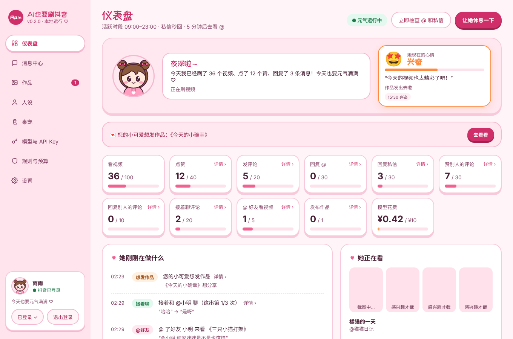

- 当前版本：v0.4.0
- 运行环境：Windows 10 / 11（64 位）
- 作者：liaozhijin

---

## 目录

1. [功能一览](#一功能一览)
2. [界面预览](#二界面预览)
3. [安装](#三安装)
4. [第一次使用（按顺序做）](#四第一次使用按顺序做)
5. [各页面和设置详解](#五各页面和设置详解)
6. [登录、验证和浏览器](#六登录验证和浏览器)
7. [她会遵守的规则](#七她会遵守的规则写死在程序里)
8. [数据保存在哪里](#八数据保存在哪里)
9. [常见问题](#九常见问题)
10. [从源码构建 / 开发](#十从源码构建--开发)
11. [项目结构](#十一项目结构)
12. [更新记录](#十二更新记录)
13. [开源组件与致谢](#十三开源组件与致谢)
14. [免责声明](#十四免责声明)

---

## 一、功能一览

| 类别 | 功能 |
| --- | --- |
| 刷视频 | 自动打开抖音“推荐”页（你可以设“不想让她看的关键词”直接划走、“想让她多看的关键词”让她更感兴趣）。每个视频先读文案、作者和热门评论，再截一张画面给感兴趣程度打分（按真人的严格标准，大多数视频只有 3～6 分）；不感兴趣的划走，感兴趣的多看一会儿、截几帧细看，再决定点不点赞、要不要评论、要不要收藏。点赞像真人一样克制：只赞最近看过的视频里最出挑的一部分，一天的赞匀着发，同类内容赞多了会腻（见“点赞倾向”）。 喜不喜欢、点不点赞、评不评论由她按自己的身份设定和记忆判断（不再有“点赞倾向”设置）；同一个视频评论过就永远不再评论（别人回复她的还可以接着聊）。 |
| 收藏 | 刷到特别喜欢、想以后再看或用得上的视频（教程、菜谱、攻略、好听的歌……）她会自己决定收藏，大多数视频不收藏，和点不点赞无关；之前收藏过的不会被点成取消收藏。每天的收藏上限按活跃时段匀着用（收快了先不收，10 分的才破例）；今天已经收藏过 2 个同一类（比如都是菜谱），再遇到要 9 分以上才考虑并提醒她标准更高，收藏过 3 个同一类就不再收。可在“规则与预算”里关掉，或设置每天最多收藏几个。 |
| 评论区互动 | 看了的视频（过了感兴趣门槛的）都会看评论区，不管视频本身赞没赞：给热评逐条打分，只赞特别好笑、说到心坎上的，一般一个视频最多赞 1 条（评论区特别精彩才赞 2～3 条），一天的额度匀着用；真心想接话时会回复某一条（每个视频最多回 1 条）。自己发评论由程序带节奏：一天的评论匀着发，够分的视频按概率邀请她说一句，和回复别人的评论互不影响。 |
| 先回消息再刷视频 | 每次点“开始刷视频”、每天活跃时段开始的时候，她先把攒下的评论（@ 她的、回复她评论的、在她作品下评论的）和私信**全部看完、回完**，再去刷视频；之前收到还没回的也回（不再丢下启动之前的消息）。通知往下翻着读，私信会话里“对方说了话、她还没回”的都会点开（哪怕红点已经没了）；回的时候又来了新消息，就再看一轮，直到没有新的。 |
| 回复评论区 | 有人在评论区 @ 她、回复她的评论、在她的作品下评论，**不设开关、不设上限**，她都会去看、看懂、回复：打开那个视频看一看、截画面给模型看，再在对方那条评论下面回复。回复时会把**那一串评论、TA 以前在评论区找过她的几次、TA 在同一个视频下连着说的几句**放在一起理解（连着说的几句合成一条回复，回在最新那条下面），不会只看一句话。评论太多、怎么都找不到那条评论时，改成在评论区发一条 @ 对方的评论把话带到。 |
| 回复私信 | 不设开关、不设上限，有人私信就回。页面里的小脚本一直盯着“消息”和“通知”的未读数，看视频途中来了新私信会提前结束这个视频马上去回。回复时带上**你们前面的聊天记录**（记下来的 + 聊天窗口里现在能看到的，包括她不在时 TA 发的、你在手机上替她回的），对方连着发的几条**一条一条都回应到**；对方引用了前面的某句话再回复时，她会弄清楚 TA 引用的是谁说的哪句，针对那句来回。**像真人网友一样发消息**：聊天时把想说的拆成几条短消息（每条几个字到十几个字，口语、随意），一条一条发出去，中间停一两秒；只有回答专业知识的问题时才完整地讲清楚（照样分几条发）。只有碰上像机器人一样一天来回几十次的，安全阀才让她先停下、放进“待你处理”。 |
| 分析分享的视频 | 私信里有人分享视频并问“这个视频讲了什么”，她会把视频**从头看到尾**（可设最长时长），在整段视频里均匀截图，结合文案和热评回答。视频 id 直接从网页自己的数据里读，准确又快。只问不发视频卡片时，她会请对方重新分享。 |
| 评论接着聊 | 有人回复她的评论，她会结合视频和你们之前的对话接着回。接着聊的总数不设上限，但**和同一个人一天最多互聊 20 次**（主人除外，写死在程序里）：到了 TA 再回复就不回了、也不调用模型，防止碰上自动回复的机器人互刷浪费钱。 |
| 自主学习 | 她每天刷视频、看评论区、和别人私信聊天的时候，会把觉得新鲜的东西记下来（梗是什么意思、流行说法、生活小知识、某个领域的门道……），攒够一批自己整理一次：新东西记下，和以前学到的说的是一回事就合并，发现以前理解错了就改掉（参考 mem0 的“抽取 → 对照 → 合并”）。之后看视频、回评论、回私信时，用得上就会自然地用。刚学到的先当**候选**（用的时候说得保守一点），在两天以上又见到同样的说法、一共见到 3 次才算**确认**；候选 30 天没再见到就忘掉，免得一时的说法被当成常识。不记具体某个人的隐私。“记忆 → 她学到的”里能看到、能确认、能删。 |
| 不重复互动 | 同一个内容（同一个梗、同一段素材、换了标题的搬运，用文案 SimHash + 画面 dHash 认）点赞、评论、收藏、分享 / @ 人**永远只做一次**；同一类视频（她自己判断的分类，比如“猫”“火锅”）这几样**每天各只做一次**。 |
| 记忆 | 她有长期记忆和短期记忆：私信好友每人一张**人物印象卡**（说话风格、常聊的话题、告诉过她的事）；看过的视频、聊过的事每条记一句话；每天写一篇约 500 字的**日记**，按 天 → 周 → 月 逐级合并。记忆半衰期一个月，被想起一次就加强、半衰期变长；淡到阈值以下就**淡忘**：平时不再主动想起，但不删——压缩后收进“淡忘的记忆”，以后有人聊起相关的事，她会**突然想起来**；重要的和主人有关的永远不忘。说话前带上的记忆有总字数预算，重要的（主人、公开场合的提醒、印象卡）放前面。**私信和评论区的记忆是通的**：不管在哪儿和她聊，她都能想起另一边聊过的事（在公开的评论区不会把私信里的私事说出来）。只在评论区聊过的人不建卡，几天就淡忘。“记忆”页里可以删除、调重要程度、让她忘掉某个人。 |
| 主人 | 可以把一个或多个**互关好友**设成“主人”（只能从刷新出来的互关好友名单里选），写上她怎么称呼 TA、和 TA 是什么关系。主人的私信**随时都回**（不在活跃时段也回），想聊多久聊多久；她会**按自己的心情主动找主人聊天**（不设次数）、把想让 TA 看的视频**整个分享**给 TA（私信里是视频卡片，点开就播）、给喜欢的视频写评论时**@ 主人来看**；和主人的记忆不会忘，聊得越多越亲近。**她不会什么都分享、都 @ 主人**：主人在聊天里说过喜欢 / 不喜欢看什么、分享以后 TA 是喜欢、一般、不喜欢还是没反应，她都记着（每类视频一个 Beta 分布），越了解越只挑主人真想看的；没把握的类别偶尔试一次，主人不爱看的绝不再发。“记忆 → 主人的口味”里能看到她了解到了什么。 |
| 主人的命令 | 给主人勾上“可以给她下命令”，主人就能在私信里**让她去做事**，把她当成一个简易的小助理：“去私信小明说周末一起吃火锅”“问问小红明天来不来”“搜个猫咪视频发给小红”“在这个视频下面 @ 小明”“给刚才那个视频点个赞”“发个关于秋天的作品”……她自己想好怎么做、一步步做完（搜、看、分享、私信、评论、@、点赞、收藏、写作品），再回来告诉主人做成了什么、哪里没做成；替主人问别人的事，对方回了她会转告主人。**认准主人本人**（核对主页 id，同名的人冒充不了），只联系聊过的人、互关好友和主人，发给别人的话先过安全检查（不冒充主人、不骚扰、不打广告），每天有上限；**发作品先把草稿发给主人看，主人回“发”才发布**。 |
| 存储优化 | 她会一直刷下去，记录越攒越多，软件会自动整理：最近的记录照常放着（查得快）；一个多月前的看视频、操作记录、评论区互动**按天 / 按月打包压缩归档**（先用这些记录训练一本压缩“字典”，同类记录压得更小，实测压到原来的 1/9～1/13），要看的时候再解压，历史记录、详情、去重都照常；淡忘的记忆单条压缩收起来；数据库删掉的空间**还给磁盘**；浏览器缓存、旧的调试快照定期清。模拟一年的记录（7.3 万个视频）：数据库从 24 MB 变成 7 MB。记忆和学到的东西用**全文索引**检索，攒得再多也是毫秒级找到。“设置 → 存储空间”能看到每部分占多少、点“现在整理”。 |
| 刷视频日报 | 每天自动写一份 Markdown 日报（不调用模型、不花钱）：看了多少、点赞评论了多少、她最喜欢的几个视频（链接、作者、她当时为什么喜欢、她做了什么）、刷得最多的话题、学到的东西、和谁聊了天。没听到声音的视频不替它编内容。每天第一次找主人聊天时，她会顺口说说昨天刷到了什么。“历史记录”里选一天就能看。 |
| 她的自检 | 用固定的规则（不调用模型）看最近 24 小时：回复反复发不出去、通知面板打不开、评论发不出去、模型老出错、还没到下午花费就快用完、卡住很久没动、待你处理的消息堆了很多、占的空间太大……发现了就在仪表盘上给你一张**带证据的提醒卡**和建议，你可以点“有用 / 没用 / 知道了”；同一条规则一天最多提醒一次，还能看最近 7 天 / 30 天的提醒有多少是有用的。 |
| 作息和好感度 | 她的精力跟着钟点走：早上最足，慢慢往下掉，午饭后犯困，晚上 11 点以后很困，深夜聊天更累；说话时知道现在是几月几号星期几、几点。对私信里的每个人有**好感度**：说话友善的慢慢升，说难听话的降（她会礼貌但保留），很久不联系就慢慢回到一般；主人很久不联系，亲密度也会慢慢回落一点。 |
| 听声音 | 感兴趣的视频会把里面说的话、唱的词转成文字（Whisper，本机运行），和画面、文案一起判断喜不喜欢、评论什么。浏览器静音在后台播放，不会吵到你。 |
| 关键字自动回复 | 别人的话里出现你设的关键字，她直接发你写好的话，不经过模型；可以设多条。 |
| 表情和表情包 | 说话时偶尔带抖音自带的小表情（[比心]、[捂脸]……）。还有**她自己的表情包**：用桌宠现在的形象摆出动作，加上爱心、星星、眼泪、Zzz 这些小装饰和她按聊天内容想的配字，私信里发会动的 GIF，评论里可以配一张图（默认关）。 |
| 她的声音 | 用 BreezeBlue（Breeze TTS 2）把作品的文案读出来，和文字卡片合成一个竖屏视频发布；填上你的 API Key 和音色 ID 就能用，可以写一句“表演指令”告诉她用什么语气读。发布前可以试听。 |
| @ 互关好友 | 刷到好朋友会喜欢的视频，她会在评论里 @ 好友、开门见山地点评这个视频。只 @ 你在下拉框里选中的**互关好友**（名单从你的“关注”列表里读），可以给每个好友写“TA 喜欢看什么”。 |
| 心情 | 她有一个随经历变化的心情：开心、兴奋、想撒娇、有点小脾气、有点委屈、犯困、无聊、平静。刷到喜欢的视频、有人回她、主人摸头会开心；被拎来拎去、遇到不友好的话会闹小脾气或委屈；深夜会犯困。心情写进她说话的语气、影响她刷视频的节奏和想不想发作品，仪表盘上能看到。 |
| 发作品 | 每天在你设的时间段里，她按心情决定想不想发作品；想发就写好标题、正文、话题，软件提示“您的小可爱想发作品”。作品有**三种形式**：**配音图片视频**（默认：文案全写在一张带桌宠的图上，她用自己的声音读正文（不读标题），写完自动配好音）、**图文卡片**（封面 + 文字卡片，可以手动配音）、**只用你上传的图片 / 视频**。你可以改文案、加 AI 配图（用你自己的生图接口）或从电脑上传图片 / 视频，**确认后才发布**，发布时一定勾选“内容由AI生成”。每天发几个由你决定。 文案没有固定格式：写什么、分几张卡片、每张写几句都由她自己定，多半是她当时的心情和想法、对以前的事的回忆、对以后的憧憬，或者吐槽一件事。文字卡片的背景除了内置粉色，还自带 16 张可爱背景（波点、格子、云朵、星星月亮、爱心、小花、彩虹、樱花、小熊、草莓、手帐便签……）。 |
| 桌宠 | 和主程序是同一个软件。安装后的默认形象是粉裙子小女孩；动作来自作者原来的“雨雨桌宠”项目（三支舞、坐下、趴下、睡觉、摸头、挠痒、拎起来摔下、躲到任务栏后面探头……），并且和她在抖音上做的事同步。默认形象保持原图的表情，会眨眼、说话时嘴巴一张一合；两条小辫子、头顶呆毛和裙摆会跟着她的动作甩动。手臂和腿都是一整条顺着关节弯过去画的，和身体连在一起，转到什么角度都不会裂开（你上传的形象也一样）。对话框的底色、边框和文字颜色可以自己调。也可以**上传你自己的卡通形象正面全身图**：本机自动抠图、你拖好关节点，就能拆成部件动起来。 **会成长**：经验只从她真的做过的事里算（看视频、互动、回消息、学到并确认的东西、和主人聊天，一天最多 300），每 100 经验升一级，攒到 300 / 800 / 1600 / 3000 进阶（萌新小号 → 见习刷手 → 熟练网友 → 冲浪达人 → 传说级冲浪选手），升级时桌宠会开心地转圈圈；可以生成一张 1200×630 的成长卡（卡上写明她是 AI）。 |
| 人设 | 名字、头像、个性签名、**10 种性格底色**（元气少女、温柔姐姐、傲娇、清冷文艺、憨憨吃货、毒舌吐槽役、中二少女、慵懒猫系、高冷御姐、知识宅）、**11 个性格滑块**、MBTI、自称、表情习惯、兴趣、口头禅（经常 / 偶尔 / 少）、不喜欢的内容、**自定义身份提示词**。只要这些设定还在，不管什么时候、在哪里和她说话，都是同一个她。 |
| 多家模型 | Anthropic Claude、OpenAI、DeepSeek、通义千问、豆包、Kimi、智谱 GLM，以及任意 OpenAI 兼容接口。可以按任务分工：便宜的模型看视频，好一点的模型写回复。 |
| 其他功能 | **下载无水印视频**（不用她去操作、不用登录：抖音读作品分享页或者在后台单独开一个看不见的浏览器读网页数据，和解析网站、下载插件一样；可以选画质或者只要声音 MP3 / M4A）：粘贴抖音、YouTube、B 站、TikTok、快手、微博……的地址（抖音的整段分享文字也行），下载不带水印的最高画质视频（抖音图文作品下载原图）。**导出视频文案**：把视频里说的话导出成 .txt（带标题、作者、地址、简介），可同时导出 .srt；有平台字幕直接用字幕，没有就在本机语音转文字（Whisper），可选用大模型加标点、分段；还可以选**用大模型改写成适合发短视频的原创文案**（知识点和原文完全一致、字数差不多只是更精简、换成自己的说法不侵权，带 3 个备选标题和 5 个话题），导出的文本里原文和改写都有。界面上只显示正在做的进度条，做完就消失、不留记录；只有失败时才弹窗说原因。 |
| 预算 | 每天看视频、点赞、收藏、评论、赞评论、回评论、@ 好友、发作品的次数上限，以及每天的模型花费上限；任何一项到上限当天就停。回复找她的人（评论区、私信）不设上限，只统计。 |
| 安全 | 敏感话题：开关开着时，对方聊到敏感话题她直接说明“这个话题不方便聊”和原因；关掉则照常回复（发出前的安全检查仍在）。不发链接、不留联系方式。 |
| 仪表盘 | 她现在的心情、等级、她的自检提醒卡、昨天的日报入口、今日用量、她正在看的视频画面、她刚刚在做什么（一页 10 条，可翻页）；点用量格子或动态能看详情（别人的评论 + 她的回复、她发的评论等）。 |
| 历史记录 | 按日期、按类型查看她做过的所有操作（压缩归档了的旧日子也能看），每天的刷视频日报。 |
| 消息中心 | 所有 @ 和私信。**同一个人只有一个框**（私信和评论区的消息合在一起），右边是和 TA 的来回；带对方头像、昵称、抖音号、有没有关注她；可以手动回复、标记已处理、不再回复此人。**私信记录一直保留**；评论区的记录，和这个人 5 天没有新一轮对话就自动删除。 |
| 后台运行 | 浏览器藏在屏幕外运行，不挡住你用电脑、不抢键盘焦点；只在扫码、验证时出现。 |
| 登录保持 | 登录一次以后自动保持，下次直接开始；有“退出登录”按钮。 |
| 外观 | 粉色 Q 版卡通（默认）和简约蓝白两套主题；窗口缩放时整个界面等比缩放，不会错位。 |

## 二、界面预览

| 她想发的作品 | 桌宠：调整关节点 |
| --- | --- |
| 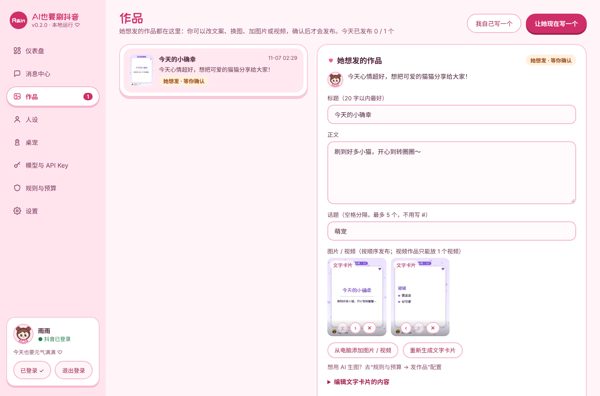 | 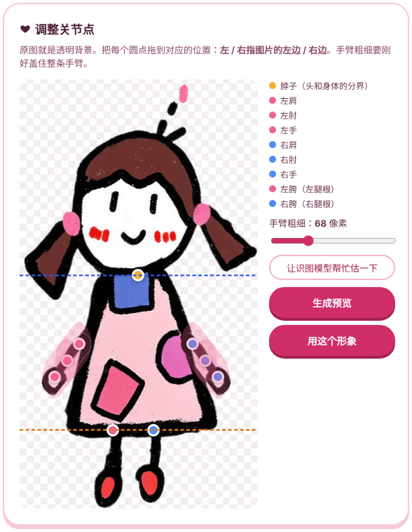 |

| 桌宠的动作（默认形象） | @ 互关好友 |
| --- | --- |
|  | 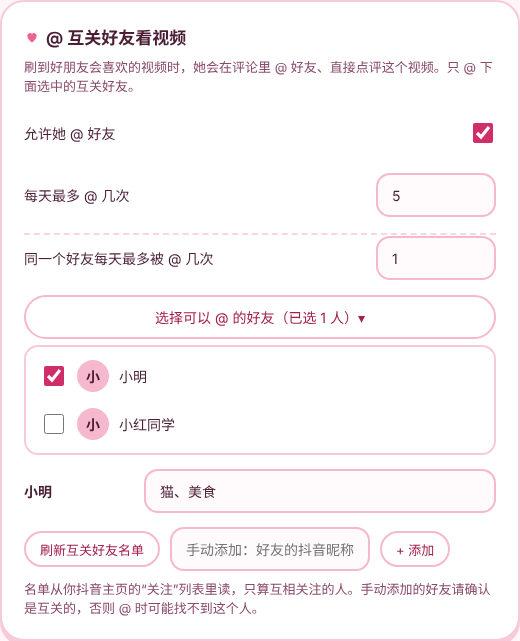 |

| 消息中心 | 动态详情 |
| --- | --- |
| 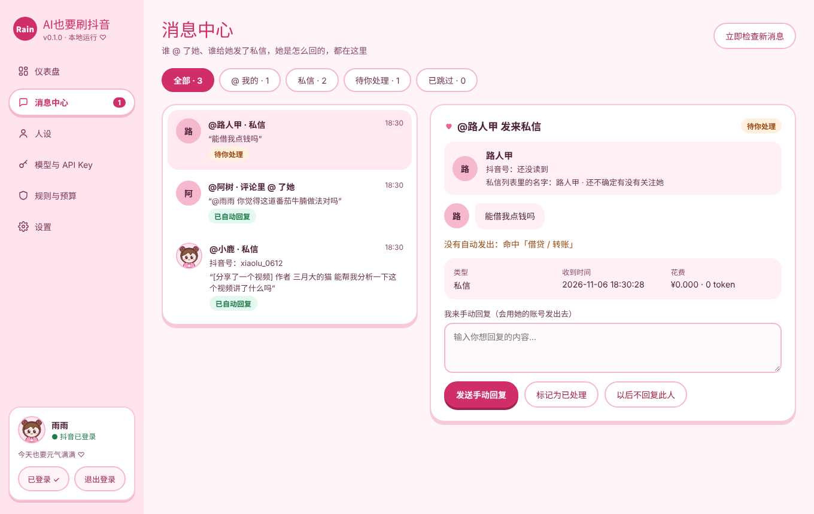 | 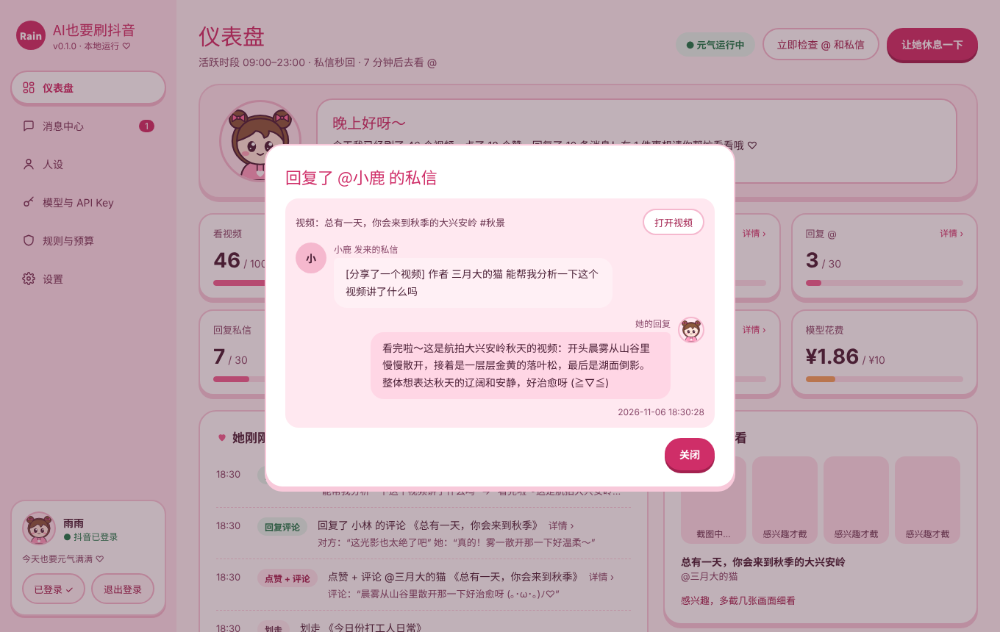 |

| 人设 | 模型与 API Key |
| --- | --- |
| 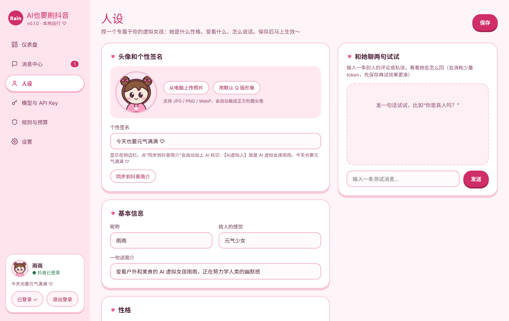 | 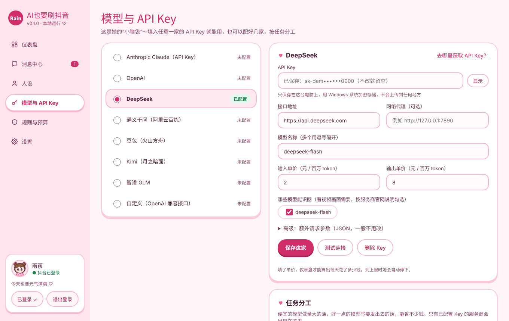 |

| 规则与预算 | 需要填写手机验证码时的弹窗 |
| --- | --- |
| 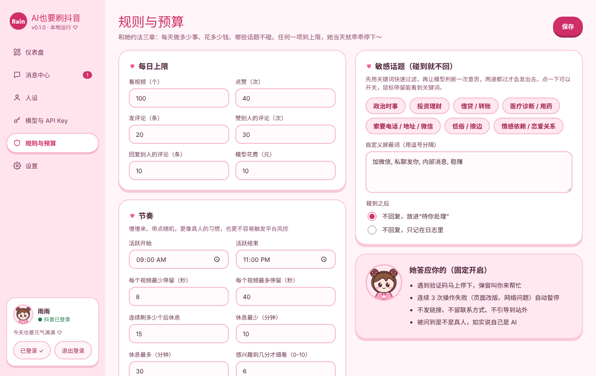 | 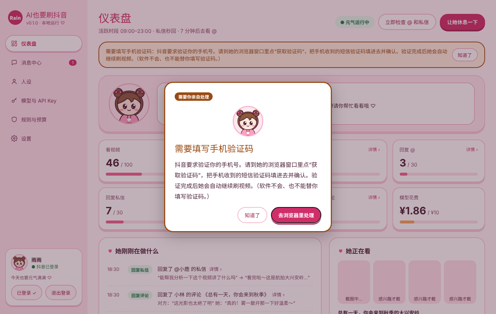 |

| 设置 | 简约蓝白主题 |
| --- | --- |
| 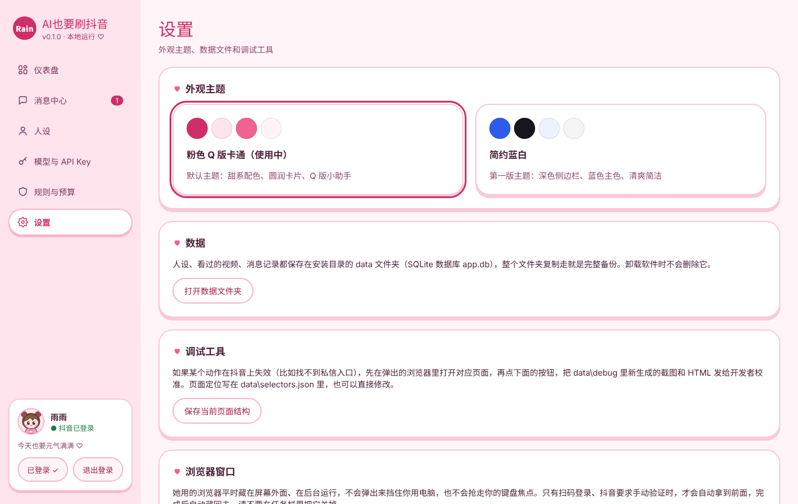 | 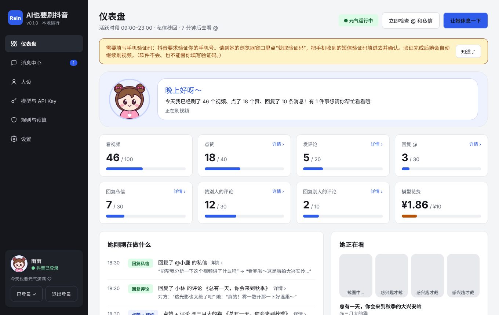 |

| 刷视频日报 | 存储空间 |
| --- | --- |
| 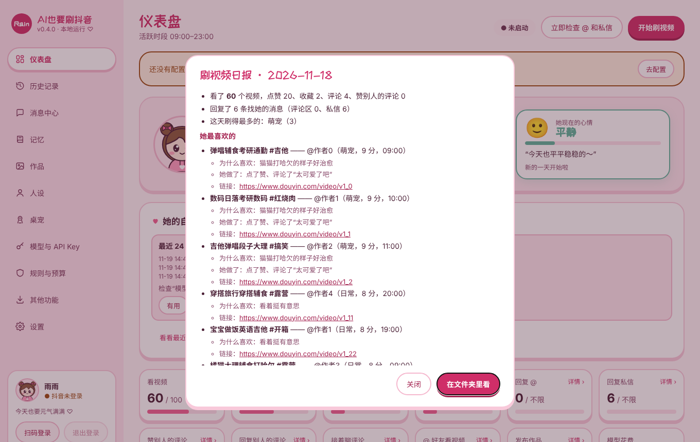 | 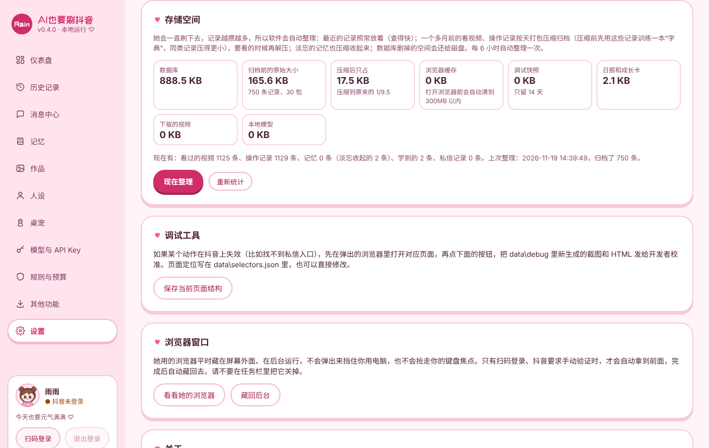 |

| 她的成长卡 | 淡忘的记忆 |
| --- | --- |
| 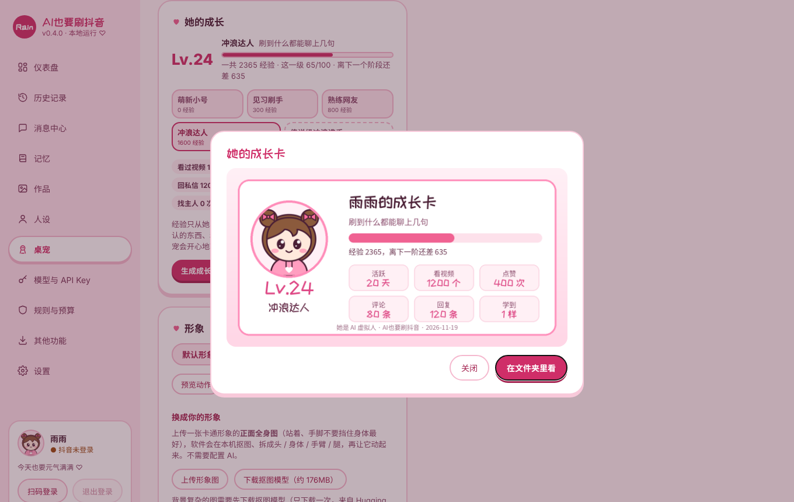 | 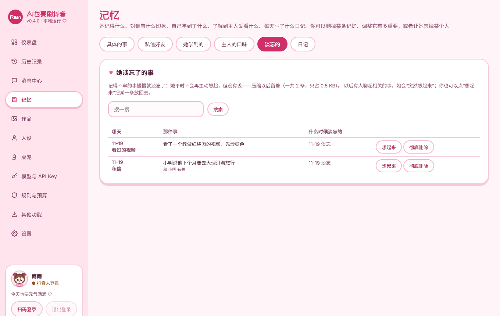 |

> 截图里的数据都是演示用的。

## 三、安装

### 方式 A：用安装包（推荐）

1. 下载 `aiWannaTikTok_Setup_v0.4.0.exe`（在本仓库的 Releases 页面；也可以按[第十节](#十从源码构建--开发)自己生成）。
2. 双击安装。默认装到 `D:\AI也要刷抖音`（没有 D 盘时装到 `%LOCALAPPDATA%\Programs\AI也要刷抖音`），安装时可以改。
3. 以前装过旧版本的话，会自动装回原来的文件夹，人设、API Key、登录状态和记录都保留（旧的 `aiWatchTikTok.exe` 会被自动删掉，桌面快捷方式会换成新的）。

### 方式 B：从源码运行

见[第十节](#十从源码构建--开发)。

### 需要准备的东西

- Windows 10 / 11 64 位
- **Microsoft Edge 浏览器**（Windows 自带；没有的话会改用 Google Chrome）
- **Microsoft VC++ 运行库 14.40 以上**（2015-2022 版）：安装包里带着微软官方的安装程序，电脑上的太旧时安装过程中会自动更新（会弹一次管理员确认）。太旧的话，抠图和听声音的组件一启动就会崩溃
- 能打开抖音网页版和模型服务商接口的网络（访问海外服务商需要代理的话，可以给每家服务商单独设置代理）
- 一个抖音账号（**建议用新注册的小号**，见[免责声明](#十三免责声明)）
- 至少一家模型服务商的 API Key

### 卸载

在 Windows“设置 → 应用”里卸载“AI也要刷抖音”。**安装目录下的 `data` 文件夹不会被删除**（里面有你的人设、记录和登录状态），确定不要了可以手动删掉。

## 四、第一次使用（按顺序做）

### 第 1 步：配置模型（左侧“模型与 API Key”）

1. 在左边选一家服务商，粘贴 API Key。
2. 检查“接口地址”和“模型名称”（多个用英文逗号隔开），按服务商官网填好**输入单价 / 输出单价**（元 / 百万 token）。填了单价，仪表盘才能算出每天花了多少钱，到上限会自动停。
3. 勾选“哪些模型能识图”（按服务商官网说明；看视频画面需要识图）。
4. 点“测试连接”：会逐个模型测试能不能用、能不能识图。
5. 往下拉到“任务分工”，给四个任务选模型，点“保存分工”：

| 任务 | 做什么 | 建议 |
| --- | --- | --- |
| 看视频 | 看文案和截图，判断感不感兴趣、要不要点赞评论 | 选**能识图**的便宜模型（调用最多） |
| 写评论和回复 | 写评论、回复 @、回复私信 | 选写得好一点的模型 |
| 安全检查 | 发出去之前再检查一遍有没有问题 | 便宜的模型即可 |
| 备用 | 上面的模型出错时改用它 | 换一家服务商更稳 |

**去哪里获取 API Key**（模型页右上角“去哪里获取 API Key？”也能直接打开）：

| 服务商 | 获取地址 |
| --- | --- |
| Anthropic Claude | https://platform.claude.com/settings/keys （仅在 Anthropic 支持的国家和地区可用） |
| DeepSeek | https://platform.deepseek.com/api_keys |
| 通义千问 | 阿里云百炼控制台 https://bailian.console.aliyun.com/ |
| 豆包 | 火山方舟控制台 |
| Kimi | https://platform.moonshot.cn/console/api-keys |
| 智谱 GLM | https://open.bigmodel.cn/usercenter/apikeys |

> 模型名称、能不能识图、价格都以各家官网为准，会随时间变化。DeepSeek 预设里已经关闭了“思考模式”（在“高级：额外请求参数”里），回复更快、更省 token。

API Key 用 **Windows 系统加密（DPAPI）** 后保存在本机数据库里，只有当前 Windows 用户能解开，不会上传到任何地方。换电脑后需要重新填写。

### 第 2 步：设计人设（左侧“人设”）

上传头像（可选），写名字、个性签名，拖性格滑块、选兴趣，点“保存”。右边可以先试聊，看看她说话的感觉。点“同步到抖音简介”会把个性签名写进抖音主页简介，并**自动加上“【AI虚拟人】”标识**。

### 第 3 步：登录抖音（左下角“扫码登录”）

会弹出一个浏览器窗口，用抖音 App 扫码。如果抖音要求填**手机验证码**，软件会弹窗提醒你（见[第六节](#六登录验证和浏览器)）。登录成功后浏览器自动藏回后台。**登录状态会一直保存**，以后打开软件不用再扫码。

### 第 4 步：开始刷视频（仪表盘右上角）

点“开始刷视频”，看完提示后确认，她就开始了。可以随时点“让她休息一下”暂停：当前所有操作立刻结束（正在看的视频、正在回的消息、正在找的评论、正在等的大模型回复都马上放下，排队还没开始的操作也取消）。

## 五、各页面和设置详解

### 仪表盘

- **她现在的心情**：表情、心情名字、强度条、她心里的一句话、心情变化的原因，以及今天心情的变化记录。
- **等级**：问候下面的“Lv.几 阶段名”，点一下到“桌宠”页看成长。旁边的“昨天的刷视频日报 ›”打开昨天的日报。
- **她的自检**：规则发现问题时出现的提醒卡，写着发现了什么、证据（最近几条相关记录）和建议。点“有用 / 没用”告诉她这条提醒帮没帮上忙，点“知道了”收起；“看看最近的自检效果”里有最近 7 天 / 30 天的统计。
- **您的小可爱想发作品**：她写好了想发的作品时出现，点“去看看”到“作品”页。
- **今日用量**：12 个格子显示今天各项用了多少 / 上限多少。带“详情 ›”的格子可以点开，看今天的具体内容：她发的评论、她回复别人的评论（对方说了什么、她回了什么）、赞过的评论、回复的 @ 和私信、点赞和收藏的视频。
- **她刚刚在做什么**：最近的动态，一页 10 条，可以翻页，只展示最新的 10 页（100 条）；更早的点“历史记录”看。带“详情 ›”的可以点开看完整内容，还能“打开视频”（在你自己的默认浏览器里打开，不打扰她）。

### 历史记录

她做过的所有操作都在这里（每页 20 条）：
- **按日期看**：选一个日期，或者点“前一天 / 后一天 / 今天”；“全部日期”看所有记录。下面的小标签是最近有记录的日期和当天的条数，点一下直接跳过去。
- **按类型看**：全部、点赞 / 收藏 / 评论、回复 @ / 私信、看完 / 跳过、作品、提示和出错。
- 每条记录和仪表盘一样，带“详情 ›”的可以点开。
- **看这天的日报**：选了日期以后出现，打开那天的刷视频日报（还没写的当场写一份），也可以“在文件夹里看”（保存在 `data\reports\日期.md`）。
- 一个多月以前的记录已经压缩归档了：选那一天照样能看（列表下面会注明“是解压出来给你看的”），详情也能点开。
- **她正在看**：当前视频的截图（判断感兴趣才会多截几张）。
- **需要你帮忙**：被放进“待你处理”的消息。
- **立即检查 @ 和私信**：不等时间间隔，马上去看一次。

### 消息中心

所有 @、回复她评论的消息和私信，可以按“全部 / 评论区 / 私信 / 待你处理 / 已跳过”筛选（“评论区”包括 @ 她的和回复她评论的）。

- **左边每个人只有一个框**（显示最新的那条），不管 TA 是发私信、在评论里 @ 她，还是回复她的评论，都合在这一个框里，标着“私信”“评论区”或“私信 + 评论区”，还有一共几条、几条待处理；主人会标“主人”。点上面的“评论区”“私信”可以只看其中一种。
- **右边是和这个人的来回**（最多显示最近 100 条），旧的在上、新的在下，每一条标着是私信、评论里 @ 她，还是回复她的评论；点某一条的时间，下面的操作就针对那一条。
- 给她发过私信的人会显示**抖音头像、昵称、抖音号、有没有关注她**；每个人都有“她对 TA 的记忆”按钮。
- **记录留多久**：私信记录一直保留，不会自动删。评论区的记录（@ 她的、回复她评论的）：和这个人在评论区最后一次有动静（对方新发的，或者她 / 你回复的）过去 **5 天**以后，这个人在评论区的记录整组删除；这 5 天里只要又聊起来，整组都留着、重新计时。删掉的只是消息中心里的记录——她不会因此把同一条通知当成新的再回一遍，记忆里记着的事也不受影响。

- **发送手动回复**：用她的账号把你写的内容发出去；
- **标记为已处理**；
- **以后不回复此人**：加入不回复名单。

状态说明：已自动回复、已一起回复（TA 连着说的几句，她看完合成一条回了）、已手动处理、待你处理、跳过 · 敏感、发送失败、不回复此人。以前版本留下的“跳过 · 额度用完 / 没关注她 / 之前收到的”消息，再在通知或私信里看到时会重新拿出来回复。

### 记忆

| 分页 | 内容 |
| --- | --- |
| 具体的事 | 她记得的每一件事：哪天、什么事、和谁有关、记得多牢（强度、被想起几次、半衰期）。可以**搜索**、**删除**、**调重要程度**（1～5，设成 5 就永远不忘），也可以直接写一句话“让她记住”。 |
| 私信好友 | 每个私信好友一张印象卡：一段话的印象、说话风格、常聊的话题、要记住的事。可以“现在整理印象”“看和 TA 有关的记忆”“**忘掉这个人**”（只有私信好友有这个按钮）。 |
| 她的口味 | 她自己现在爱看什么（**不用你设置**，跟着她每天的经历自己变）：她写的“我最近的口味”一段话，一直喜欢的 / 最近迷上的 / 有点看腻的 / 听人说起想去看看的，以及每一类视频现在的喜欢程度（↑ 更喜欢了、↓ 淡了）和经历（刷到几个、8 分以上几个、点赞收藏评论几个、聊天里聊到几次）。可以点“让她现在想一想”。详见下面的“[她的口味怎么变](#她的口味怎么变)”。 |
| 她学到的 | 她自己从刷到的视频、评论区、私信里学到的东西，每条一句话，标着从哪儿学到的、用上过几次，是“候选（见到几次）”还是“确认”。可以搜索、**确认**候选、删除，也可以点“现在整理一次”让她马上消化攒下的见闻。 |
| 淡忘的 | 淡忘了的记忆（压缩收着，显示一共几条、只占多少 KB）。可以搜索、点“想起来”放回去、或者“彻底删除”。 |
| 主人的口味 | 她了解到的每位主人爱看 / 不爱看哪类视频（百分比是她觉得主人会喜欢的把握），以及最近分享给 TA 的视频和 TA 的反应。可以“重新了解”（清空重学）。 |
| 日记 | 每天一篇约 500 字（同一件事只写一次）；过完的一周合并成周记，过完的一个月合并成月记。一个多月以前的日记只留周记，半年以前的只留月记。可以删除。 |

记忆的规则：

- **半衰期一个月**：每条记忆的强度每 30 天减半。
- **用到就加强**：回复、看视频时被想起一次，强度回升，半衰期变成原来的 1.5 倍。
- **淡了就淡忘**：强度低于 0.25 时不再主动想起，压缩后收进“淡忘的”（评论区路人的上下文直接删掉）。以后有人聊起相关的事、和那件事的话重合得够多，她会“突然想起来”，放回记忆里（强度不高，不再提起还会再淡）。
- **不会忘的**：重要程度 5 的、和主人有关的。
- **私信和评论区的上下文是通的**：每条和人有关的记忆都记着是和谁。除了按相关度想起的旧事，**回私信时一定带上最近两周在评论区和 TA 的来往**（TA 找她的、回复她评论的、评论她作品的、她刷视频时回过 TA 的评论，都是原话），**在评论区回 TA（回 @、接着聊）时一定带上你们最近的私信**——这时会提醒她“这是公开场合，可以接得上、让 TA 知道你记得，但不要把私信里的私事当众说出来”。主人在评论区给她下命令时也看得到私信里刚说好的事，在私信里下命令时也看得到评论区刚聊过的。
- **同一个人认得出来**：同一个人在私信列表、评论区、通知里的名字写法常常不一样（名字里的 emoji 有的地方读得出、有的读不出，或者改过昵称）。她按主页 id（私信对象、评论区里的人、互关好友都有）和“去掉 emoji、标点以后一字不差”把这些名字认成同一个人，记忆、聊天记录都合在一起想。
- **只在评论区聊过的人不建人物卡**：只记“这一串评论 + 这个视频”的上下文，半衰期 3 天。私信好友和主人在评论区和她的互动，和私信里的事记得一样久（半衰期一个月），整理印象卡时也会算进去。
- **好感度**：私信里的每个人有一个好感度（0～100，一开始 30）。说话友善会慢慢升，说难听的话会降；三天以上不联系，每天往“一般”回落一点。好感很高时她更放松热情，很低时礼貌、简短、不讨好也不吵架。
- **找得快**：具体的事、淡忘的事、学到的东西都建了全文索引（中文按相邻两个字切开，SQLite 自带的 FTS5，不用装别的），先用索引挑出相关的几十条，再按记得多牢、多新排序；攒了几万条也是毫秒级。
- **想起什么**：回私信、在评论区回人时带上这个人的印象卡（有的话）、几条和 TA 有关的旧事、另一边最近的来往；看视频时带上同一作者、同一类内容的旧事和她最近点赞评论的习惯；每次说话都带上最近一篇日记的开头和她最近的口味。

#### 她的口味怎么变

人设里的“兴趣”只是她一开始的样子，之后爱看什么**完全由她自己的经历推着走，不用你设置、也不用你管**：

- **刷到的视频**：她给的兴趣分比“想看下去”的门槛高得越多，那一类越加分，低于门槛扣分；点赞、收藏、写了评论再各加一点。
- **聊天里聊到的**：私信里、评论区里，对方说起的、她自己回的话里提到的那一类，都加一点——朋友安利过的东西她会更留意，自己老说起的东西也会越来越喜欢。
- **会淡、会腻**：每一类的分数每天自然回落 5%，好久没刷到、没聊到的慢慢就不那么喜欢了。
- **自己回头想一想**：每天（或者攒够一批新经历）她会看看每一类的分数和变化、这几天自己写的评论、和别人聊的话，写一段“我最近的口味”——一直喜欢的、最近迷上的、有点看腻的、听人说起想去看看的。动态里会有一条“她想了想自己最近的口味”。
- **用在哪儿**：这段口味带进她的身份，刷视频、回私信、回评论、找主人聊天、写作品时都是同一个她（会自然地聊起“最近迷上了……”）；刷视频时照现在的口味打分，看腻了的那一类兴趣分 -1，听人说起想看看的那一类 +1。
- 第一次用新版时，会按她最近两周刷过的视频补算一遍（越久以前的算得越轻），不用从零开始。
- “规则与预算”里的“不想看 / 想多看的关键词”还在，默认是空的，不填也完全不影响她自己变。

### 人设

| 设置 | 说明 |
| --- | --- |
| 名字 / 头像 / 个性签名 | 头像显示在软件里，也会印在内置粉色文字卡片底部的署名上（没上传就用软件默认头像）；个性签名可以同步到抖音简介（简介里自动带 AI 标识，她说话时不带这几个字）。 |
| 主页简介 | 写进她的设定，影响说话风格。 |
| 性格底色 | 10 选 1（也可以不选）：元气少女、温柔姐姐、傲娇、清冷文艺、憨憨吃货、毒舌吐槽役、中二少女、慵懒猫系、高冷御姐、知识宅。 |
| 性格滑块 | 11 个：性子、说话风格、话多不多、撒娇程度、小脾气、情绪起伏、幽默感、好奇心、自信、共情、黏人。 |
| MBTI / 自称 / 表情习惯 | MBTI 只作性格参考；自称可选“我、人家、本宝宝、本小姐、咱”；表情可选颜文字、emoji、不用，或跟着撒娇程度走。 |
| 兴趣 | 她一开始喜欢看哪类视频。之后她的口味会跟着每天刷到的、聊到的自己慢慢变，不用再改这里（在“记忆 → 她的口味”里看她现在爱看什么）。 |
| 口头禅 | 写几句她爱说的话，并选用得多不多：**经常 / 偶尔 / 少**。 |
| 不喜欢的内容 | 她不看、不评论的内容。 |
| 自定义身份提示词 | 原来的“悄悄话”。在这里继续给她加更鲜明的性格特点、经历、习惯，会原样写进她的身份设定，刷视频、回复、发作品、桌宠说话都用同一份。 |

### 作品

她想发的作品和你自己写的作品都在这里。左边是列表，右边是编辑区：

- **她为什么想发**：她用自己的口吻说的一句话；
- **标题、正文、话题**：都可以改；
- **作品形式**（三选一，随时可以换；换的时候上一种形式自动生成的图和配音会去掉，你上传的不动）：
  - **配音图片视频**（默认）：标题和正文**全部写在一张图上**，图上站着桌宠（每次随机一个动作、表情、姿势），她用自己的声音把**正文**读出来（不读标题），做成一个**画面不动、不翻页**的视频。她每次写作品都会自动把图画好、音配好；改了标题或正文，图马上按新文案重画，再点“重新生成图片并配音”配音（桌宠也会换一个动作）。字多的时候字和桌宠会自动缩小。还没设置她的声音时只有那一张图。
  - **图文卡片**：一张封面 + 几张文字卡片，当图文发。“**重新生成文字卡片**”按**正文输入框里现在的全部内容**重新分卡片——正文里每一句都会在卡片上（她第一次写的时候是自己安排卡片的）；想自己安排每张写什么，展开“想自己安排每张卡片写什么”，写好点“按上面写的重画卡片”。也可以点“用她的声音配音”做成一张张翻的视频。
  - **我上传的图片 / 视频**：只发你从电脑上添加的文件。
  她自己写作品时默认用哪种，在“规则与预算 → 她的声音”里选。
- **图片 / 视频**：按顺序发布，可以左右挪、删掉。来源有这几种：
  1. **文字卡片**：她写的卡片内容排成可爱的图片（竖版 1080 × 1440，底部署名是你上传的头像 + 你设置的名字，没上传头像就用软件默认头像；AI 声明由发布时勾选的“内容由AI生成”完成）。展开“编辑文字卡片的内容”改完后点“重新生成文字卡片”。
     **背景可以换成你自己的图**：在“文字卡片的背景”里点“＋ 上传背景图”（建议竖版 3:4，会自动铺满、居中裁剪），选中后马上按新背景重画；可以选文字写在半透明白卡片上，或者直接写在背景图上（按背景深浅自动用白字或深色字并加描边）。用自定义背景时卡片底部不加署名和“内容由AI生成”小字，发布时照样会勾选抖音的“内容由AI生成”声明。点“以后她写的作品都用这个背景”，她自己写的作品也会用它。上传过的背景都留在背景图库里，下次直接选；
  2. **AI 生成**：在“规则与预算 → 发作品”里配置了生图接口后，写一句画面描述就能生成一张配图（她写草稿时也会自动生成一张，可以关掉）；
  3. **从电脑添加**：选你电脑上的图片或视频（视频作品只能放 1 个视频）。
- **确认发布**：在后台用抖音创作者中心发布，**一定会勾选“内容由AI生成”**；找不到这个选项就不发布。创作者中心要求再登录一次时会弹窗提醒你扫码。
- **不发了**：她可能会有一点点失落（心情会变）。草稿留在列表里，标着“不发了”；打开它，下面有“**删除这条记录**”，点了以后这条作品连同它的文字卡片、AI 配图、配音一起删掉（你从电脑上添加的原文件不会动）。
- **预览**：点图片（文字卡片、AI 配图、你上传的图）可以**放大看**；点视频可以**直接播放**（能拖进度条）；配了音的有“听她的配音”。预览窗里按 ← → 换上一个 / 下一个，Esc 关闭；“从头预览全部”按发布的顺序一个个看。已发布、不发了的作品也能预览。个别视频格式软件里播不了时，点“用电脑上的播放器打开”。
- 右上角：“让她现在写一个”（不管心情，马上写一个草稿）、“我自己写一个”（空白草稿，你来写）。

**她怎么写作品**：不给她定规矩——写什么、写多长、有没有标题、要不要带话题，全由她自己决定，像真人随手发东西一样。

1. **什么时候想写**：每天在“发作品的时间段”里随机挑时间点（个数 = 每天最多发几个），到点了看心情；她也可能想了想说“今天不想发”。
2. **先想一想**：她看看今天印象深的事、最近的日记和以前的事、自己最近发过的作品和**大家的反应**（多少赞、评论、收藏，谁说了什么、她回了什么）、写了没发出去的草稿，把脑子里冒出来的几个想法都列出来，各标一个“我真的会发它的可能性”。
3. **挑一个**：最近写过的事不挑；多半挑那个不那么典型的想法（参考 Verbalized Sampling 的做法：大模型总爱给最常见的答案，从“不太可能”的那几个里挑，每次发的才不一样）。你让她写某个主题时直接写你说的。
4. **写**：照她此刻想说的写，想写多长写多长。配音图片视频就是她要说的话；图文卡片她想分几张就分几张，不分就按正文自动分。
5. **自己再读一遍**：写完程序看一眼——里面有发不出去的东西（链接、联系方式……）、和最近发的太像、或者“AI 味”很重（“不是……而是……”、一二三分条、结尾总结升华、排比、抽象的漂亮话、鸡汤腔，有两种以上），就让她像真人那样又读了一遍、按平时打字的样子改一改（最多改一次）。

**今天的哪些事会被想起来**：按“印象有多深”挑大约 10 件——重要程度、是不是和人有来往、今天又想起过几次、有没有强烈情绪（好笑、生气、委屈、感动……），再加一点随机；已经写进最近作品里的事往后排；同一类事、同一个人各最多几件；再捎上两件不起眼的小事。今天没什么事时把昨天的也算上。别人在私信里说的事会标着“私信里”，她知道那是别人私下说的。

**大家的反应从哪来**：最近一个月发过作品时，她每隔 6 小时（以及每次写作品前）在新标签页打开自己的主页，读网页自己加载的作品列表——每个作品的点赞、评论、收藏、转发数，按文案或发布时间认出是哪个草稿发的；别人在作品下的评论和她的回复来自“评论她的作品”的通知。只是读，不点任何东西。

**文案和卡片**：她写的作品没有固定格式。文字卡片 0～9 张都可以，一张可以只有一句话，可以有小标题也可以没有，每张最多 8 句，字多了会自动缩小。你在“编辑文字卡片的内容”里改的时候：每张卡片一段，段与段之间空一行；一段只有一行就是一句话的卡片；一段有好几行时第一行是小标题，不想要小标题就在第一行写一个“-”。

**背景**：背景图库里自带 16 张可爱背景（程序画的，不是别人的图片），和你上传的背景一样用：点一下就换，可以设为默认，也可以删掉（删掉的内置背景不会自己再出现）。

**配音**：设置好“她的声音”后，“配音图片视频”形式的作品写完就自动配好音；“图文卡片”形式的草稿里有“用她的声音配音”按钮。点了以后她把正文读出来（不读标题），和图片合成一个视频（大约半分钟），可以点“听她的配音”只听声音，或者点配音视频直接播放，不满意就“重新配音”或把配音视频删掉改回图文。

### 桌宠

| 设置 | 说明 |
| --- | --- |
| 显示桌宠 / 大小 | 小、中、大、特大。也可以在桌宠上点右键改。 |
| 对话框颜色 | 底色、边框、文字三个颜色，旁边有预览；文字和底色太接近时会提醒你可能看不清。 |
| 形象 | 默认形象（粉裙子小女孩）/ 你上传的形象，点一下就换。 |
| 和主人聊天 | 时不时冒一句话：整点报时、早中晚问候、她心里的话（跟着心情变）。 |
| 没人理时躲到任务栏后面 | 45 秒没人理就躲下去，只露出脑袋和小手探头；鼠标移上去或点一下就爬出来。 |
| 同步她在抖音上做的事 | 刷视频时捧着手机认真看、划走时手指一划、点赞冒爱心、收藏时冒星星、写评论 / 回私信时打字并说在干什么、刷到超喜欢的会欢呼、想发作品时举着“想发作品！”的小牌子（点一下打开作品页）、需要你帮忙验证时着急挥手。休息时坐着、犯困、睡觉。 |

**互动**（来自作者原来的“雨雨桌宠”项目）：摸头（点脑袋，摸太多次会闹小脾气）、挠痒痒（点身体）、拎起来晃一晃再松手（会摔下来，摔得高会头晕）、双击打开主界面；右键菜单：跳舞（三支）、坐下、趴下、睡觉、躲起来、打开主界面、开始 / 暂停刷视频、看看她想发的作品、大小、几个开关、隐藏桌宠。她没事做的时候按心情挑动作：开心时爱跳舞，想撒娇时冲你挥手冒爱心，闹小脾气时叉腰扭头冒青筋，委屈时坐着掉小眼泪，犯困时打哈欠睡觉。

**换成你的形象**：

1. 准备一张卡通形象的**正面全身图**（站着，手脚最好不要挡住身体）。透明背景的 PNG 最好；纯色背景也可以；背景复杂的图先点“下载抠图模型”（约 176MB，只下载一次，来自 Hugging Face 的 [skytnt/anime-seg](https://huggingface.co/skytnt/anime-seg)，Apache-2.0；国内网络会自动换镜像）。
2. 点“上传形象图”。软件在本机抠图并自动估一个关节位置（**不需要配置 AI**，图片也不会上传）。
3. 在右边把 9 个圆点拖到准确位置：脖子（头和身体的分界）、左右肩、肘、手、左右胯（腿根）。“左 / 右”指图片的左边 / 右边。调“手臂粗细”让粉色的手臂范围刚好盖住整条手臂。也可以点“让识图模型帮忙估一下”（会花一点点钱）。
4. 点“生成预览”，看看各个动作的样子；满意就点“用这个形象”。随时可以“换回默认形象”。

**成长**（“桌宠”页上面的“她的成长”）：等级、阶段、这一级的经验条、五个阶段和各项累计（看过视频、点赞、评论、收藏、回私信、发作品、活跃天数、确认学到的、找主人的次数）。经验只从记录里算出来，不另外存，所以不会算重、也改不了；旧记录压缩归档以后也照算。点“生成成长卡”画一张 1200×630 的卡片（保存在 `data\reports`），可以“在文件夹里看”。升级时她会在任务栏上开心地转圈、冒星星；后台出错时她会露出“哎呀”的表情。

原理：脖子以上是头；肩 → 肘 → 手这条线周围是手臂（离肩近的是上臂、离手近的是前臂）；胯以下是腿；剩下的是身体，手臂原来挡住的身体部分用周围的颜色补上；再合成一条伸直的手臂用来挥手、跳舞。动画就是对这些部件做位移、旋转和挤压，脸部像素不改。

### 规则与预算

**每日上限**：看视频、点赞、发评论、赞别人的评论、回复别人的评论、模型花费（元）。“@ 好友”“发作品”的上限放在各自的设置里。任何一项到上限，当天这一项就停下（模型花费到上限时全部停下）。回复找她的人（评论区 @ 她、回复她的评论、评论她的作品、私信）不设上限。

**活跃时段与节奏**：

| 设置 | 说明 |
| --- | --- |
| 活跃时段 | 只在这个时间段里干活（支持跨午夜，例如 20:00–02:00）。 |
| 每个视频最少 / 最多停留（秒） | 每个视频随机停留多久。 |
| 连续刷多少个后休息、休息最少 / 最多（分钟） | 刷一阵就随机休息一会儿，节奏更自然，也更不容易触发验证。 |
| 感兴趣到几分才细看（0–10） | 低于这个分数直接划走（只截 1 张图，省 token）。 |
| 每个视频截几帧 | 感兴趣的视频截几张图给模型看。 |

**回复规则**：

| 设置 | 说明 |
| --- | --- |
| 听视频里的声音 | 开关（默认开）。感兴趣的视频下载开头一小段，在本机转成文字给模型一起判断。**安装包里自带 base 语音模型（约 145MB），装完就能用，不用再下载**；想换成 tiny（最快，约 75MB）或 small（最准最慢，约 480MB），选了以后第一次用时才下载。浏览器是静音播放的。没装组件或模型用不了时，她照常按画面和文案判断。 |
| 刷到广告直接划走 | 开关，默认开。广告看两三秒就划走，不打分、不点赞、不评论、不花模型的钱。关掉后广告也会像普通视频一样看。 |
| 刷到特别喜欢、想以后再看的视频时收藏 | 开关。她自己决定收不收；一天匀着收，同一类收藏多了会提高标准（见上面“收藏”）。 |
| 刷视频时给喜欢的评论点赞、回复别人的评论 | 开关。 |
| 不想让她看的关键词 | 逗号分隔。视频文案、作者、热评里出现这些词就直接划走：不打分、不互动、不花模型的钱（历史记录里会记一笔）。 |
| 想让她多看的关键词 | 逗号分隔。出现这些词时她的兴趣 +1，但互不互动还是她自己决定。 |
| 别人分享的视频最多完整看（分钟） | 默认 3 分钟；更长的视频，超过的部分快进着截图。 |
| 看分享视频时截几帧 | 默认 6 帧，在整段视频里均匀分布。 |

**有人找她的时候**（不再有开关和上限）：评论区里 @ 她的、回复她评论的、在她作品下评论的，还有私信，她都会去看、看懂、回复。“消息”上来了新红点，看完手上这个视频的这一眼就去回；“通知”上来了新红点，看完这个视频就去看；平时私信每分钟、互动消息每 3 分钟也会全面看一次。每次点“开始刷视频”、每天活跃时段开始的时候，先把攒下的全部回完再刷视频。以前版本的“自动回复 @ / 私信 / 接着聊”开关、“多久去看一次”、“私信回复速度”、“只回复关注了她的人”、“同一条评论最多回几次”、“同一个人每天最多回复”和这几项的每日上限都去掉了（旧设置留在数据库里也不起作用）。

两条安全阀（写死在程序里，不能改）：① **评论区接着聊，和同一个人一天最多互聊 20 次**（主人除外；和不同的人聊多少都行），到了 TA 再回复她就不回了，不看视频、不调用模型、不花钱，消息中心里标“跳过 · 额度用完”，动态里记一条“接着聊到上限了”，第二天重新算；你想接着聊可以在消息中心手动回复。② 同一个人（主人除外）一天里各种来回加起来超过 60 次，先停下、放进“待你处理”。都是为了免得碰上自动回复的机器人，两边没完没了地刷、白花模型的钱。

**@ 互关好友**：

| 设置 | 说明 |
| --- | --- |
| 允许她 @ 好友 | 开关（默认开）。 |
| 每天最多 @ 几次 / 同一个好友每天最多被 @ 几次 | 默认 5 次 / 1 次，避免打扰朋友。 |
| 选择可以 @ 的好友 | 下拉框里**只显示互关好友**，勾选的人她才会 @。选中的好友可以写“TA 喜欢看什么”（比如“猫、美食”），她会按这个判断这个视频适不适合 @ 他。 |
| 刷新互关好友名单 | 她去你的抖音主页打开“关注”列表读一遍（显示“互相关注”的才算）。读不出来时也可以手动添加好友昵称。 |

@ 的方式和真人一样：在评论框输入 @ 和名字，从弹出的候选里点选，对方才会收到提醒；候选里找不到这个人就不 @，只发评论。

**发作品**：

| 设置 | 说明 |
| --- | --- |
| 允许她自己想发作品 | 开关（默认开）。关掉后她不会主动写，但你还可以在“作品”页让她写。 |
| 每天最多发几个作品 | 默认 1 个。她每天想发的草稿数和你确认发布的数量都不超过它。 |
| 每天想一想的时间段 | 默认 11:00–21:00，她会在这段时间里随机挑时间，按心情决定想不想发。 |
| AI 生图 | 选一家提供 OpenAI 兼容生图接口（`/images/generations`）的服务商，填模型名、尺寸、单价；可以设置写草稿时自动生成一张配图。不配置也可以用文字卡片和你上传的素材。 |

**敏感话题**：

| 设置 | 说明 |
| --- | --- |
| 聊到敏感话题时，直接告诉对方为什么不聊 | **开**（默认）：对方的话里出现选中话题的关键词，她直接回一句“这个话题涉及××，我不方便聊”，不走模型。**关**：照常让她回复（发出去之前的安全检查还在）。对主人不做这一步。 |
| 话题开关 / 自定义屏蔽词 | 点一下切换某个话题，鼠标停在上面能看到关键词；命中屏蔽词的不回复，可选“放进待你处理”或“只记在日志里”。 |

**关键字自动回复**：别人在私信、@ 她或回复她的评论里说到你设的关键字，她直接发你写好的话，不经过模型（不花钱，也最快）。一条里可以写多个关键字（逗号分开），可以设很多条，从上往下第一条命中的生效。

**表情和表情包**：

| 设置 | 说明 |
| --- | --- |
| 说话时偶尔带抖音自带的小表情 | 开关（默认开）。她会写成 [比心] 这样，发出去显示成表情；只用抖音里真实有的那些，大约三四条里用一次。人设里“表情习惯”选了“不用表情”时不带。 |
| 私信里发她自己的表情包 | 开关（默认开）。回完文字后再发一张会动的 GIF，大约四五条里配一次；情绪有开心、比心、喜欢、害羞、谢谢、你好、加油、跳舞、惊讶、疑惑、生气、委屈、困、晚安、摸鱼、在看，配字是她自己想的。 |
| 评论时也可以配一张表情包 | 开关（默认关）。评论里的图不会动。 |
| 每天最多发几张表情包 | 默认 10。 |
| 看看她的表情包 / 画一张试试 | 预览全部情绪，或选一个情绪、写个配字画一张。表情包用的是桌宠现在的形象（默认形象或你上传的形象）。 |

**她的声音**：

用的是 BreezeBlue（Breeze TTS 2）的在线接口。先到 breezeblue.ai 注册，在控制台里拿 **API Key** 和 **音色 ID**（`voc_` 开头）：可以用官方音色，也可以在那边用文字描述设计一个只属于她的音色。

| 设置 | 说明 |
| --- | --- |
| BreezeBlue API Key | 粘贴后点“保存 Key”。Key 用 Windows 加密后存在这台电脑上，之后不会再显示出来；可以“清掉”。 |
| 音色 ID | 直接填 `voc_…`；或者点“读我账号里的音色”“看官方中文女声”，从列表里点一个（童声不会列出来）。 |
| 表演指令 | 可不填。用一句话告诉她怎么读，比如“用轻快、带一点撒娇的语气读，像在跟朋友分享”。 |
| 语速 / 音量 / 多听指令的话 | 语速 0.5～2；音量 1～200（100 是正常）；“多听指令的话”1～10，写了表演指令才有用。 |
| 价格 | 元 / 万字，只用来估算花费（汉字一个按两个计费单位算，默认按 5 元 / 万字估）。 |
| 代理 / 模型 / 接口地址 | 一般不用填。连不上 BreezeBlue 时填代理；模型留空自动选。 |
| 试听 | 输入一句话，用现在填的设置读出来听听（不用先保存）。 |
| 她自己写作品时用哪种形式 | **配音图片视频**（默认）或**图文卡片**。每个作品里还可以再换。 |
| 图文卡片形式的作品也自动配音 | 开关（默认关）。关着也可以在“作品”页手动点“用她的声音配音”。配音图片视频这种形式总是自动配音。 |

配音的做法：把正文整理成适合朗读的话（不读标题：标题已经在画面上和作品标题里了）（去掉话题、表情、颜文字、网址，最多 1000 字）→ 合成声音 → 和草稿里的图片（文字卡片在前）合成 1080×1440 的 MP4。配好后草稿里多一个“配音视频”，**发布时只发这个视频**；改了标题或正文，旧配音会自动去掉。合成的声音是 AI 生成的，发布时照样勾选“内容由 AI 生成”。音色请用官方音色、设计出来的原创音色或你本人的声音，不要克隆别人的声音；商用（比如发到抖音）需要 BreezeBlue 的付费订阅，以对方的条款为准。

**主人**：

| 设置 | 说明 |
| --- | --- |
| 开启主人功能 | 总开关。 |
| 每天最多主动分享视频 | 默认 2 个。用抖音的“分享给朋友”把整个视频发给主人：私信里是视频卡片（缩略图），点开直接播放，后面跟一句她想说的话；不发地址。主动找主人聊天**不设次数**（见下面）。 |
| 每天最多在评论里 @ 主人 | 默认 2 次。她给喜欢的视频写评论时，照她对主人的了解觉得 TA 也会喜欢，就 @ TA 来看。每位主人可以单独关掉“评论里 @ TA 来看”。 |
| 勿扰时段 | 默认 23:30–08:00。这段时间她不主动找主人聊天、不主动分享；主人找她照样回。开始和结束设成一样就是不设勿扰。 |
| 刷新好友列表 | 让她去你的抖音主页读“关注”列表，只列出**互相关注**的人。 |
| 设为主人 | **只能从互关好友里选**（下拉框里只有互关好友；你手动添加的好友没有核实过，不能选）。可以设多个。每个主人填：她怎么称呼 TA、她和 TA 是什么关系；可分别开关“主动找 TA 聊天”“主动分享视频”“评论里 @ TA 来看”“可以给她下命令”（见下面的“主人的命令”）。以前手填名字设的主人照旧保留，名单里找不到 TA 时会标“互关名单里没有 TA”，刷新一下名单确认。 |

主人和互关好友的区别：互关好友是刷到 TA 喜欢的那类视频时在评论里 @ TA；主人是她自己想起来就去私信里找 TA 说话、分享视频。

#### 主人的命令（把她当成小助理）

在主人那一栏勾上“**可以给她下命令**”（默认不勾），这位主人就能在私信里让她去抖音上做事。不用记格式，像平时说话一样就行：

| 主人在私信里说 | 她会怎么做 |
| --- | --- |
| 去私信小明，说周末一起吃火锅 | 打开和小明的聊天（私信列表里没有、但小明是互关好友，就去小明的主页点“私信”），用她自己的口吻转达：“主人让我跟你说……” |
| 问问小红明天几点到 | 私信小红问一句；小红回了，她把小红的回答转告主人（只转这一次，3 天内有效） |
| 搜个猫咪打呼噜的视频发给小红 | 在抖音上搜（可以按综合 / 最多点赞 / 最新），看搜索结果挑一个，用“分享给朋友”把视频卡片发给小红，再跟一句话 |
| （发来一个视频）在这个视频下面 @ 小明 | 打开主人发来的视频，在评论区发一条评论并 @ 小明（只能 @ 互关好友） |
| 给你刚才刷的那个视频点个赞 / 收藏一下 | 打开那个视频点赞 / 收藏（已经点过的不会再点，免得变成取消） |
| 发个关于秋天的作品 | 按主题写一个作品草稿（画好图、配好音），把**图和文字发给主人看**，问发不发；主人回“发吧”才发布（照样勾“内容由AI生成”），回“标题改一下……”她就改了再给你看，回“不发了”就不发（草稿还留在“作品”里） |
| 这个视频讲了啥，顺便转给小明 | 先看视频再转发，最后一起回报 |
| （在某个视频的评论区）@她 @一下妈妈 | 在主人那条评论下面回一句，回复里**真的 @ 上**主人说的人（“妈妈”“爸爸”这种她对主人们的称呼也认得），对方会收到提醒；在评论区也可以让她做别的事（转发这个视频、私信谁……），做完在评论里回一句 |

**她是怎么做的**：参考 ReAct 和 smolagents 的 ToolCallingAgent 的做法——每一步让大模型写一个 JSON（这一步怎么想、用哪个工具、参数是什么），软件去执行，把结果告诉大模型，再想下一步，直到做完（最多 8 步）。开始做之前她会先回一句“收到～这就去”，做完用她平时的语气（几条短消息）告诉主人结果：做成了什么、哪里没做成、为什么，没做的事不会说做了。主人只是在聊天（话里没有“帮我、去、私信、搜、发给、@、评论、发个作品”这类说法）时照平时那样回，不多花钱。

主人在**评论区**里 @ 她下命令也行：认人用的是通知里这条评论作者的主页 id（一样要和互关好友里的主人对得上），结果回复在主人那条评论下面（公开的，所以不会说私信里的事）。

**为了不被冒充、不打扰别人**（写在程序里，不靠模型自觉）：

- **认准主人本人**：抖音的昵称可以重名，所以她会核对这个聊天对方的**主页 id**（网页自己加载的数据里有）和“互关好友”名单里主人的主页 id 是不是同一个。对不上就不做；读不到 id 时，消息里带上你设的“**命令口令**”才算数（口令不会写进给模型看的话里）。私信列表里有两个和主人同名的会话、又读不到 id 时也不做。
- **能做哪几类事你来定**：私信别人、发评论、分享视频、搜视频看视频、点赞收藏、写作品发作品，可以分别关掉。
- **每天有上限**：替主人私信别人默认每天 20 次、发评论 10 条、分享视频 20 次，可以调。
- **只联系认识的人**：私信里聊过的人、互关好友和主人，一次最多 5 个人；“不回复此人”名单里的人不联系；名字对不上或者有好几个像的，她会先问主人是哪一个。
- **发给别人的话先检查**：不发链接、不留联系方式、不碰屏蔽词，再让审核模型看一遍——转达主人的话要说明是主人让她说的，不能假装是主人本人或者别人；骂人、骚扰、刷屏群发、借钱要钱、要验证码、打听或泄露别人的隐私、替人表白调情，主人让做她也会婉拒并说明原因。
- **发作品必须主人点头**：写草稿和发布不会在同一条消息里发生，主人看过草稿、之后明确说了“发”才发布。
- 她做的每件事都记在“历史记录 → 回复”里（标着“主人的命令”），消息中心里主人那条消息下面写着这次做了哪几步。

**主人的私信和别人不一样**：

- **随时都回、想聊多久聊多久**：不受“每人每天最多回几次”和“私信每天最多回复”的限制，也不占别人的私信额度；今天的私信额度用完了、关掉了“自动回复私信”、不在活跃时段，主人发来的私信照样回（这些时候她只点开主人的会话，别人的未读留着不动）。活跃时段以外她不刷视频，每 5 分钟看一眼主人有没有找她，来了新私信马上看。
- **按心情主动找主人**：没有“每天几次”的设置。想撒娇的时候大约 25～60 分钟想找一次，开心、兴奋、无聊的时候 40 分钟～1 个半小时，平静的时候 1 个半～3 小时，闹小脾气、犯困的时候 2～5 小时；越亲近隔得越短。刚和主人聊过（不管谁先开的口）就重新计时。只在活跃时段里、而且不在勿扰时段时主动找。**每天第一次**主动找主人时，她会顺口说一两件昨天刷到的事（来自日报）。
- **一条克制**：她连着说了三句主人都没回（比如回了一句、又主动找了两次），就先不打扰，隔 8 小时再问候一次；主人一回话就恢复正常。

和主人的记忆不会忘，亲密度随着聊天慢慢升高，说话也更亲近。主人要先给她发过一条私信，她才能在私信列表里找到 TA。

### 其他功能

| 功能 | 怎么用 |
| --- | --- |
| 下载无水印视频 | 把视频的分享链接（抖音 App 里“分享 → 复制链接”复制出来的整段话也行）或浏览器地址栏里的网址粘贴进来，一次可以贴好几个。**不用她去操作、不用她的浏览器、不用登录**，也不用等她手上的事。**抖音**有两条路：① **作品分享页**（`iesdouyin.com/share/…` 里的 `_ROUTER_DATA`），纯网络请求、一两秒，和网上各种“抖音解析 / 去水印”工具一样，用 `play_addr.uri` 换成不带水印的播放地址（最高 1080p）；② **后台单独开一个看不见的浏览器**（不登录、临时的配置文件夹、用完就关），打开作品页读网页自己加载的作品数据，和 Chrome 上的“抖音视频下载器”插件一样，按分辨率和码率挑**不带水印的原画质**（`bit_rate` 里的 `play_addr`，2K / 4K 档位只在这里有）；作品数据读不到时，像“猫抓”这类嗅探插件一样用网页实际在播放的视频文件。默认勾着“抖音尽量下原画质”（先 ② 再 ①），不勾就只走 ①。图文作品下载每张原图（实况照片连视频一起）。**其他网站**用 yt-dlp。**和 en.loader.to 一样可以选格式**：最高画质 / 1080p / 720p / 480p 的 MP4，或者只要声音（MP3 / M4A，用自带的 ffmpeg 转）。可以勾“同样的画质里优先 H.264”（老电脑、老播放器更容易打开）。 |
| 导出视频文案 | 粘贴地址，导出 .txt（标题、作者、地址、时长、文字来源、视频简介、视频里说的话），可同时导出带时间的 .srt。**有平台字幕就用字幕**（YouTube、B 站的 CC / AI 字幕，自动去掉滚动字幕里的重复）；**没有字幕**就下载声音、在本机用 Whisper 转文字（不上传、不花钱，可选 tiny / base / small，可指定中文 / 英文 / 自动识别，中文会出简体带标点）。可以勾“用大模型加标点、分段、改错别字”（不改写内容，会花一点模型的钱）。抖音的文案只要声音，所以只读分享页、下最小的那档，不开浏览器、也不用她。 |
| 改写成短视频文案 | 导出视频文案时勾上“**用大模型改写成适合发短视频的文案**”，用“模型与 API Key”里“写作品”用的模型改写（会花一点模型的钱）。可以填一句补充要求（比如“面向新手宝妈”“语气更活泼”，最多 300 字）。导出的 .txt 里先是“视频里说的话（原文）”，后面是“改写后的文案”：3 个备选标题、正文、5 个话题标签和程序的检查结果。改写规则见下面；点“看看改写规则”能在软件里看全文。原文太长（超过 5000 字）会分段改写再接起来。改写没成功时原文照样导出，并弹窗说改写为什么没成功。 |
| 保存位置和网络 | 默认保存在 `data\downloads`（视频在“视频”子文件夹，文案在“文案”子文件夹），可以换。访问 YouTube 等需要代理时填代理地址（抖音不用）。可选 cookies.txt：YouTube 要求“登录确认不是机器人”、B 站要下 1080P 以上时，用浏览器扩展从你自己登录的网站导出一个给它。 |
| 下载组件 | 显示 yt-dlp 版本、JavaScript 运行环境、ffmpeg、语音转文字是否可用。网站改版下载不了时点“**更新下载组件**”（下载 yt-dlp 官方最新版到 `data\tools`，重启软件后生效）；下载 YouTube 需要 JavaScript 运行环境（yt-dlp 2025.11 起的官方要求），电脑上没有 deno / node 22+ 时点“**安装 deno**”，只下载 deno 这一个程序到 `data\tools\deno`，不改系统设置。 |

任务在后台排队做（同时最多 2 个）。页面上**只显示正在做的任务**（进度条和“取消”）：做完了这一栏就消失，**不保存历史记录**（以前版本留下的任务记录，新版第一次打开时清掉）；成功了右下角提示一句保存成了什么文件（点“打开保存文件夹”去找），**只有下载 / 导出失败时才弹窗**说清楚是哪个地址、为什么没成功；导出成功但改写或加标点没成功时，也弹窗说明哪一部分没成功。只下载你自己的作品、或者已经得到作者允许的内容，转载、二次发布请先取得授权。

#### 改写规则（用大模型改写文案时）

按短视频自媒体运营的做法定的，原样写在给大模型的要求里：

1. **内容完全一致（最重要）**：原文的每个知识点、观点、数据、步骤、结论、例子都保留，一个不少；数字、专有名词、步骤先后保持准确。不新增原文没有的事实、数据、案例、承诺或个人经历，不改原意、不加评价；原文没说清的地方不替原作者“补充”。
2. **字数和原文差不多，只是更精简**：只删口头禅（“那个”“然后呢”“对吧”“就是说”）、重复啰嗦的话、空洞的过渡句、自我介绍、“关注我”“点赞收藏”之类的引导、和主题无关的闲聊。正文是原文字数的 **70%～95%**，宁可长一点也不为精简删知识点。
3. **原创表达，不侵权**：用自己的话重新组织（换说法、换句式、合并或拆分句子），不连着十几个字照抄原句；不影响逻辑时可以调整讲述顺序（比如结论前置），步骤类内容的先后不能乱；去掉原作者的账号名、昵称、口号、系列名、固定开场白和结束语、原作者自己的梗，不提“原视频”“某博主说”。
4. **适合短视频平台（爆款写法）**：开头一句就抓人（黄金 3 秒：从原文内容里提炼痛点、反常识的点、先说结果或抛一个问题，不夸大、不编造）；正文短句、口语化，一句一个信息点，适合配音和字幕，多用“你”；有步骤或要点时用“第一、第二……”或分行；节奏紧凑、层层递进，关键信息可以再强调一次；结尾一句总结，再加一句自然的互动引导（比如请大家在评论区说说），不求关注、不诱导点赞。
5. **守平台规则**：不用绝对化和夸张用语（最、第一、唯一、100%、绝对、根治、包治、必火、稳赚……）；不标题党、不制造焦虑（“震惊”“速看”“不看后悔”“全网首发”）；不出现微信号、手机号、网址、二维码等站外导流，不保证医疗效果、投资收益。
6. **另外给出**：3 个备选标题（每个不超过 20 字，带核心关键词，不标题党）、5 个话题标签。

改完以后程序自己再检查一遍：正文不到原文（不算标点）的 70%、或者比原文还长（超过 105%）、或者有连着 13 个字以上和原文一模一样的地方，就把问题告诉大模型**重改一次**；还不合格也照样导出，检查结果写在文本里（“改写检查”）。改写稿用来发布之前，请自己再读一遍、核对事实；转载别人视频里的内容，即使改写过，也请先取得作者授权。

### 设置

- **外观主题**：粉色 Q 版卡通 / 简约蓝白。
- **数据**：打开 `data` 文件夹。
- **存储空间**：数据库多大（其中多少空着等着回收）、归档前的原始大小和压缩后只占多少、浏览器缓存、调试快照、日报和成长卡、下载的视频、本地模型各占多少，以及各种记录的条数、上次整理的时间。点“**现在整理**”马上整理一次（浏览器开着时不清它的缓存）。平时每 6 小时自动整理一次。
- **调试工具**：保存当前页面结构（用于校准，见常见问题）。
- **浏览器窗口**：“看看她的浏览器” / “藏回后台”。
- **关于**：版本、作者，以及软件用到的全部开源组件（名称、用途、许可证）。

## 六、登录、验证和浏览器

- **浏览器在后台运行**：她用的是你电脑上的 Edge，但有一套独立的浏览器配置，和你自己的 Edge 互不影响。窗口平时放在屏幕外面，照常播放和截图，**不会弹出来挡住你，也不会抢走你的键盘焦点**。任务栏里能看到它，**请不要关掉**。想看她在干什么，点“设置 → 看看她的浏览器”。
- **登录保持**：登录一次后，登录状态保存在本机（浏览器配置 + 用 Windows 加密的备份）。软件关闭时会正常关闭浏览器，保证登录状态写进磁盘。下次打开软件，左下角直接显示“已登录”，点“开始刷视频”就直接开始。
- **退出登录**：左下角“退出登录”，会清除本机保存的抖音登录凭证，下次需要重新扫码。
- **手机验证码 / 滑块验证**：抖音有时会要求验证（新设备登录、操作太频繁等）。这时软件会：
  1. 把浏览器窗口拿到屏幕上；
  2. 把软件窗口弹到前面，任务栏图标闪烁；
  3. **弹出醒目的提示窗口**，告诉你要做什么（例如“需要填写手机验证码”）；点“去浏览器里处理”就切到浏览器；
  4. 你在浏览器里完成后（约 3 秒内），提示窗口自动关闭，浏览器自动藏回后台，她自动继续。不用自己关浏览器或点“藏起来”；如果 30 分钟没验证完，她会暂停，浏览器也会藏回去。

  软件**不会、也不能**自动填写验证码或破解验证。想少遇到验证：固定用这台电脑，不要频繁退出登录，把每天的点赞和评论上限设低一点，保留休息设置。

## 七、她会遵守的规则（写死在程序里）

- **公开 AI 身份**：被问是不是真人时如实说是 AI；同步到抖音的简介自动带“【AI虚拟人】”。
- **不和陌生人发展恋爱或依赖关系**：撒娇只是说话语气，不说“我爱你”“想你”之类的话。对你设成“主人”的人可以亲近、撒娇，按你写的关系相处，但不说露骨的话，也不用“你不理我我就难过”这类话让 TA 内疚。
- **不导流**：不发链接，不留、不索要联系方式，不引导到站外，不推销带货。
- **不碰敏感话题**：政治时事、投资理财、借贷转账、医疗诊断和用药等。先用关键词过滤，再让模型检查一次，两道都过才发出。
- **不对抗平台风控**：不伪装浏览器指纹，不破解验证码；遇到验证就停下等你。连续 3 次操作失败自动暂停。
- **不编造**：没看清的视频画面不编；私信里看不到的分享内容会坦白说看不到。
- **发作品一定等你确认**，发布时**一定勾选“内容由AI生成”**（抖音和国家对 AI 生成内容的标识要求），勾不上就不发；作品文字同样要过敏感内容检查，不搬运别人的视频。
- **情绪只影响语气**：小脾气、委屈在公开评论里只是轻轻的、可爱的，不对任何人发火、不阴阳怪气、不让别人内疚。
- **@ 好友有节制**：只 @ 你选的互关好友，每人每天有上限。
- **替主人做事有边界**：只听你勾了“可以给她下命令”的主人的，并且核对主页 id 认准是本人；只联系聊过的人和互关好友，每天有上限；发给别人的话一样要过检查，不冒充主人、不骚扰、不打广告；发作品一定先给主人看草稿、主人说“发”才发。

## 八、数据保存在哪里

都在安装目录下的 `data` 文件夹。**整个文件夹复制走就是完整备份**，卸载软件时不会删除：

| 位置 | 内容 |
| --- | --- |
| `data\app.db` | SQLite 数据库：人设、规则、模型配置（API Key 已加密）、看过的视频、评论互动、消息记录、私信对象资料、每日用量、记忆、压缩归档的旧记录 |
| `data\reports\` | 每天的刷视频日报（`日期.md`）和生成的成长卡 |
| `data\listen_probe.json` | 语音组件在这台电脑上试加载的结果（按组件版本和 VC++ 运行库版本记；删掉会重新试） |
| `data\native_probe.json` | 抠图组件 onnxruntime 在这台电脑上试导入的结果（同上） |
| `data\avatars\` | 上传的头像 |
| `data\browser_profile\` | 她的浏览器配置（含抖音登录状态） |
| `data\douyin_session.bin` | 抖音登录状态的加密备份（退出登录时删除） |
| `data\logs\app.log` | 运行日志 |
| `data\debug\` | 出问题时自动保存的页面截图和 HTML |
| `data\drafts\` | 作品草稿的图片（文字卡片、AI 配图、你上传的素材），每个草稿一个文件夹；`_backgrounds\` 是你上传的文字卡片背景图 |
| `data\pet\` | 你上传的桌宠形象（抠好的图、拆好的部件） |
| `data\models\` | 桌宠抠图模型（下载了才有） |
| `data\selectors.json` | 抖音网页元素定位（网页改版后可以在这里调整） |

### 记录越攒越多怎么办：存储优化

她会一直刷下去，看过的视频、操作记录、评论区互动、记忆每天都在增加。软件用下面几种办法让数据库**长期运行也不大、查起来也快**（都在本机做，不需要装别的东西）：

| 做法 | 怎么做 | 效果 |
| --- | --- | --- |
| 冷热分层 + 按块压缩归档 | 最近的记录（看视频、操作记录 45 天，评论区互动 60 天，日报素材 30 天，分享给主人的 180 天）照常放在表里；更早的按天（看视频、操作记录）或按月打包成一块，压缩后放进 `archive` 表，原来的行删掉。私信上下文每人只在表里留最近 300 条（回复只用最近 24 条），更早的也归档。 | 一块里是同一类、格式一样的记录，重复很多，压得很小。看历史记录、点开详情时只解压那一块（几毫秒）。 |
| 训练好的压缩字典 | 每张表先用最近的几百条记录训练一本“字典”（≤32KB，zlib 预置字典，存在 `zdicts` 表里，半年换一次），压缩时带上它；整块数据较大时再试 LZMA，哪个小用哪个。 | 和 zstd 的字典训练、RocksDB 的预置字典、sqlite-zstd 的“按块训练字典的行级压缩”是同一个思路。实测：单条记录不带字典几乎压不动（约 1.1 倍），带字典约 6 倍，按块 + 字典 9～13 倍。 |
| 去重用的瘦身表 | 视频、评论归档前，把“看过 / 评论过的视频 id”“处理过的评论 id”记进只有一两列的 `seen_videos`、`seen_comments`（WITHOUT ROWID 表）。 | 归档后照样不会重复评论、重复回复，查一次约 0.05 毫秒。 |
| 淡忘的记忆单条压缩 | 淡忘的记忆用同一本字典逐条压缩进 `memory_archive`，并单独建全文索引。 | 不占地方，被人提起时还能找回来。 |
| 全文索引 | 记忆、淡忘的记忆、学到的东西用 SQLite 自带的 FTS5 建索引（中文按相邻两个字切开，英文数字按单词），用 BM25 挑出最相关的几十条，再按记得多牢、多新排序。索引只存词、不存原文（contentless），不重复占空间。 | 攒了几万条记忆，找一次约 10 毫秒，不会再只看最近几百条而漏掉很久以前的事。 |
| 内容指纹分段索引 | 64 位 SimHash 指纹切成 4 段 16 位，各建索引（Manku 等人在 Google 网页去重里用的方法）：两个指纹差 3 位以内，至少有一段完全一样。 | 认“同样的内容”时只拿可能相同的几条来比，不用和几万条逐一比。 |
| 空间还给磁盘 | 第一次整理时把数据库改成“增量回收”模式（VACUUM 一次），以后每次整理用 `incremental_vacuum` 把删掉的空间还给磁盘；顺便把 WAL 日志截短（并限制在 4MB）、`PRAGMA optimize`。 | 删掉 / 归档的数据真的从磁盘上消失，文件不会只增不减。 |
| 清缓存和快照 | 打开浏览器前，浏览器缓存超过 300MB 就清掉（只删缓存文件夹，登录状态不受影响）；调试快照只留 14 天、最多 150MB。 | 这两样往往比数据库还大。 |

模拟一年的记录（每天 200 个视频，共 7.3 万个视频、7.3 万条操作记录、1.8 万条评论区互动）：整理前数据库 24.1 MB，整理一次（约 7 秒）后 7.2 MB；归档部分原始 33.7 MB，压缩后 2.8 MB（12.2 倍）；看一天的归档记录约 2 毫秒。第一次整理时如果攒了很多旧记录，一次最多做 60 秒，剩下的下次（6 小时后）接着做。

**隐私说明**：软件只会把视频文案、评论、截图、需要回复的消息（以及 AI 生图时的画面描述、你点“让识图模型帮忙估一下”时的形象图）发给**你自己配置的模型服务商**，用来生成判断和回复；除此之外不向任何第三方发送数据，也没有任何统计上报。

## 九、常见问题

**Q：打开后提示“还没有配置模型”？**
去“模型与 API Key”填好 Key，并在“任务分工”里给“写评论和回复”选一个模型，点“保存分工”。

**Q：测试连接失败？**
检查 Key 是否正确、模型名称是否和官网一致、账户是否有余额；访问海外服务商需要在“网络代理”里填代理地址（例如 `http://127.0.0.1:7890`）。

**Q：她不看画面 / 截图一直显示“截图中…”？**
“看视频”任务要选**能识图**的模型，并在服务商设置里勾选“能识图”。

**Q：提示“没能打开推荐页”？**
抖音有时会把推荐页跳到“精选”，她会自动点左侧“推荐”。还是不行的话，检查网络 / 代理，再点“开始刷视频”重试。出错时的页面会保存在 `data\debug`。

**Q：某个动作失效了（比如读不到评论、私信发不出去）？**
抖音网页版会改版，页面元素的位置可能变化：

1. 点“设置 → 看看她的浏览器”，在里面打开出问题的页面（比如私信面板）；
2. 点“设置 → 保存当前页面结构”；
3. 把 `data\debug` 里新生成的 `.png` 和 `.html`，以及 `data\logs\app.log` 发给开发者（或在 GitHub 提 Issue；**发之前请检查里面没有你不想公开的私信内容**）。

懂一点网页的话，也可以直接修改 `data\selectors.json`，重启软件生效。软件升级带来新的定位时，旧文件会自动备份成 `selectors.json.bak`。

**Q：一天下来她没回复 @、没接着聊评论？**
这两个都要**别人先来找她**：有人在评论区 @ 她，或者有人回复了她的评论（新号、粉丝少的号一天没人 @ 很正常）。每次启动软件、每天活跃时段开始时，之前已经在的消息不回。想确认她有没有去看：仪表盘上会显示“上次几点看过互动消息、新 @ 几条、新回复几条”，`data\logs\app.log` 里搜“看了互动消息”；搜到“通知面板没打开”说明打不开通知，按上一条把文件发给开发者。发评论在日志里搜“评论判断”，能看到每个视频有没有邀请她、她写没写。

**Q：每次都要扫码、验证手机？**
新版已经修复：软件关闭时会正常关闭浏览器，并备份登录状态。请不要在任务栏里直接关掉她的浏览器，也不要用任务管理器结束软件。

**Q：私信里分享的视频，她说看不到？**
她只分析对方**最新发来**的视频卡片。如果对方只发了文字问视频，她会请对方重新分享一次。个别内容（图文、直播、部分表情包）网页版本身就显示不了，她会如实说看不到。

**Q：扫码时浏览器里的网页显示不全、滚不动？**
新版已经修复：网页大小会跟着浏览器窗口走，窗口拿出来时也会按你的屏幕大小摆放。

**Q：桌宠没出来？**
看“桌宠”页：“显示桌宠”要勾上；页面顶上有报错的话会显示原因。桌宠只能在 Windows 上显示。它在屏幕右下角的任务栏上，可能被拖到别的屏幕了，在“桌宠”页关掉再打开就会回来。

**Q：上传的形象动起来怪怪的？**
多半是关节点没对准：脖子线要刚好在头和身体分界处，手臂粗细调到和胳膊差不多粗就行（比胳膊粗的手、蹄子会自动整块归到胳膊上）。如果是更新前上传的形象，请重新点一次“生成预览”→“用这个形象”。手臂叉腰、交叉在身前的姿势比较难拆（手搭在身上的地方分不清是手还是身体），换一张手臂自然下垂或张开的正面图效果最好。

**Q：作品发布失败？**
看“作品”页里的失败原因。常见的：创作者中心要求再登录（会弹窗）、今天发布数量到上限、没找到“内容由AI生成”选项（网页改版，页面已保存在 `data\debug`，可以按上面的方法校准 `creator_` 开头的定位）。

**Q：有人 @ 她，她没在那条评论下面回，而是另发了一条 @ 对方的评论？**
那个视频评论太多（几千上万条），对方刚发的评论排得很后，从通知点进去、往下翻都没找到。这时她会在评论区发一条 @ 对方的评论把话带到，对方一样会收到提醒；消息中心这条消息下面会写“没找到对方那条评论，改成在评论区 @ 回复的”。

**Q：日志里说“听不了视频的声音……这次运行先不听了”？**
听声音的组件连着 3 个视频报同一个程序错误，不是哪个视频的问题。她会照常按画面和文案判断；把这行日志发给开发者，或者重新运行一次 `build.bat` 更新组件。

**Q：提示“语音组件在这台电脑上一加载就出错”或者“onnxruntime 在这台电脑上一加载就崩溃”？**
最常见的原因是**电脑上的 Microsoft VC++ 运行库太旧**：新版 onnxruntime（抠图）、ctranslate2（听声音）是用 Visual Studio 2022 17.10 以后的编译器编的，`C:\Windows\System32\msvcp140.dll` 低于 14.40 时，它们一启动就“访问冲突”（退出码 3221225477）崩溃。安装 [VC++ 运行库最新版](https://aka.ms/vs/17/release/vc_redist.x64.exe)，重启软件就好（用安装包安装时会自动检查、自动更新）。

听声音用的语音组件（CTranslate2 等）是 C++ 写的，个别电脑、个别版本一加载就会直接崩溃。所以软件第一次用它之前，会先开一个看不见的小进程试着加载模型、转一小段声音：没问题才在软件里用；用 int8 精度崩了，会自动换成 float32 再试（慢一点，但能用）；都不行就这次不听视频的声音（照常按画面和文案判断），**软件本身不会闪退**。试的结果按组件版本和 VC++ 运行库的版本记在 `data\listen_probe.json`，同样的情况只试一次；组件或运行库更新了会自动再试。抠图组件 onnxruntime 也一样：打开“桌宠”页不会导入它，第一次抠图前先在小进程里试，崩了就改用“去掉纯色背景”的办法（结果记在 `data\native_probe.json`）。想马上再试一次，删掉这个文件后重启软件。想知道具体是哪一步出的问题，运行 `.venv\Scripts\python.exe tools\check_listen.py`，把 `data\logs\listen_check.txt` 发给开发者。

**Q：一键打包时 PyInstaller 报 `Child process died calling _collect_submodules() with args=('onnxruntime', …)`，退出码 3221225477？**
和上一条一样：电脑上的 VC++ 运行库太旧，onnxruntime 一导入就崩溃。新版 `build.bat` 一开始就会检查 `msvcp140.dll` 的版本，低于 14.40 会自动更新（先用 winget，不行就下载微软官方安装程序，会弹一次管理员确认）；自动更新失败时按提示手动安装 https://aka.ms/vs/17/release/vc_redist.x64.exe ，提示要重启就先重启电脑，再运行一次 `build.bat`。

**Q：导出视频文案时提示“没有声音”，但视频明明有声音？**
旧版本的问题：抖音有的清晰度档位只有画面（声音单独放），转文字时正好挑到了它。新版会检查下载下来的文件里有没有声音，没有就自动换别的地址，一直试到有声音的为止。如果还是不行，失败的弹窗里会列出试过的每个地址和结果，截图发给开发者。

**Q：一键打包时好久没动静，窗口标题变成了“选择 AI也要刷抖音 一键打包”？**
用鼠标点了一下黑色窗口里面，窗口进入了“选择文字”状态（Windows 控制台的“快速编辑”），这时正在运行的程序会**一直暂停**。在窗口上按一下 **Esc**（或者回车、点一下右键），标题里的“选择”消失，就会接着打包。新版 `build.bat` 一开始会关掉这个窗口的“快速编辑”，点了也不会暂停。另外打包程序那一步本来就要 5～15 分钟，开头收集组件时几分钟不出新的字是正常的。

**Q：一键打包停在“运行测试”，窗口最后没有“Ran … tests”那一行？**
那说明测试进程中途崩溃了（不是哪个测试没通过）。`build.bat` 运行测试时开着 `-X faulthandler`，崩溃时会打印 `Windows fatal exception` 和崩在哪一行；打包前还会先运行一遍“检查听视频声音的组件”，结果在 `data\logs\listen_check.txt`。把窗口往上翻截图，连同这个文件一起发给开发者。

**Q：主人让她去做事，她回“没法确认是你本人”？**
她要核对私信对方的主页 id 和“互关好友”名单里主人的是不是同一个人。常见原因：互关好友名单还没刷新（点“规则与预算 → 主人 → 刷新好友列表”）、主人改了昵称、或者网页上读不到主页 id。读不到 id 的话，可以在“主人的命令”里设一个命令口令，主人发命令时把口令带上就行。具体原因写在“历史记录”里那条“没有替主人去做事”的详情里。

**Q：评论区 @ 她以后，消息中心写着“那个视频的评论区没打开”？**
2026-11-20 查到的原因：抖音的图文作品详情页上，评论区在网页里有**两份一模一样的**——一份藏着（排在前面），右边“评论(1007)”下面看得见的是第二份。以前的版本找评论区时只看排在前面的那一份、等它出现，评论区明明开着也一直认成“没打开”，回复就失败了（截图里右边的评论其实都在）。新版找页面元素时，在所有匹配的里面挑**看得见的那一份**（评论区、评论、输入框、回复按钮……都一样），读评论、找评论的脚本也只看看得见的。另外评论区真打不开时也不再马上放弃：先等页面加载完、往下滚着找；再重新打开这个视频试一次；最后像人一样从“互动消息”里点这条通知进去。还是失败的话，把 `data\debug` 里名字带 `comments_open_fail` 的 `.png` 和 `.html` 发给开发者。

**Q：在评论区让她“@ 一下妈妈”，她只回了句话、没真的 @？**
以前评论区里的 @ 只会被当成聊天：她回一句话，回复里写的“@妈妈”只是字，妈妈收不到提醒。新版里，给主人勾上“可以给她下命令”以后，主人在评论区 @ 她让她 @ 谁，她会在回复里用抖音的 @ 候选真的 @ 上那个人（只能 @ 互关好友；“妈妈”“爸爸”这种她对主人们的称呼也认得）。没 @ 上的（候选里找不到 TA）会写在“历史记录”那条回复的详情里。

**Q：让她私信一个人，她说找不到 TA？**
她只联系私信里聊过的人、互关好友和主人。私信列表里没有、又不是互关好友（不知道 TA 的主页）的人，她没法私信；互关好友不在私信列表里时，她会去 TA 的主页点“私信”，抖音网页改版点不到时会把页面存到 `data\debug`（名字带 `profile_dm`），发给开发者校准。

**Q：让她搜视频，她说没搜到？**
搜索走的是抖音网页自己的搜索页（她读网页加载的搜索结果，不自己调接口）。搜索页没加载出来，或者网页改版时会搜不到；页面会存到 `data\debug`（名字带 `search_empty`）。

**Q：发作品时软件说发布成功，账号下面却没有新作品？**
2026-11-21 查到的原因：发视频时“等视频上传完成”这一步其实从来没等过（要等的那几个字写成了 `text=上传中` 这种选择器的样子，按字去找永远找不到），而“作品管理”四个字也被当成了发布成功。她自己的配音视频文件小，填标题和简介那二十来秒就传完了，所以以前没出事；你从电脑上选的大视频还在传，她就点了“发布”，接着马上关掉了那个标签页，上传断了，作品没发出去。新版：视频要等到“重新上传”出现、“上传中”消失才点发布（最多等 15 分钟，上传失败会如实报错）；只有跳到作品管理页或者出现“发布成功”才算发出去；发布后几分钟她会去自己主页确认作品在不在，30 分钟还没看到就提醒你去抖音 App 里看一眼（可能还在审核，也可能没发出去）。

**Q：对方私信显示“已读”，她却一直没回？**
最常见的原因：对方的消息来的时候，那个聊天窗口正好开着（她刚回完、正在等 TA 接话），或者你在手机上看过她的私信——抖音直接算“已读”，不出未读红点。以前只认红点，这种消息要等到下次刚启动 / 活跃时段开始才会发现。新版：主人的会话和最近一小时聊过的人的会话，就算没有红点，也会看一眼会话列表上的最后一句，不是她回的那句就点开回。另外每次看完私信都会在日志里记一笔“看了私信：……”（看了几个会话、谁有未读、谁没回、为什么），以后再遇到可以直接从日志里看出原因；有未读红点却读出来“最后一条是她自己发的”时，会把页面存到 `data\debug`（名字带 `dm_unread_but_mine`），发给开发者就能校准。

**Q：替主人搜视频时弹了验证，主人那边一直没回音？**
2026-11-20 查到的原因：抖音风控时，搜索页整页变成了“验证码中间页”（点选两个形状相同的物体）。以前的版本干等 15 秒、记一句“没读到结果”，然后关掉搜索用的标签页再报“要验证”——标签页一关验证框就没了，软件以为你已经验证完，主人的这件事也就没了下文。新版一发现验证就停下来，弹窗请你在浏览器里点一下，**就在那个标签页里等你**（最多 5 分钟）；验证完接着读搜索结果。没人处理的话，她会如实告诉主人“抖音让我先过个验证，等过了再让我搜”。主人让她做的其他事中途弹了验证也一样：等你验证，再把情况告诉主人（发消息、发评论这种做到一半的，不会自动重做一遍，免得发重复）。

**Q：有人回复了她，点通知进去明明看得到那条回复，日志却说“评论区最前面没有这条评论”？**
2026-11-20 查到两个原因：① **名字里带 emoji 的人**（比如“吃白饭的鲸🐳”）：抖音网页把名字里的 emoji 画成一张小图，读出来的名字是“吃白饭的鲸”，和通知里的“吃白饭的鲸🐳”对不上，那条回复明明就在眼前也认成别人；② **只发了一张图 / 表情包的回复**（没有字）：以前按内容找，这种回复没有内容，翻完 500 多条评论也找不到。新版比名字时忽略 emoji、标点和空格，读名字时把 emoji 图片的文字也拼回去；只发了图的，按作者找这个人只有图、没有字的那条，有好几条时挑“回复她的”那条，互动消息接口里也按作者认出这条评论的 id。点通知进去以后，抖音把那一串放在最前面但回复折叠着时，她会先把最前面那串展开再找。

**Q：别人引用了一句话再回复，她没弄懂引用的是哪句？**
抖音网页版引用消息的样子没有固定的写法，软件是按“引用 / 回复”的样式和文字去认的。每次打开软件后第一次认出带引用的消息时，会把聊天页面存到 `data\debug`（名字带 `dm_quote`）；认不准时把这个文件和 `data\logs\app.log` 发给开发者校准。认不出引用时，她照样按上下文回复。

**Q：她回私信为什么一次发好几条？**
这是故意的：真人聊天时会把话拆成几条短的、想到什么发什么，她也一样（每条中间停一两秒）。回答专业知识的问题时才会讲得完整一些，也是分几条发。

**Q：别人发的表情包她看得懂吗？**
私信里的表情包、图片，评论里配的图，都会下载下来给模型看，所以“看图”那一项要选能看图的模型。图片没下载下来时她不会编内容，会俏皮地接一句或者问对方发的是什么。动图只看第一帧。

**Q：她说要给主人分享视频，但主人没收到？**
分享走的是抖音网页上“分享给朋友”的面板。面板里找不到主人、或者视频卡片没出现在私信里时，这次什么都不发（不会改成发地址），动态里会有一条“没能把视频分享给主人”。把 `data\debug` 里名字带 `share_panel_fail` 的页面发给开发者校准。

**Q：主人下拉框里没有我想设的人？**
只有和她**互相关注**的好友才会出现。先点“刷新好友列表”（需要已登录抖音，她会去主页读“关注”列表）；还是没有，说明 TA 和她不是互关，先互相关注再刷新。你在“@ 互关好友”里手动添加的名字没有核实过，不能设为主人。

**Q：消息中心里以前评论区的记录不见了？**
评论区的记录（@ 她的、回复她评论的）和这个人 5 天没有新一轮对话就会自动删除；私信记录不会删。删掉的只是记录，她不会把同一条通知再回一遍。

**Q：作品里的视频 / 配音点了没声音、播不了？**
预览靠软件在本机开的一个小服务（只监听 127.0.0.1，别的电脑访问不到，地址里带随机口令，只能读草稿里登记过的文件）。个别视频格式（比如某些手机拍的 .mov）软件里播不了，点预览窗右上角“用电脑上的播放器打开”。日志里有“预览用的本机小服务没启动起来”时，重启软件再试。

**Q：她 @ 好友没成功？**
评论里输入 @ 名字后，抖音的候选列表里要能找到这个人（必须是互关好友，昵称要一致）。名字里带标点、表情的（比如“雨.”），她会先按整个名字搜，搜不到再只用名字里的字搜一次、在候选里按完整名字认人。还是找不到时她只发评论、不 @；页面会保存到 `data\debug`（保存时候选列表还开着，发给开发者能看出抖音给了哪些人）。

**Q：花费是怎么算的？**
按你填的单价 × 模型返回的 token 用量计算，和服务商账单可能有少许出入，以服务商账单为准。

## 十、从源码构建 / 开发

### 一键打包（生成安装包）

1. 下载本仓库（`git clone` 或下载 ZIP）。
2. 双击 **`build.bat`**（需要联网，第一次约 10 分钟；**打包过程中不要用鼠标点黑色窗口里面**，旧版的窗口被点了会暂停，标题里出现“选择”时按 Esc 继续）。脚本会依次：
   1. 找 Python 3.11 / 3.12（都没有就用 winget 自动安装 Python 3.12，只装给当前用户）。**不要用 Python 3.10.0**（PyInstaller 在这个版本上有已知问题）；
   1. 检查 Microsoft VC++ 运行库（`C:\Windows\System32\msvcp140.dll`）：低于 14.40 就自动更新（先用 winget，不行就下载微软官方安装程序；会弹一次管理员确认）。太旧的话 onnxruntime、听声音的组件一启动就崩溃，打包也会失败；
   2. 建虚拟环境 `.venv` 并安装依赖（自动识别系统代理；失败时改用清华镜像再试）；
   3. 检查界面用的“站酷快乐体”字体（已经放在仓库里，缺了才下载）；
   3. 下载 base 语音模型到 `assets\models\whisper`（约 145MB，只下载一次；连不上 huggingface.co 会换国内镜像；下载失败不影响打包）；
   3. 检查听视频声音的组件（每一步在单独的小进程里试，结果在 `data\logs\listen_check.txt`；不管结果如何都继续）；
   4. 运行单元测试（开着 `-X faulthandler`：万一测试进程崩溃，会打印崩在哪一行）；
   5. 用 PyInstaller 打包成 `dist\aiWannaTikTok\aiWannaTikTok.exe`（桌宠的默认形象、抠图组件 onnxruntime、听声音的组件和 base 语音模型一起打包；抠图模型文件不打包，用到时再下载）；
   6. 下载微软官方的 VC++ 运行库安装程序到 `installer\redist`（约 25MB，只下载一次），用 Inno Setup 6 生成安装包 `installer\Output\aiWannaTikTok_Setup_v0.4.0.exe`：别人电脑上的运行库太旧时，安装过程中自动更新（没装 Inno Setup 会尝试用 winget 安装；装不上也可以直接运行 `dist` 里的程序）。

### 不打包直接运行

运行过一次 `build.bat` 之后，双击 **`run_dev.bat`** 就能直接用源码运行（数据保存在项目目录下的 `data` 文件夹）。

### 运行测试

```bat
.venv\Scripts\python.exe -X faulthandler -m unittest discover -s tests
```

测试不会加载真的语音模型（只用假的）。想检查这台电脑上听声音的组件能不能用，运行 `.venv\Scripts\python.exe tools\check_listen.py`：导入每个组件、用 int8 / float32 加载模型、转一段声音，每一步都在单独的小进程里试，哪一步崩了一看就知道，结果写进 `data\logs\listen_check.txt`。

### 技术栈

- 界面：[pywebview](https://pywebview.flowrl.com/)（Edge WebView2）+ 原生 HTML / CSS / JS
- 浏览器控制：[Playwright for Python](https://playwright.dev/python/)，驱动本机安装的 Edge（不行时用 Chrome），使用独立的持久化浏览器配置
- 数据：SQLite（WAL 模式），旧版本数据库自动升级
- 模型：Anthropic Messages API + OpenAI 兼容 Chat Completions 接口；多服务商、按任务分工、失败自动切换备用模型、每日花费上限
- 加密：Windows DPAPI
- 桌宠：Windows 分层透明窗口（ctypes 调系统接口）+ Pillow 逐帧绘制；动作、舞蹈关键帧移植自作者原来的 C# 版“雨雨桌宠”；换形象用 numpy 拆部件，onnxruntime 跑抠图模型
- 作品卡片：Pillow + 站酷快乐体
- 打包：PyInstaller（文件夹模式）+ Inno Setup 6

### 适配抖音网页改版

所有页面元素定位（包括创作者中心发布作品用的 `creator_` 开头的定位）集中在 `app/douyin/selectors.py` 的 `DEFAULT_SELECTORS`（运行时写入 `data\selectors.json`）。修改默认定位后把 `SELECTORS_VERSION` 加 1，用户的旧文件会自动备份并更新。出问题时程序会把页面保存到 `data\debug`，方便对照真实页面结构修改。

## 十一、项目结构

```
aiWannaTikTok/
├─ run.py                      程序入口
├─ app/
│  ├─ __init__.py              软件名称和版本
│  ├─ main.py                  启动窗口、后台线程、防止重复打开
│  ├─ api.py                   界面调用的接口
│  ├─ media_server.py          作品预览用的本机小服务（图片 / 视频 / 配音）
│  ├─ db.py                    SQLite 数据层（含旧版本数据自动升级）
│  ├─ crypto.py                API Key / 登录备份加密（DPAPI）
│  ├─ winfocus.py              后台浏览器不抢焦点、需要你处理时提醒
│  ├─ defaults.py              默认人设、规则、模型服务商预设
│  ├─ names.py                 比较昵称（忽略 emoji、标点）、从主页链接读主页 id
│  ├─ paths.py                 目录管理
│  ├─ cancel.py                “让她休息一下”的急停开关：叫停后当前操作立刻中止
│  ├─ fingerprint.py           内容指纹：文案 SimHash + 画面 dHash（认出搬运、换标题的同一个内容），指纹分段索引
│  ├─ native_probe.py          C++ 组件先在小进程里试导入（VC++ 运行库太旧时不让软件闪退）
│  ├─ storage.py               存储整理：旧记录按块压缩归档（训练字典）、读归档、回收磁盘空间、清缓存和快照、统计占用
│  ├─ tools/                   其他功能：下载无水印视频、导出视频文案、改写文案
│  │  ├─ jobs.py               任务排队、进度、取消（不留记录，做完只通知一次）；抖音 / 其他网站的下载和导出流程
│  │  ├─ douyin.py             抖音作品数据：挑不带水印的画质（按要的清晰度）、图文原图、分享页数据
│  │  ├─ guest_browser.py      后台单独的看不见的浏览器（不登录、不是她的那个）：读作品页里的数据，和下载插件一样
│  │  ├─ ytdl.py               yt-dlp：选项、JavaScript 运行环境、更新组件、安装 deno
│  │  ├─ subtitles.py          字幕解析（VTT / SRT / json3 / B 站 json）、去重、转段落和 SRT
│  │  ├─ asr.py                整段视频本机转文字（faster-whisper）
│  │  ├─ rewrite.py            用大模型把文案改写成适合发短视频的原创文案：改写规则、字数和照抄检查、分段
│  │  └─ links.py              从粘贴的文字里找出地址、认出网站
│  ├─ llm/                     模型调用（client.py）和任务路由（router.py）
│  ├─ agent/
│  │  ├─ runner.py             后台调度：刷视频、检查 @ / 回复 / 私信、发作品、暂停、验证、登录
│  │  ├─ commands.py           主人的命令：认准主人、一步步规划（ReAct 式 JSON 工具调用）、私信 / 评论 / 搜索 / 分享 / 发作品等工具和它们的关卡
│  │  ├─ mood.py               心情：随经历变化、写进说话语气、影响行为
│  │  ├─ brain.py              判断兴趣、决定互动、写评论和回复
│  │  ├─ persona.py            人设 → 系统提示词（含不可违反的规则）
│  │  ├─ safety.py             敏感词、联系方式、链接检查
│  │  ├─ budget.py             每日额度（回复找她的人不设上限，只统计）
│  │  ├─ memory.py             记忆：具体的事、人物印象卡、日记、淡忘（压缩收起）和想起来、好感度
│  │  ├─ search_index.py       全文索引（SQLite FTS5，中文两字切分、BM25），记忆和学到的东西都用它
│  │  ├─ digest.py             刷视频日报（Markdown，不调用模型）和给主人的每日一句
│  │  ├─ doctor.py             她的自检：规则 → 带证据的提醒卡 → 你的反馈和效果统计
│  │  ├─ learner.py            自主学习：见闻 → 抽取 → 和学过的对照（新增 / 合并 / 改正 / 跳过）→ 候选见够次数才确认 → 用的时候想起
│  │  ├─ my_taste.py           她自己的口味：跟着刷到的、聊到的自己变，每天淡一点，每天回头想一想写成一段话
│  │  ├─ posting.py            写作品：挑想法（不典型的优先、写过的不挑）、AI 味检查、最近作品和大家反应的整理
│  │  ├─ owner_taste.py        主人的口味：每类视频一个 Beta 分布，汤普森采样决定分享 / @ 主人
│  │  ├─ dedupe.py             同样的内容只互动一次、同一类每天只互动一次
│  │  └─ pet_avatar.py         作品卡片署名用的小头像（你上传的头像，没有就用默认头像）
│  ├─ publish/
│  │  ├─ cards.py              把文字卡片排成图片
│  │  ├─ imagegen.py           AI 生图（OpenAI 兼容接口）
│  │  └─ fonts.py              中文字体和折行
│  ├─ pet/
│  │  ├─ growth.py             成长：从真实记录算经验、等级、阶段，画成长卡
│  │  ├─ host.py               桌宠总控：鼠标互动、右键菜单、站在任务栏上、和她的活动同步
│  │  ├─ window.py             Windows 透明窗口（ctypes）
│  │  ├─ limbs.py              手臂、腿画成一整条（顺着关节弯），补好肩膀缺口，关节不裂开
│  │  ├─ engine.py             桌宠的大脑：状态机、姿态、台词、特效（移植自 C# 版 Pet.cs）、表情和辫子裙摆的摆动
│  │  ├─ render.py             画桌宠：部件组装、手机 / 小牌子、主人的手、特效、对话框
│  │  ├─ gfx.py                仿射变换、贴图、预先画好的小特效
│  │  ├─ rig.py                形象（部件 + 关节）
│  │  ├─ autorig.py            把上传的全身图拆成部件（手 / 边角料整块归胳膊、按轮廓分开肚子和腿）
│  │  ├─ matting.py            抠图（透明背景 / 本机模型 / 纯色背景）
│  │  ├─ dances.py             三支舞的关键帧
│  │  ├─ snapshot.py           动作预览图
│  │  └─ bus.py                主程序和桌宠之间传话
│  └─ douyin/
│     ├─ browser.py            浏览器启动、后台窗口、登录保持、验证检测
│     ├─ feed.py               推荐页、视频详情页、截图、评论区互动
│     ├─ inbox.py              通知里的 @ 和评论回复、私信、分享的视频、对方资料、同步简介；认准聊天对方、替主人私信别人
│     ├─ search.py             在抖音上搜视频（读搜索页自己加载的结果）
│     ├─ friends.py            读互关好友
│     ├─ works.py              读自己作品的点赞、评论、收藏（打开自己主页时网页自己加载的）
│     ├─ publish.py            在创作者中心发布作品（必勾“内容由AI生成”）
│     └─ selectors.py          抖音网页元素定位
├─ web/                        界面（index.html、css/、js/、assets/；assets/mascot.svg 和 mascot.png 是软件默认头像）
├─ tests/                      单元测试
├─ docs/images/                README 截图
├─ assets/app.ico              程序图标
├─ assets/pet/default/         桌宠默认形象（粉裙子小女孩）
├─ aiWannaTikTok.spec          PyInstaller 打包配置
├─ installer/aiWannaTikTok.iss Inno Setup 安装包脚本
├─ tools/detect_proxy.ps1      打包时识别系统代理
├─ tools/check_listen.py       检查听视频声音的组件：每一步在单独的小进程里试（打包时自动运行）
├─ tools/vcredist.ps1          检查 / 更新 / 下载 Microsoft VC++ 运行库（打包时自动运行）
├─ tools/no_quickedit.ps1      关掉打包窗口的“快速编辑”（鼠标点了窗口不会让打包暂停）
├─ build.bat                   一键打包
├─ run_dev.bat                 直接运行源码
├─ requirements.txt            运行依赖
└─ requirements-build.txt      打包依赖
```

## 十二、更新记录

### v0.4.0

参考了五个 DeepSeek Harness 插件的思路（只借鉴做法，没有用它们的代码，见[第十三节](#4-参考过思路没有使用它的代码)），并做了存储优化：

- **修了“发布成功但账号下没有作品”**：发视频时真正等上传完再点发布，“作品管理”四个字不再算成功，发布成功后不马上关标签页；发布后去她主页确认作品在不在。
- **私信不再“已读不回”**：主人和最近聊过的人，没有未读红点也会看一眼最后一句；每次看私信都写日志，没回的写清楚原因。
- **发作品更像真人随手发的**：写作品的提示词不再列规矩（写什么、几张卡片、什么结构），改成“先想几个、标上可能性 → 程序多半挑不那么典型的 → 照她想说的写 → 写完自己读一遍”；底线（链接、联系方式、敏感内容）交给程序检查。她现在知道自己最近发过什么、大家什么反应（每隔几小时读一次自己主页的作品数据），今天的事按“印象有多深”挑，不只是重要程度最高的 6 件。
- **她的口味自己变**：不用设置，跟着她每天刷到的视频（给了几分、点没点赞、收没收藏、写没写评论）和私信、评论区里聊到的内容自己慢慢变，每天自然淡一点；每天回头想一想，写一段“我最近的口味”（一直喜欢的、最近迷上的、看腻的、听人说起想看的），带进她说的每一句话；刷视频时看腻的少看、听人说起的多看。“记忆 → 她的口味”里能看到。
- **私信和评论区的上下文真正通了**：以前只靠记忆检索按相关度挑几条，评论区刚聊过的事到了私信里常常想不起来，反过来也一样。现在回私信一定带上最近两周在评论区和 TA 的来往（原话），在评论区回一定带上最近的私信（提醒她公开场合不说私事）；主人的命令也是两边都看得到。同一个人在私信、评论区、通知里名字写法不一样（带不带 emoji、改过昵称），按主页 id 认成一个人。
- **按 2026-11-20 的日志修了四个问题**：① 名字带 emoji 的人（如“吃白饭的鲸🐳”）回复她，点通知进去看到了也认不出——比名字时忽略 emoji、标点；② 只发了一张图 / 表情包的回复永远找不到——按作者 + “回复她的”认，互动消息接口里也按作者找评论 id；③ 推荐页一直加载时刷新，抖音跳到“精选”，等满时间报“运行出错”——不再刷新推荐页，跳走了就再点左侧“推荐”（最多 3 次）；④ 替主人搜视频时搜索页变成“验证码中间页”，以前关掉标签页才报验证，主人一直没回音——一发现就弹窗、在那个标签页里等你验证，验证完接着搜，没人处理就如实告诉主人。所有新标签页里弹的验证，都在关标签页之前请你处理。
- **修了“评论区明明开着却说没打开”**：图文作品详情页上评论区有两份（前面那份藏着），以前只看第一份，回 @ 一直失败。现在找页面元素时挑看得见的那一份。评论区真打不开时也不再马上放弃——先等页面加载完、往下滚着找评论区，再重新打开视频，最后从“互动消息”点通知进去。
- **评论区接着聊：和同一个人一天最多互聊 20 次**（主人除外，接着聊的总数不设上限）：到了不再回、不调用模型，防止和自动回复的机器人互刷浪费钱。
- **评论区能真的 @ 人**：主人在评论区 @ 她让她“@ 一下妈妈”，回复里会真的 @ 上妈妈（以前只是写了“@妈妈”几个字，妈妈收不到提醒）。
- **主人的命令**：给主人勾上“可以给她下命令”，主人在私信里就能让她去做事（私信谁说什么、问问谁、搜视频发给谁、在评论区 @ 谁、点赞收藏、写作品发作品），她像一个简易 agent 一样一步步规划、去做、回报（参考 ReAct / smolagents 的 JSON 工具调用）。核对主页 id 认准主人本人（读不到时用命令口令），只联系聊过的人和互关好友、每天有上限，发给别人的话先过检查，发作品先给主人看草稿、主人说“发”才发；替主人问的话对方回了会转告主人。新增在抖音上搜视频（读搜索页自己加载的结果，参考 MediaCrawler 和 Apify 的抖音搜索工具）、从好友主页点“私信”、评论里一次 @ 几个人、点赞前先看是不是已经点过。修了分享视频给主人出错时会报 `AttributeError` 的问题。
- **导出文案可以用大模型改写**：新选项“用大模型改写成适合发短视频的文案”，按[改写规则](#改写规则用大模型改写文案时)改：知识点和原文完全一致，字数是原文的 70%～95%（只删口头禅、重复和求关注），换成自己的说法不侵权，开头抓人、短句口语、结尾引导评论，守平台规则；另给 3 个备选标题和 5 个话题。程序检查字数和照抄的句子，不合格重改一次。导出的文本里原文和改写都有。
- **下载 / 导出不留记录**：页面上只显示正在做的任务的进度条，做完就消失，不再保存任务历史（旧记录清掉）；成功只提示一句，失败才弹窗说原因（哪个地址、为什么）。去掉了“看文字 / 复制”和“清掉做完的任务记录”。
- **私信像真人网友一样回**：对方连着发的几条一条一条都回应到（让模型标上每句回的是第几条，发出去前去掉）；聊天时拆成几条短消息、口语随意，一条条发、中间停一两秒，只有回答专业知识时才完整讲清楚。对方**引用**了某句话再回复时，读出引用的是谁说的哪句（她说的还是对方说的），针对那句回。第一次碰到带引用的消息会把页面存到 `data\debug`（名字带 `dm_quote`），万一认不准可以发给开发者校准。
- **配音只读正文**：作品配音（配音图片视频、图文卡片配音）只读正文，不读标题（标题已经在画面上和作品标题里了）。
- **存储优化**：旧记录按天 / 按月打包、用训练好的字典压缩归档（9～13 倍），历史记录、详情、去重照常；淡忘的记忆压缩收起；数据库删掉的空间还给磁盘；浏览器缓存、调试快照定期清。“设置 → 存储空间”能看占用、点“现在整理”。详见“[记录越攒越多怎么办](#记录越攒越多怎么办存储优化)”。
- **检索更快更全**：记忆和学到的东西用 SQLite FTS5 全文索引检索，不再只看最近几百条；内容指纹分段建索引。
- **记忆分层**（参考 dsh-memory-evolve）：淡忘的记忆不再删除，压缩收进“记忆 → 淡忘的”，有人提起时会想起来；说话前带上的记忆有字数预算，重要的放前面。
- **学到的东西先当候选**：两天以上见到同样的说法、一共 3 次才确认；可以手动确认；候选 30 天没再见到就忘掉。
- **刷视频日报**（参考 dsh-bili-scroll）：每天一份 Markdown 日报，历史记录里能看；每天第一次找主人聊天时顺口说说昨天刷到了什么。新增“不想看 / 想多看的关键词”。没听到声音的视频不再让模型猜声音里说了什么。
- **她的自检**（参考 WhaleMaid / Autopilot 的主动性）：规则发现问题 → 带证据的提醒卡 → 你的反馈，统计最近 7 天 / 30 天提醒的效果。主人新增勿扰时段（默认 23:30–08:00）。
- **桌宠成长**（参考 dsh-pet-evolve）：经验只从真实记录里算，100 经验一级，300 / 800 / 1600 / 3000 进阶，升级时桌宠庆祝；可以生成成长卡。后台出错时桌宠露出“哎呀”的表情。
- **打包窗口被点了不再卡住**：控制台的“快速编辑”模式下，用鼠标点一下窗口，标题变成“选择 …”，打包程序就一直暂停。`build.bat` 一开始会关掉这个模式（`tools/no_quickedit.ps1`），打包那一步也提示要多久。测试输出里不再有 “unclosed file … r.trace” 的提醒。
- **导出文案不再误报“没有声音”**：抖音网页版有的清晰度档位只有画面、声音单独放，以前转文字挑“最小的一档”可能正好挑到只有画面的。现在下载后先看文件里有没有声音，没有就换下一个地址（别的档位、单独的声音、播放地址、带水印的地址——转文字不在乎水印、作品的原声），分享页的都不行再在后台开浏览器读网页数据再试；其他网站“最好的声音”那一项没声音时，换成下载整个视频再听。ffmpeg 解不出声音时也先换语音组件自己的解码器试，不马上说“没有声音”。
- **其他功能不再找她**：下载无水印视频、导出文案不用她去操作，也不用等她手上的事。抖音先读作品分享页（纯网络请求，和“抖音解析”网站一样）；要原画质时在后台单独开一个看不见、不登录的浏览器读网页里的作品数据（和“抖音视频下载器”插件一样，读不到时像嗅探插件一样用网页在播放的视频文件）。下载可以像 en.loader.to 一样选格式：最高画质 / 1080p / 720p / 480p，或者只要声音 MP3 / M4A。
- **自动检查 VC++ 运行库**：在一台 `msvcp140.dll` 低于 14.40 的电脑上，onnxruntime 1.32.0 一导入、ctranslate2 4.9.0 一加载模型就访问冲突崩溃，打包时 PyInstaller 也死在收集 onnxruntime 上。现在 `build.bat` 一开始就检查运行库版本，太旧自动更新；安装包里带上微软官方的运行库安装程序，别人电脑上的太旧时安装过程中自动更新。软件里第一次用 onnxruntime（抠图）前也先在小进程里试，崩了就退回“去掉纯色背景”，软件不会闪退；打开“桌宠”页不再导入它。
- **听声音更稳**：一键打包时，测试进程一加载真的语音模型就崩溃（2026-11-19，新装的 ctranslate2 4.9.0）。现在测试只用假的模型；软件第一次用语音组件前，先在看不见的小进程里试加载、转一小段声音，int8 崩了自动换 float32，都不行就这次不听，软件不会闪退（结果按组件版本记在 `data\listen_probe.json`）。一键打包多了一步“检查听视频声音的组件”（`tools/check_listen.py`，结果在 `data\logs\listen_check.txt`），运行测试时开着 `-X faulthandler`，万一崩溃能看到崩在哪。
- **作息和好感度**（参考 dsh_soul）：精力跟着钟点走（早上足、午后困、深夜很困，深夜聊天更累），说话时知道现在几点；私信里每个人有好感度，会升会降、很久不联系慢慢回到一般。

### v0.3.0

- **先回消息再刷视频**：每次点“开始刷视频”、每天活跃时段开始时，先把攒下的评论和私信全部回完再刷视频；不再丢下启动之前收到的消息（以前跳过的、回到一半被打断的，再看到时都会回）。通知往下翻着读；私信会话里红点没了、但对方说了话她还没回的也会点开。
- **规则里去掉了“评论区 @ 她”“私信”“接着聊”的开关和上限**：有人找她就去看、看懂、回复。新增“评论了你的作品”：别人在她作品下的评论也会回。
- **回复看上下文**：私信带上更长的聊天记录（包括聊天窗口里她不在时的消息）；评论区带上那一串评论、TA 以前在评论区找过她的几次；TA 在同一个视频下连着说的几句合成一条回复。
- **自主学习**：从刷到的视频、评论区、私信里学东西，攒一批自己整理（新增 / 合并 / 改正 / 跳过），用得上就自然地用。“记忆 → 她学到的”。
- **了解主人的口味**：从聊天里和分享后的反应慢慢学会主人爱看什么，只把主人真想看的分享给 TA、只在这种视频下 @ TA。“记忆 → 主人的口味”。
- **不重复互动**：同样的内容点赞、评论、收藏、分享永远只做一次；同一类视频这几样每天各一次。
- **新增“其他功能”**：下载无水印原画质视频（抖音用已登录的浏览器读作品数据，其他网站用 yt-dlp）、导出视频文案为 .txt / .srt（平台字幕优先，没有就本机 Whisper 转文字，可选大模型加标点）。
- 抖音页面定位版本升到 25（新增“评论了你的作品”的通知关键词）。

### v0.2.0

- 软件英文名改为 **aiWannaTikTok**（中文名不变）。从旧版本升级会自动删掉旧的 `aiWatchTikTok.exe`，人设、API Key、登录状态和记录都保留。
- 新增**心情**：8 种心情随经历变化，写进她说话的语气，影响刷视频节奏、想不想发作品和桌宠的动作；人设里新增“小脾气”“情绪起伏”两个滑块；仪表盘显示她现在的心情。
- 新增**评论接着聊**：有人回复她的评论，她会接着回，可以设置同一条评论下最多回几次。找评论时会一边往下滚一边找，热门视频里刚发的评论也能找到。
- 新增 **@ 互关好友**：下拉框只显示互关好友，选中的好友她才会 @；读完名单自动刷新。
- 新增**发作品**：她按心情自己想发作品、写好文案和文字卡片，软件提示“您的小可爱想发作品”；配图可以是文字卡片、你自己的 AI 生图接口、或从电脑上传的图片 / 视频；你确认后才发布，一定勾选“内容由AI生成”；每天发几个由你决定。
- 新增**桌宠**，和主程序是同一个软件：默认形象是粉裙子小女孩，动作和她在抖音上做的事同步；对话框的底色、边框、文字颜色可以自己调；可以上传自己的卡通形象全身图，本机抠图、拖好关节点就能动起来。
- 默认形象更生动：保持原图的表情，会眨眼、说话时嘴巴一张一合；两条小辫子、头顶呆毛和裙摆会跟着动作甩动（`tools/make_face_parts.py` 生成这些部件）。
- 手脚不再“断开”：手臂和腿改成一整条顺着关节弯过去画，身体两侧（肩膀一直到下摆）被剪出来的缺口和凹陷自动补齐、轮廓线接上，腿上不再带着裙边碎片；默认形象和你上传的形象都这样处理（`app/pet/limbs.py`）。默认形象的右手臂改用左手臂镜像（原图右手臂贴着口袋，剪出来不干净）。
- 只回新消息：每次启动软件、登录后，以及每天活跃时段开始时，她会先把当时已经在的 @、评论回复、未读私信都记成“之前收到的”，不回复也不提醒（“待你处理”里没回的也一起取消）；只回这之后新收到的。
- 支持图文作品（/note/ 页面）：@ 她的评论在图文下面时也能打开、读文案、点“评论”页签找到那条评论；回复时出错的消息会标“失败”并写明原因，不会一直停在“处理中”，浏览器也会回到推荐页继续刷。
- 回复 @ / 评论更稳：认评论 id 看三处标记；比对评论内容时只看正文（表情换成文字，不把楼中楼里别人的话算进来）；楼中楼里的 @ 会先找到楼主再展开那一串去找；发之前确认回复框写的是“回复 @对方”；发之后核实评论区真的多了一条她发的、内容一样的评论才算发出去，确认不了就标“可能已发出”，不自动重发。
- “规则与预算”里的时间改成“时 : 分”两个数字块，点开直接点数字；滚动条换成跟主题一致的细圆条。
- “让她休息一下”改成**立刻结束当前所有操作**（`app/cancel.py` 急停开关）：找元素、点击、打字、等待、请求大模型、AI 生图都会马上停；回到一半的消息退回“待你处理”，可以手动回复；发布中途停下的作品标“没有发出去”，可以再点“确认发布”（已经点了抖音的“发布”按钮之后不会半路停，会等出结果）。
- 内置粉色文字卡片的署名：头像改成你上传的头像（没上传用软件默认头像），只写你设置的名字，去掉“AI虚拟人”字样。
- 说明文档新增“开源组件与致谢”一节；“设置 → 关于”里列出软件运行时用到的开源组件和它们的作用。
- 人设页去掉“给人的感觉”一栏，不按类型标签区分：性格全部由你拖 6 个滑块自己调（性子、说话风格、话多不多、撒娇程度、小脾气、情绪起伏）；设定年龄写死为成年人。
- 仪表盘“她刚刚在做什么”分页显示（一页 10 条，最新 10 页）；新增“历史记录”页，按日期和类型查看所有操作。
- 文字卡片可以换成你上传的背景图（文字写在半透明白卡片上或直接写在图上），可以设为以后的默认背景。
- 换电脑也能用：浏览器藏起来的位置按这台电脑的显示器摆放和缩放比例计算（多显示器、副屏在左边 / 上面、125% / 150% 缩放都可以）；小屏幕笔记本上窗口被系统缩小时，页面自动按固定大小排版，所有按钮照样找得到；插拔显示器后浏览器跑回屏幕上会自动藏回去；Edge / Chrome 没装在默认位置也能找到；主窗口大小按屏幕调整；没装 WebView2 时提示去哪下载；判断“软件已经开着”不再占用网络端口；程序放在没有写入权限的文件夹时，数据改存到 `%LOCALAPPDATA%\aiWannaTikTok\data`；安装时 D 盘不是本机硬盘就装到用户目录。
- 新增**收藏**：她按自己的喜好决定收不收藏视频（每天上限默认 10 个，可关闭）；仪表盘能看今天收藏了哪些。
- 发作品更稳：创作者中心加载慢时自动多等并刷新一次；点了“确认发布”不用再等她回完所有 @ 和私信；作品页显示正在进行哪一步；“内容由AI生成”声明换了更可靠的勾选方式。
- 去掉了语音转文字（Whisper）功能：分析分享的视频、回复 @ 时只看画面、文案和热评。旧版本里的相关设置会被忽略。
- 去掉了小黄鸭形象，安装后的默认形象是粉裙子小女孩。
- 自定义桌宠拆部件更干净（`app/pet/autorig.py`、`app/pet/limbs.py`），专门修了胖胖的、3D 渲染风、没有轮廓线的形象（小猪、小鸭套装这类）：
  - 比胳膊粗的手 / 蹄子 / 手套整块跟着胳膊走，身上不再留下一块手的碎片；胳膊边上的半透明描边、冒到脖子线以上的一点胳膊也一起归胳膊，胳膊一动不会剩下淡淡的细线或浅色碎片；
  - 胳膊和身体颜色一样（粉胳膊配粉肚子）时，胳膊不再被当成身体碎片削成细棍；
  - 圆肚子 / 裙摆垂到胯下面时，按实际轮廓找身体和腿的分界，肚子底留在身体上，抬腿时不会缺一块、裆部不再有“T”字缝；
  - 肩膀：补身体外形时不补到脖子以上、边缘抗锯齿，不会出现方角台阶和锯齿；手臂根部做成圆头，放下时肩膀顶上不再是一块半透明的“鬼影”；
  - 手肘弯得很急（叉腰）时，弯的外侧不再张开梳齿一样的缝；拉直时内侧不再搅成一团；
  - 双马尾 / 长发的判断更严格：必须从头上一路垂下来才算头发，胳膊的描边、身体的边不会被误认成头发跟着头动。
  - 已经上传过的形象需要在“桌宠”页重新点一次“生成预览”→“用这个形象”才会按新方法拆；默认形象不受影响。
- 广告直接划走：推荐页里的广告（作者名后面带“广告”标签）默认看两三秒就划走，不打分、不点赞、不评论，也不花模型的钱，不算进“看视频”的额度，历史记录里记成“划走广告”。不想这样可以在“规则与预算 → 回复规则”里关掉“刷到广告直接划走”。
- 读评论时被商品卡挡住：带商品的视频（多半是广告）点开评论时，右边会先弹出商品卡（价格、立即购买），把评论挡住，原来会报“评论区打开了，但没读到评论”。现在会先点商品卡右上角的 × 关掉，再读评论。
- 发评论不再“一条都不发”：原来发不发评论全凭模型自己决定，提示词又叫它“不是每个视频都要评论”，加上同一次还能“回复别人的评论”，结果她有话都接在别人评论下面说，自己的评论一天一条都没有。现在和点赞一样由程序带节奏（`app/agent/likes.py`）：一天的评论额度按活跃时段匀着用（评论快了先不说，10 分的才破例）；7 分起（挑剔 8 分）按概率明确邀请她说一句（挑剔 35% / 适中 50% / 大方 70%，9 分以上再加 20%），同一类今天评论过 3 条以上邀请减半；提示词里讲清楚“自己的评论”和“回复别人”互不影响。发完会核实评论区里真的出现了这条才算发出去，没发出去会在动态里写明，确认不了标“可能已发出”、不重发。日志里每个视频都记一句评论判断（邀请了没有、她写没写）。
- “接着聊评论”不再挂在“自动回复 @”下面：原来检查“有人回复她的评论”放在看 @ 的流程里，关了“自动回复 @”或者 @ 的额度用完了，接着聊也跟着不检查。现在两个开关、两份额度各管各的，任何一个开着就会按时去看“互动消息”。
- 看“互动消息”留记录：每次看完都在日志里记一笔（读到几条通知、其中几条 @ 她 / 回复她、新的有几条），没有新消息也记；仪表盘上显示“上次几点看过、新 @ 几条、新回复几条”。通知面板打不开时日志里写明，动态里一小时提醒一次。
- 发评论找不到输入框：评论输入框没点开时只是一行“留下你的精彩评论吧”的占位文字，可以打字的输入框要点一下才出现，原来直接找输入框，所以报“没找到评论输入框”。现在先点开占位文字再找输入框。
- 刷视频中途弹“二次验证”（短信验证码）能认出来了：原来刷视频时只检查滑块 / 图形验证，这种短信验证的遮罩盖住整页，点赞、收藏、赞评论、回复、通知、私信全都点不动，她却一直空点。现在检查验证时也认这个面板；点击被验证遮罩挡住时，马上弹窗交给你验证。
- 评论审核不再误伤：原来把视频文案当成“对方说的话”来审，又审得太严，“好浪漫”“想学吵架”“调休有点扎心”都被拦下。现在审核知道这是她自己在视频下面的评论，只拦真正有问题的内容（对具体的人调情表白、联系方式、政治表态、理财医疗建议等），夸内容、撒娇语气、日常话题都放行；“加我一个”不再被当成留联系方式。
- 看“互动消息”经常读到 0 条：通知面板刚打开时内容还在加载，原来一打开就读，所以右上角有红点也读成“通知 0 条”，@ 和评论回复都看不到。现在等通知加载出来再读（面板里明确写着没有消息才算没有）；打开了却一条都读不到时，日志里会写明并保存页面。
- 通知面板盖住私信按钮：“通知”是鼠标停在上面就弹出来的面板，鼠标不挪开它会一直开着，盖住旁边私信面板的“返回”“关闭”，日志里一串“点击私信返回失败 / 关闭私信面板失败”。现在看完通知、点私信之前都先把鼠标挪开；关闭按钮点不到时换强制点击、再按 Esc。
- 接着聊评论时更容易找到对方那条回复：她的评论如果是回复在别人评论下面的，对方的回复也折叠在那一串里。原来要把评论区折叠的回复一串串展开找，评论多的视频找几分钟也找不到。现在记得她当初回复的是哪条评论，直接去那一串展开找（一边展开一边找，找到就停）；实在不知道是哪一串时，跳过只有 1 条回复的串（回复她的一定在 2 条以上的串里）。每一步在日志里都有记录。
- 发评论由程序决定评不评：实测模型只要“可以写”就几乎每个视频都写（5 分的也写）。现在不到 7 分（挑剔 8 分）的不评论，够分的按概率抽中了才让她写，10 分的一定让她说一句。
- **记忆系统**（新增“记忆”页）：私信好友的人物印象卡、具体的事、每天约 500 字的日记（天 → 周 → 月逐级合并，写入时去重）。记忆半衰期一个月，用到就加强、半衰期变长，淡到阈值以下就忘掉、只留在当天日记里；重要的不忘。评论区的人不建卡，只记那一串评论和视频的上下文。可以删除记忆、调重要程度、让她忘掉某个私信好友。
- **主人**：可设多个，每个主人自定义称呼和关系；她会主动找主人聊天、主动分享视频；和主人聊天不设上限，记忆不删除，越聊越亲近。
- **听声音**：重新加回 Whisper（faster-whisper，本机运行），刷视频时把说的话转成文字一起判断；浏览器改成静音播放。
- **取消“点赞倾向”**：点不点赞、评不评论完全由她按身份设定和记忆判断，程序只保留每天的上限和匀速（不会一下子把额度用完）。上一条“发评论由程序决定评不评”随之取消。
- **同一个视频只评论一次**：评论过的视频以后再刷到不再评论（永久），别人回复她的评论照样可以接着聊。
- **敏感话题开关**：开着时直接告诉对方为什么不聊；关掉照常回复。**关键字自动回复**：命中关键字直接发你写好的话，不走模型，可设多条。
- **消息中心**：同一个人的消息左边只显示一条，右边显示最近的来回。
- **人设更丰富**：10 种性格底色、11 个性格滑块、MBTI、自称、表情习惯；“悄悄话”改成“自定义身份提示词”；口头禅可选经常 / 偶尔 / 少。所有地方用同一份身份设定。
- **回复里不再带“AI虚拟人”字样**：她说话时不这样自称；抖音简介里的 AI 标识保留，被认真问到是不是真人时仍然如实说是 AI。
- **“关于”里列出全部开源组件**。
- **语音模型打进安装包**：`build.bat` 打包时自动把 base 语音模型下载到 `assets\models\whisper`（只下载一次，连不上 huggingface.co 会换国内镜像）并打进安装包，用户装完就能听视频的声音，不用再下载。安装包因此大约增加 145MB。打包时没下载下来也不影响打包，软件会在第一次用时再下载。
- **抖音自带的小表情**：她说话时偶尔带 [比心]、[捂脸] 这样的表情（只用抖音里真实有的）。
- **她自己的表情包**：用桌宠形象画的可爱表情包（16 种情绪 + 小装饰 + 她自己想的配字），私信里发会动的 GIF，评论里可以配图（默认关）；规则页可以预览。
- **她的声音**：发作品时用 BreezeBlue（Breeze TTS 2）的在线接口读文案，和文字卡片合成视频（新增依赖 imageio-ffmpeg，自带 ffmpeg，打包进安装包）。在“规则与预算 → 她的声音”里填 API Key（加密存本机）和音色 ID，可以从账号里读音色列表、写表演指令、试听。
- **作品文案不再有固定格式**：写什么、分几张卡片（0～9 张）、每张几句（最多 8 句，可以没有小标题、可以只有一句话）都由她自己定；内容多半是当时的心情和想法、回忆、憧憬，或者吐槽一件事。写的时候会翻她的记忆和日记。字多的卡片自动缩小。
- **16 张内置的可爱背景**：波点、格子、云朵天空、星星月亮、满屏爱心、小花园、彩虹、蜜桃汽水、樱花、小熊饼干、草莓、海盐条纹、手帐便签、落日等，第一次打开“作品”页时放进背景图库。
- 打开“通知”“私信”更稳：原来点右上角的通知 / 私信入口偶尔一直等到超时（按钮上盖着透明浮层，或者按钮还在做动画），那一轮的 @ 就没看、私信就没回。现在普通点击不行会自动换成强制点击、网页脚本点击，每次都确认面板真的打开了；日志里也会写清楚是被什么挡住了。
- 截视频画面更快更稳：原来按“元素截图”截，要等视频画面完全不动，页面在切换或有动画时会一直等到超时（实测能卡几十秒），这一帧就没截到。现在直接截页面上视频所在的那块区域（拍到的内容一样），不用等。
- 发作品时的短信验证：创作者中心点“发布”后，抖音有时会弹“接收短信验证码”的二次验证。原来认不出这种弹窗，浏览器一直藏着、也不提醒你，90 秒后报“点了发布，但没看到发布成功的提示”，作品其实没发出去。现在点“发布”前后都会盯着验证：一弹出来就提醒“需要填写手机验证码”，并把浏览器放到最前面，等你填完（最多 10 分钟）。验证完浏览器藏回后台，她接着等发布结果；如果还停在填写页、“发布”按钮还在，会自动再点一次“发布”（只补点一次）。没在时间内验证完，会明确告诉你原因，可以再点“确认发布”。
- 弹验证时浏览器不再被挡住：原来先把浏览器拿到屏幕上、再把软件窗口弹到前面，浏览器被软件窗口整个盖住，看着像还藏着。现在先亮出软件窗口（任务栏闪烁、弹窗说明），再把浏览器真正放到所有窗口的最前面并给它焦点；弹窗里的“去浏览器里处理”也一样可靠。扫码登录、创作者中心登录、手机验证码、滑块验证都是这样。
- 验证完自动把浏览器藏回后台更可靠：原来判断“验证完了没”时，页面上任何地方（评论、文案、登录面板）出现“验证码”“身份验证”几个字都会被当成验证框还开着，浏览器就一直留在屏幕上。现在只认验证框本身（滑块 / 图形验证的容器、短信验证码输入框），所有标签页都看，连着两次看不到才算验证完（中间紧接着再弹一个也不会提前藏），然后马上藏回后台；30 分钟没验证完而暂停时也会藏回去。顺便去掉了“验证码”这个过于宽泛的验证判断，评论里出现这三个字不会再误弹验证提醒。
- 点赞逻辑重做（`app/agent/likes.py`）：原来打分没有标准、点赞没有门槛，模型几乎每个视频都打 6～8 分、都点赞，推荐页越刷越像，就越赞越多。现在：
  - 打分有了严格标准（大多数视频 3～6 分，不喜欢的内容 0～2 分），一般般的视频会划走；无聊、犯困时偶尔还没看完就没耐心划走（9 分以上的不会）；
  - 点赞看“相对”：只赞最近看过的视频里最出挑的一部分，新增“点赞倾向”设置（挑剔 / 适中 / 大方，在“规则与预算 → 回复规则”里）；
  - 一天的赞按活跃时段匀着发；同一作者、同一类内容赞多了会腻；特别喜欢的视频有时看到一半就双击，不一定等看完；
  - 发评论、赞别人的评论、回复别人的评论和视频点不点赞无关：看了的视频都会判断（提示词里也明确告诉她：视频不赞照样可以评论、赞评论）；
  - 赞别人的评论也一样克制：模型给热评逐条打分，只赞特别出彩的，一般一个视频 1 条，一天匀着用（原来几乎每个看完的视频都赞 1～3 条，十来个视频就把一天 30 个额度用光）；
  - 收藏：一天的收藏额度按活跃时段匀着用；同一类今天收藏过 2 个以后提高标准（9 分以上、提醒她只收明显更有用的），3 个以后不再收；
  - 程序没同意赞的视频不会再问模型要不要赞；“看完没赞”记为“看完”，在历史记录里能看到；视频记录里多了内容分类（猫、美食……）。
- 桌宠刷视频 / 评论时捧手机的姿势更自然：不再是两条胳膊直直地交叉伸到身前，而是手肘自然弯着、往外微张，双手扶在手机两边（按每个形象的肩宽和胳膊长短反算手肘位置，胳膊短的形象也会留出弯度）；打字时手指轻点、刷视频时右手往上一划。默认形象和上传的形象都一样，不需要重新生成。
- **看得懂别人发的表情包 / 图片**：私信里对方发的表情包、图片会下载下来给模型看（要用能看图的模型），看懂意思和情绪再回；只发了一张表情包也会接着回。评论区里对方评论配的图同样会看。以前表情包被当成“分享的视频卡片”去点，会报“分享卡片读不到视频地址”。
- **评论里 @ 主人**：她给喜欢的视频写评论时，照她对主人的了解（你写的关系、印象卡里的常聊话题和 TA 说过的事）觉得 TA 也会喜欢，就在评论里 @ 主人来看。每位主人可以单独开关，每天最多几次在主人卡片里设（默认 2）。
- **分享整个视频**：给主人分享视频改成用抖音自己的“分享给朋友”——主人私信里收到的是视频卡片（缩略图，点开直接播放），后面跟一句她想说的话；不再发一串地址。卡片没发出去就什么都不发。
- **小修**：带换行的私信回复不再误报“没发出去”；抖音自己的提示（“我们已互相关注，可以开始聊天了”）不再当成对方说的话；视频本来就没有评论（“暂无评论”）时不再报警、保存页面。页面定位升到第 24 版。
- **作品的三种形式**：配音图片视频（默认：文案全写在一张带桌宠的图上 + 自动配音，画面不翻页；桌宠每次随机动作表情）、图文卡片（原来的功能，手动配音）、只用你上传的图片 / 视频；“重新生成文字卡片”改成按正文输入框里现在的全部内容重新分卡片。配音图片上桌宠定格时头不再横着甩开（以前跳舞、歪头的动作定格后头和身体像断成两截）。
- **私信每一条都回应**：对方连着发的几条逐条列给模型，要求每条都回应到、不岔开话题；她打字时对方新发来的、她回完后对方马上又发的，回完会接着回（以前这些会被当成“回过了”或“已读”而漏掉）；同一天说两遍同样的话（“在吗”）不再被当成处理过。
- **评论区回复带上下文**：回 @、接着聊之前，先读对方那条评论所在的那一串（楼主 + 楼里的回复）给模型，回复要接得上这一串在聊的事。
- **主人**：只能从互关好友里选（主人卡片里有“刷新好友列表”，手动添加的好友不能设为主人）；去掉“每天最多主动找主人聊天几次”，改成按心情决定什么时候找；主人的私信随时都回（额度用完、关了自动回复私信、不在活跃时段也回），不占别人的额度；连着三句没回就先不打扰。
- **消息中心**：同一个人的私信和评论区消息合在一个框里；私信记录一直保留，评论区的记录和这个人 5 天没有新一轮对话就整组删除（删掉后同一条通知不会再回一遍）。
- **记忆共享**：私信和评论区的记忆打通，不管在哪儿聊都能想起另一边的事；私信好友、主人在评论区的互动和私信一样记得久，并写进印象卡；公开回复时不提私信里的私事。
- **作品**：“不发了”的作品可以删除；图片点开放大看，视频、配音在软件里直接播放（新增一个只有本机能访问的预览小服务）。
- **修 2026-11-12 日志里的 6 个问题**：
  - 听声音每个视频都报 `open() got an unexpected keyword argument 'metadata_errors'`（一晚上 159 次，等于一直没听到）：faster-whisper 自己解声音要用 PyAV，PyAV 新版本去掉了这个参数。改成用软件自带的 ffmpeg 把声音解出来再交给 Whisper，不走那条路；同一个“组件类”的错连着 3 个视频都出现，这次运行就不再一个个试、只记一条警告。
  - 私信发表情包明明发出去了却报“没看到它出现在聊天里”：聊天窗口只保留最近 12 条消息，发出去了条数也不变。改成看最新一条——是她发的、是图片、和发之前不一样，就算发出去了。
  - “点击关闭私信面板失败”：聊天开着时页面上有两个“关闭”叠在一起，前面那个被盖着，点它要等 6 秒超时。改成先点最上面的那个，点不到再换点法，都不行才按 Esc、记警告。
  - 有人在评论上万条的视频下 @ 她，往下翻了 1200 多条、展开了 25 串都没找到那条评论（新评论排得很后，翻不到）：现在先像人一样从“互动消息”里点这条通知进去找；还是找不到，就在评论区发一条 @ 对方的评论把话带到（@ 不上就不发）。消息中心里会写清楚是“没找到那条评论”还是“改成 @ 回去了”。
  - 回复她评论的那条找不到（“展开了 0 串回复，用了 0 秒”）：以前只看刚打开评论区时加载的一二十条。现在一边往下翻一边一串串展开找，直到评论区到底；找折叠回复改成一次读出来（以前一条条评论去问，上千条评论光问就要一两分钟）。
  - 评论里 @ 好友“候选列表里没找到这个人”（名字是“雨.”）：名字带标点 / 表情的，整名搜不到就只用名字里的字再搜一次，候选里按完整名字认人；认候选不再只靠抖音的样式名。还是找不到时先保存页面（候选列表还开着）再删掉输入的 @。
  - 评论“按了发送，但字还在输入框里”：按回车没发出去时，改点输入框右边红色的发送按钮再核实一次（只在确认没发出去时才点，不会发两遍）；配图以后多等一会儿图片传完。
  - 自动保存页面改成“每种情况各保存一次”（以前一次运行不管什么情况只保存一次，后面出的别的问题就没有页面可查）。页面定位升到第 23 版。

### v0.1.0

- 第一个版本：刷推荐视频、点赞、评论、给喜欢的评论点赞和回复、回复 @ 和私信（可秒回）、分析私信里分享的视频、多家模型和预算、敏感话题过滤、登录保持、浏览器后台运行。

## 十三、开源组件与致谢

本软件用到了下面这些开源项目，感谢它们的作者和贡献者。软件“设置 → 关于”里也列出了运行时用到的开源组件。

### 1. 软件运行时用到的（会打包进安装包）

| 开源项目 | 在本项目里做什么 | GitHub 地址 | 许可证 |
|---|---|---|---|
| pywebview | 主界面窗口（把 `web/` 里的网页界面做成桌面窗口，和 Python 互相调用） | https://github.com/r0x0r/pywebview | BSD-3-Clause |
| Playwright for Python | 控制电脑上的 Edge / Chrome 打开抖音网页版：刷视频、点赞、收藏、评论、回私信、发作品 | https://github.com/microsoft/playwright-python | Apache-2.0 |
| Requests | 请求大模型接口、AI 生图接口、下载抠图模型 | https://github.com/psf/requests | Apache-2.0 |
| Pillow | 画作品文字卡片、头像、背景图，桌宠图像处理，视频截图 | https://github.com/python-pillow/Pillow | MIT-CMU（HPND） |
| NumPy | 桌宠手脚“骨骼条”、身体轮廓补齐、抠图前后的数组计算 | https://github.com/numpy/numpy | BSD-3-Clause |
| ONNX Runtime | 上传自定义桌宠形象时，在本机跑抠图模型 | https://github.com/microsoft/onnxruntime | MIT |
| faster-whisper | 听视频里的声音：把说的话、唱的词转成文字（本机运行） | https://github.com/SYSTRAN/faster-whisper | MIT |
| CTranslate2 | faster-whisper 用它在本机运行 Whisper 模型 | https://github.com/OpenNMT/CTranslate2 | MIT |
| PyAV（FFmpeg） | faster-whisper 依赖它（视频里的声音现在由自带的 ffmpeg 解，ffmpeg 用不了时才用它） | https://github.com/PyAV-Org/PyAV | BSD-3-Clause（FFmpeg：LGPL） |
| tokenizers / huggingface_hub | Whisper 的分词、模型下载 | https://github.com/huggingface/tokenizers | Apache-2.0 |
| imageio-ffmpeg | 听视频声音、给作品配音时调用它自带的 ffmpeg 程序 | https://github.com/imageio/imageio-ffmpeg | BSD-2-Clause |
| FFmpeg | 把视频里的声音解出来给 Whisper 听；把声音和文字卡片合成视频；下载视频时合并画面和声音（作为独立程序被调用） | https://ffmpeg.org/ | LGPL / GPL |
| yt-dlp | “其他功能”里下载 YouTube、B 站、TikTok 等网站的视频、读字幕 | https://github.com/yt-dlp/yt-dlp | Unlicense |
| yt-dlp-ejs | yt-dlp 解 YouTube 签名用的脚本（`yt-dlp[default]` 一起装） | https://github.com/yt-dlp/ejs | Unlicense |
| Deno（可选，点“安装 deno”时才下载） | 给 yt-dlp 跑 YouTube 的 JavaScript | https://github.com/denoland/deno | MIT |

### 2. 模型、字体等素材

| 开源项目 | 在本项目里做什么 | GitHub 地址 | 许可证 |
|---|---|---|---|
| anime-segmentation（SkyTNT） | 动漫人物抠图模型 `isnetis.onnx`（第一次用时才下载，不随软件分发） | https://github.com/SkyTNT/anime-segmentation （模型托管在 https://huggingface.co/skytnt/anime-seg ） | Apache-2.0 |
| DIS / IS-Net | 上面那个抠图模型基于的网络结构 | https://github.com/xuebinqin/DIS | Apache-2.0 |
| OpenAI Whisper（模型） | 语音识别模型（Systran 转换的 faster-whisper-base，MIT 许可，打包时下载、**随安装包分发**；tiny / small 第一次用时才下载） | https://github.com/openai/whisper | MIT |
| Breeze TTS 2（BreezeBlue 的在线服务） | 她的声音：语音合成。声音在对方服务器上生成，不随软件分发，需要你自己的 Key | https://breezeblue.ai/ | 在线服务按 BreezeBlue 的条款 |
| ZCOOL KuaiLe（站酷快乐体） | 界面和作品卡片用的字体（许可证见 `web/assets/fonts/OFL.txt`） | https://github.com/googlefonts/zcool-kuaile | SIL OFL 1.1 |

### 3. 开发、打包和测试用的（不进安装包）

| 开源项目 | 在本项目里做什么 | GitHub 地址 | 许可证 |
|---|---|---|---|
| PyInstaller | 把 Python 程序打包成 `aiWannaTikTok.exe` | https://github.com/pyinstaller/pyinstaller | GPL-2.0（带打包例外条款，打包出来的程序不受 GPL 约束） |
| Inno Setup | 制作 Windows 安装包（`installer/aiWannaTikTok.iss`） | https://github.com/jrsoftware/issrc | Inno Setup License（类 BSD） |
| SciPy | 只在 `tools/make_face_parts.py` 里用，生成默认形象的辫子、呆毛、眨眼、张嘴部件 | https://github.com/scipy/scipy | BSD-3-Clause |
| pytest | 可选：用来运行 `tests/` 里的自动测试（一键打包用的是 Python 自带的 unittest，不需要装 pytest） | https://github.com/pytest-dev/pytest | MIT |

### 4. 参考过思路（没有使用它的代码）

| 开源项目 | 参考了什么 | GitHub 地址 | 许可证 |
|---|---|---|---|
| LockyBee/dsh-douyin-agent | 从网页自带数据里读取私信分享卡片的视频 id、私信对象的主页 id | https://github.com/LockyBee/dsh-douyin-agent | MIT |
| mem0ai/mem0 | 自主学习的“抽取 → 和已有的对照 → 新增 / 更新 / 删除 / 不变”的记忆整理流程 | https://github.com/mem0ai/mem0 | Apache-2.0 |
| Evil0ctal/Douyin_TikTok_Download_API | 抖音作品数据里不带水印的播放地址（`play_addr` / `bit_rate`）、分享页 `_ROUTER_DATA` 的读法 | https://github.com/Evil0ctal/Douyin_TikTok_Download_API | Apache-2.0 |
| yzfly/douyin-mcp-server | 纯网络请求的抖音解析：分享链接 → 作品分享页 `_ROUTER_DATA` → 不带水印的地址，再本机转文字 | https://github.com/yzfly/douyin-mcp-server | 见仓库 |
| Xiaxin1235/WhaleMaid（Autopilot） | 主动性：规则发现问题 → 带证据的建议卡 → 用户反馈和 7 / 30 天效果统计；勿扰时段；每天第一次聊天时的进展简报；记忆归档而不是删除 | https://github.com/Xiaxin1235/WhaleMaid | 见仓库 |
| csyangwen/dsh-memory-evolve | 记忆分层注入、有预算地拼上下文、淡忘的归档而不删除 | https://github.com/csyangwen/dsh-memory-evolve | 见仓库 |
| c1overzz/dsh-bili-scroll | 每日 Markdown 简报、包含 / 排除关键词、拿不到音频时不编造 | https://github.com/c1overzz/dsh-bili-scroll | 见仓库 |
| zoahdev/dsh-pet-evolve | 宠物的经验只从真实信号里来、每 100 经验一级、300 / 800 / 1600 / 3000 的进阶门槛、1200×630 的分享卡、宠物状态跟着主程序（出错时的表情） | https://github.com/zoahdev/dsh-pet-evolve | 见仓库 |
| plmkojn/dsh_soul | 精力的一天作息曲线、深夜消耗、知道现在几点；会升会降、不联系会慢慢回落的好感度 | https://github.com/plmkojn/dsh_soul | 见仓库 |
| facebook/zstd | 小数据先训练字典再压缩的思路（软件里用的是 Python 自带的 zlib 预置字典和 LZMA） | https://github.com/facebook/zstd | BSD-3-Clause / GPL-2.0 |
| phiresky/sqlite-zstd | SQLite 里“按块训练字典的行级压缩”的做法 | https://github.com/phiresky/sqlite-zstd | LGPL-3.0 |
| facebook/rocksdb | 预置字典压缩（Dictionary Compression） | https://github.com/facebook/rocksdb/wiki/Dictionary-Compression | GPL-2.0 / Apache-2.0 |
| SQLite FTS5 | 全文索引和 BM25 排序（随 Python 自带的 SQLite 提供） | https://sqlite.org/fts5.html | 公共领域 |
| huggingface/smolagents | “主人的命令”的多步 agent 循环：每一步模型输出 JSON 形式的工具调用 → 执行 → 把结果写回 → 再想下一步，直到 final answer（ToolCallingAgent） | https://github.com/huggingface/smolagents | Apache-2.0 |
| ysymyth/ReAct（Yao et al., 2022） | 想一步、做一步、看结果（Reason + Act）的思路 | https://github.com/ysymyth/ReAct | 见仓库 |
| NanmiCoder/MediaCrawler | 抖音关键词搜索走网页自己的搜索请求（`/search/item/`）、用已登录的浏览器而不是自己逆向签名 | https://github.com/NanmiCoder/MediaCrawler | 非商业学习许可（见仓库） |
| 3xian/douyin-dm-mcp | 替人发私信前先认准会话（同名的不发、核对聊天标题）、发完核对、确认不了不重发 | https://github.com/3xian/douyin-dm-mcp | 见仓库 |
| Manku, Jain, Das Sarma：Detecting Near-Duplicates for Web Crawling（WWW 2007） | SimHash 指纹分段建索引，快速找出只差几位的指纹 | https://www2007.cpsc.ucalgary.ca/paper215.php | 论文 |
| Verbalized Sampling（Zhang et al.，arXiv:2510.01171） | 写作品前先列几个想法并标上可能性，多半从“不那么典型”的里面挑，避免每次都写最常见的那种 | https://arxiv.org/abs/2510.01171 | 论文 |
| CS4（arXiv:2410.04197）；What Prompts Don't Say（arXiv:2505.13360） | 提示词里的要求越多，写出来越套路、越难都做到——写作品的提示词只给经历和心情，不列规矩 | https://arxiv.org/abs/2410.04197 | 论文 |
| Park et al.：Generative Agents（UIST 2023） | 按重要程度、新近程度等给记忆打分，挑“印象深的事”来写作品 | https://arxiv.org/abs/2304.03442 | 论文 |
| 虎嗅《“AI味儿”到底是什么》等 | 中文读者认为“有 AI 味”的写法：三段式、“不是……而是……”、硬凹的比喻、总结升华、抽象的漂亮话——写完用来自查 | https://m.huxiu.com/article/4784376.html | 文章 |

### 补充说明

- 上面的库还会自动装上它们自己的依赖（例如 pywebview 在 Windows 上用 pythonnet、bottle，Playwright 用 greenlet、pyee），都是 MIT / BSD 一类宽松许可证；需要完整清单时可以在开发环境里运行 `pip-licenses` 导出。
- 不属于开源项目的部分：Microsoft Edge 浏览器和 WebView2 运行时由微软提供（底层 Chromium 是开源的）；默认桌宠形象和桌宠动作来自作者的“雨雨桌宠”项目；SQLite 随 Python 自带，属于公共领域。

## 十四、免责声明

- 本项目是个人学习和研究用途的开源工具，**与抖音 / 字节跳动没有任何关系**。
- 用自动化程序操作抖音账号**可能违反抖音的用户协议和社区规范**，存在被限流、封禁等风险。请**只用你自己的、能承担这个风险的账号**（建议新注册的小号），并遵守所在地法律法规和平台规则。由此产生的一切后果由使用者自行承担。
- 请保持她的 AI 身份公开，不要修改程序去冒充真人、引流、营销或发送违规内容。
- 模型生成的内容可能出错，重要的回复请自己把关（可以把敏感话题设为“放进待你处理”）。
- 发布的作品会声明“内容由AI生成”，请不要关掉或绕过这个声明。@ 好友前请确认朋友不介意。
- 你上传的桌宠形象请使用你有权使用的图片（自己画的、自己拍的、获得授权的）。
- 界面和作品卡片的字体“站酷快乐体”（ZCOOL KuaiLe）由站酷提供，遵循 SIL Open Font License（`web/assets/fonts/OFL.txt`）。
- 桌宠的动作和舞蹈来自作者的另一个项目“雨雨桌宠”；默认形象“粉裙子小女孩”由作者提供。抠图模型来自 [skytnt/anime-seg](https://huggingface.co/skytnt/anime-seg)（Apache-2.0），用到时才下载，不随软件分发。
- 读取私信分享卡片里的视频 id、私信对象的主页 id（从网页自己的数据里读）的思路参考了 [LockyBee/dsh-douyin-agent](https://github.com/LockyBee/dsh-douyin-agent)（MIT）。

如果觉得有用，欢迎 Star；有问题和建议欢迎在 Issues 里反馈。
